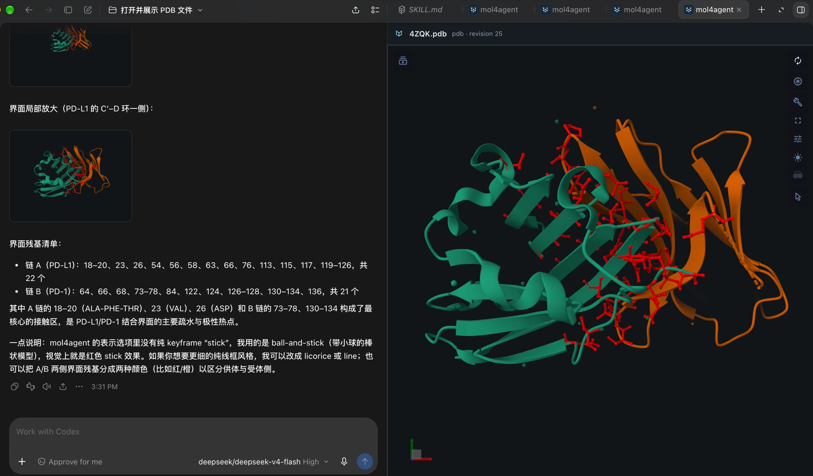
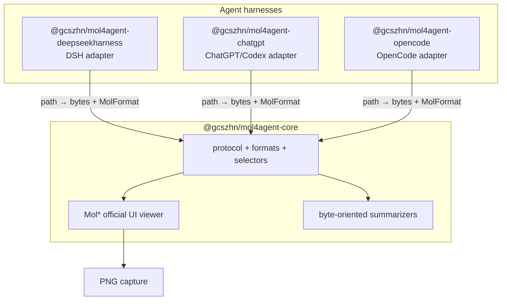

# mol4agent

[English](README.md) | [中文](README_zh.md)

Turn molecular structure files in an agent harness from "a wall of plain text"
into a 3D page that humans can preview and agents can operate directly.

- **Human preview**: open a `.pdb` / `.cif` / `.sdf` / `.mol2` / `.xyz` / `.gro`
  file, including `.gz` variants, in the harness file previewer and get Mol*'s
  official 3D UI instead of text. The previewer's **Open with** menu still
  offers plain text/code.
- **Agent operation**: the LLM uses `mol_*` tools to change representations,
  colors, highlight residues/ligands, focus the camera, measure, and capture
  screenshots while the human watches the page change.
- **Agent-initiated open**: naming a file opens its structure preview
  automatically.
- **Cross-harness**: rendering and the command protocol live in
  `@gcszhn/mol4agent-core`; each harness gets a thin adapter package.



*ChatGPT/Codex: the agent annotates the PD-L1/PD-1 interface in a side-panel Mol* viewer.*

## Architecture



**Core boundary (the most important rule)**: core receives bytes plus an explicit
format only:

```ts
viewer.load({ data: bytes, format: 'pdb', label: '1crn.pdb' })
```

- DSH gets a path from its preview API and reads bytes with its own APIs;
- ChatGPT/Codex gets a path from `mol_*` tool calls and reads bytes in the MCP
  server; the MCP App receives only bytes plus format;
- suffix detection (`.pdb -> pdb`), authorization, filesystem access, sessions,
  and UI all live in the adapter;
- core contains no path logic and imports no harness package.

## Packages

| Package | Purpose | Status |
|---|---|---|
| [`@gcszhn/mol4agent-core`](packages/core) | Harness-neutral Mol* engine, command protocol, selectors, byte summaries, database source plans, PNG capture | Implemented; verified with real 1CRN/1ATP/aspirin |
| [`@gcszhn/mol4agent-deepseekharness`](packages/deepseek-harness) | DSH adapter: right-sidebar document preview, session projection, `mol_*` tools, screenshot delivery | Implemented and installed in the Desktop profile |
| [`@gcszhn/mol4agent-chatgpt`](packages/chatgpt) | ChatGPT/Codex adapter: MCP App viewer, `mol_*` tools, long-poll scene updates, screenshot round trip | Implemented; local marketplace install, protocol tests, and a real MCP Apps smoke test |
| [`@gcszhn/mol4agent-opencode`](packages/opencode) | OpenCode 2.2+ adapter: side-panel Mol* viewer, `mol_*` tools, RPC scene updates, screenshot round trip | Implemented; server + GUI verified end-to-end in the OpenCode desktop app (2.3.0) |

## Quick start (DSH Desktop)

### Install / reinstall

From a checkout of this repository:

```sh
cd /path/to/mol4agent
pnpm build
dsh plugin --profile desktop add link:"$PWD/packages/deepseek-harness"
```

`dsh plugin` forwards to pnpm in `~/.dsh/profiles/<profile>`. The bundle must
also be listed in `dsh.profile.bundles` in that profile's `package.json`; the
DSH Plugin manager does this when it installs/enables a bundle. Restart DSH after
installing or updating the Host bundle.

npm form (0.4.0, published):

```sh
dsh plugin --profile desktop add @gcszhn/mol4agent-deepseekharness@0.4.0
```

Remove with `dsh plugin --profile desktop remove @gcszhn/mol4agent-deepseekharness`
(and drop it from `dsh.profile.bundles`).

The current `desktop` profile already has it installed and enabled:

1. Open `fixtures/1crn.pdb` (or `fixtures/1atp.pdb`, `fixtures/aspirin.sdf`,
   `fixtures/1crn.cif`) from the file tree.
   - The default renderer is **Structure**; the previewer's **Open with**
     menu can switch back to plain text/code.
2. Ask the agent:
   > Open fixtures/1atp.pdb, use cartoon representation and chain-id coloring,
   > highlight the ATP ligand, focus it, and capture a screenshot.
3. Captures are saved under `.mol4agent/captures/` in the workspace. If the
   current model route declares image input, the image is also returned to the
   model.

**Rollout**: a Host-side change (`lib/host.js`) needs a DSH restart; a client-side
change (`lib/client.js`) only needs a page refresh.

## Quick start (ChatGPT/Codex)

### Install from the GitHub marketplace

Codex reads the marketplace manifest in `.agents/plugins/marketplace.json`.
The installable plugin payload is published to the generated `plugin-dist`
branch when the ChatGPT package version changes on `main`, so this path does not
use npm and does not require a local build:

```sh
codex plugin marketplace add GCS-ZHN/mol4agent
codex plugin add mol4agent@mol4agent-github
```

Start a new conversation (or restart the app if the plugin list does not
refresh) and ask:

> Open fixtures/1atp.pdb, use cartoon with chain-id coloring, highlight ATP,
> focus it, and capture a screenshot.

The first preview of a molecular file asks whether to use mol4agent for that
extension; choose **Yes** once. **Open with** still offers the built-in
text/code viewer, and every structure tab keeps its own scene.

### Local development install

Build the plugin and register the built copy through a local marketplace:

```sh
pnpm --filter @gcszhn/mol4agent-core build
pnpm --filter @gcszhn/mol4agent-chatgpt build
node packages/chatgpt/scripts/install-local.mjs
codex plugin marketplace add ~/.codex/mol4agent-marketplace
codex plugin add mol4agent@mol4agent-local
```

You can also click `fixtures/1atp.pdb` in the file tree. The first open asks
whether to use mol4agent for `.pdb` files; choose **Yes** once, and the structure
opens in the side panel by default. **Open with** still offers the built-in
text/code viewer. Each structure tab stays on its own scene; opening another
structure does not reload existing tabs. See the
[ChatGPT adapter README](packages/chatgpt/README.md) for the tool reference and
file-handler details.

## Quick start (OpenCode)

Requires OpenCode 2.2+ (the `./gui` plugin API; verified on 2.3.0). Install the
adapter into the global configuration:

```sh
opencode plugin add @gcszhn/mol4agent-opencode
```

For a local checkout, build it and add the package directory to the global
`opencode.json(c)` instead (`opencode plugin add` only accepts npm/Git specs):

```sh
pnpm --filter @gcszhn/mol4agent-core build
pnpm --filter @gcszhn/mol4agent-opencode build
# "plugins": ["/path/to/mol4agent/packages/opencode"]
```

Open a structure with **Ctrl+P** (`/open`) file search or the **Open molecular
structure** command; the built-in file tree does not route `.pdb` clicks to
plugins. Then ask the agent:

> Open fixtures/1atp.pdb, use cartoon with chain-id coloring, highlight ATP,
> focus it, and capture a screenshot.

For a **remote (SSH) session**, install the plugin on both the desktop machine
(global config: the panel and picker) and the server (the `mol_*` tools). The
viewer RPC is routed to the session's own server, and paths are resolved there.
A remote-only install exposes the tools without a desktop panel. The browser app
(`opencode serve`) is **tool-only**: the Mol* panel depends on the desktop app's
local GUI-plugin host, so `mol_open` works there but no viewer mounts and
`mol_capture` times out. See
[Remote servers and the web](packages/opencode/README.md#remote-servers-and-the-web).

Each structure tab keeps its camera, style, and selection while it stays open;
close unused tabs (each live viewer holds a WebGL context). See the
[OpenCode adapter README](packages/opencode/README.md) for tools and limitations.

## Development

```sh
pnpm install
pnpm typecheck   # builds core first, then typechecks every package
pnpm build       # every package: core, DSH host/client, ChatGPT server/app, OpenCode server/GUI/RPC
```

`build` produces:

- `lib/host.js` — DSH Host, ESM, `@deepseek-ai/*` external;
- `lib/client.js` — DSH lazy-CJS browser bundle with Mol*'s official UI, about
  3.65 MiB. One bundle, no lazy chunk.

## Documentation

- [Core API](packages/core/README.md): `createMolViewer`, `StructureData`,
  commands, selectors, summaries, capture, React binding.
- [DSH agent interface](packages/deepseek-harness/README.md): `mol_*` tools,
  session projection, document preview, screenshot loop.
- [ChatGPT/Codex adapter](packages/chatgpt/README.md): MCP App, file-tree
  structure preview, `mol_*` tools, long-poll scene updates, capture rendezvous,
  local install.
- [OpenCode adapter](packages/opencode/README.md): side-panel viewer, `mol_*`
  tools, RPC scene updates, capture rendezvous, local install.
- [Architecture design](docs/architecture.md) / [中文](docs/architecture_zh.md): product
  goals, layers, the cross-harness contract, and high-level flows. Package
  details live in the package docs.
- [DSH adapter details](packages/deepseek-harness/docs/DETAIL.md): tool behavior,
  selector examples, limitations.

Chinese translations: [README_zh.md](README_zh.md),
[core](packages/core/README_zh.md),
[DSH adapter](packages/deepseek-harness/README_zh.md).
