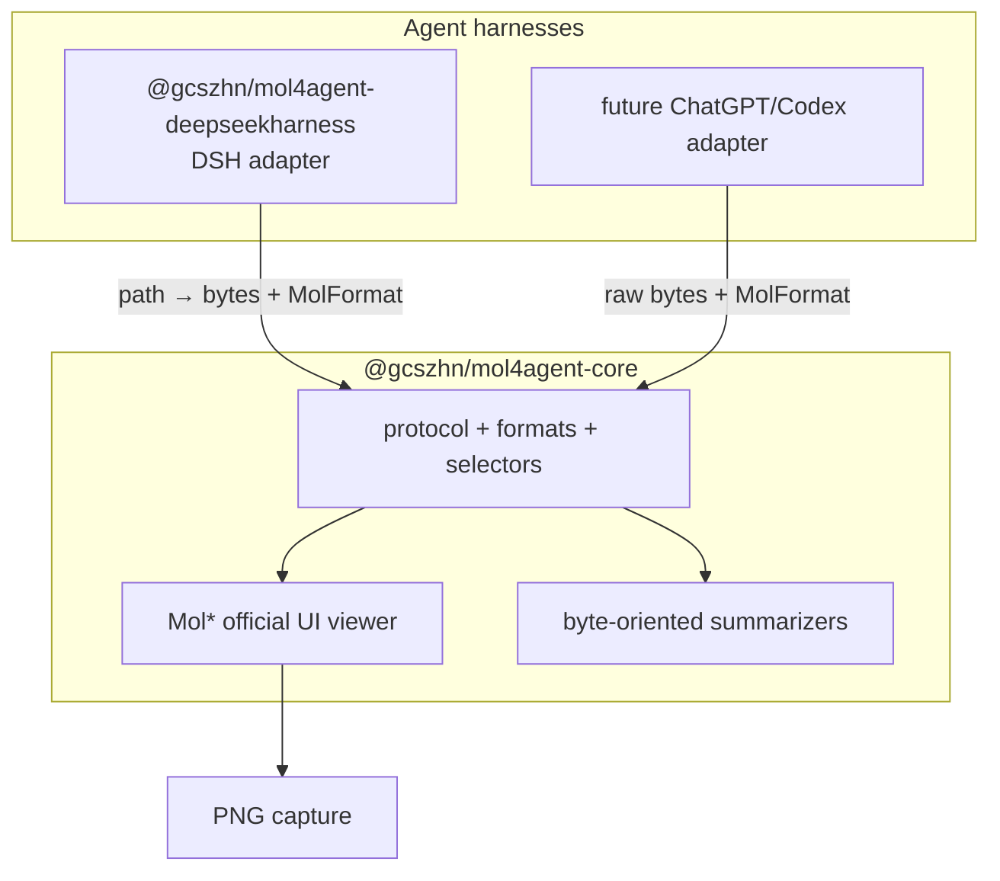

# mol4agent

[English](README.md) | [中文](README_zh.md)

Turn molecular structure files in an agent harness from "a wall of plain text"
into a 3D page that humans can preview and agents can operate directly.

- **Human preview**: open a `.pdb` / `.cif` / `.sdf` / `.mol2` / `.xyz` / `.gro`
  file in the harness file previewer and get Mol*'s official 3D UI instead of
  text. The previewer's **Open with** menu still offers plain text/code.
- **Agent operation**: the LLM uses `mol_*` tools to change representations,
  colors, highlight residues/ligands, focus the camera, measure, and capture
  screenshots while the human watches the page change.
- **Agent-initiated open**: naming a file opens its structure preview
  automatically.
- **Cross-harness**: rendering and the command protocol live in
  `@gcszhn/mol4agent-core`; each harness gets a thin adapter package.

## Architecture



**Core boundary (the most important rule)**: core receives bytes plus an explicit
format only:

```ts
viewer.load({ data: bytes, format: 'pdb', label: '1crn.pdb' })
```

- DSH gets a path from its preview API and reads bytes with its own APIs;
- ChatGPT/Codex preview surfaces hand raw data;
- suffix detection (`.pdb -> pdb`), authorization, filesystem access, sessions,
  and UI all live in the adapter;
- core contains no path logic and imports no harness package.

## Packages

| Package | Purpose | Status |
|---|---|---|
| [`@gcszhn/mol4agent-core`](packages/core) | Harness-neutral Mol* engine, command protocol, selectors, byte summaries, PNG capture | Implemented; verified with real 1CRN/1ATP/aspirin |
| [`@gcszhn/mol4agent-deepseekharness`](packages/deepseek-harness) | DSH adapter: right-sidebar document preview, session projection, `mol_*` tools, screenshot delivery | Implemented and installed in the Desktop profile |
| `@gcszhn/mol4agent-chatgpt` | Future ChatGPT/Codex adapter | Not started |

## Quick start (DSH Desktop)

The plugin is installed in the current `desktop` profile:

1. Open `fixtures/1crn.pdb` (or `fixtures/1atp.pdb`, `fixtures/aspirin.sdf`,
   `fixtures/1crn.cif`) from the file tree.
   - The default renderer is **Structure preview**; the previewer's **Open with**
     menu can switch back to plain text/code.
2. Ask the agent:
   > Open fixtures/1atp.pdb, use cartoon representation and chain-id coloring,
   > highlight the ATP ligand, focus it, and capture a screenshot.
3. Captures are saved under `.mol4agent/captures/` in the workspace. If the
   current model route declares image input, the image is also returned to the
   model.

**Rollout**: a Host-side change (`lib/host.js`) needs a DSH restart; a client-side
change (`lib/client.js`) only needs a page refresh.

## Development

```sh
pnpm install
pnpm typecheck   # builds core first, then typechecks every package
pnpm build       # core -> lib JS/d.ts, then DSH host/client
```

`build` produces:

- `lib/host.js` — DSH Host, ESM, `@deepseek-ai/*` external;
- `lib/client.js` — DSH lazy-CJS browser bundle with Mol*'s official UI, about
  3.65 MiB. One bundle, no lazy chunk.

## Documentation

- [Core API](packages/core/README.md): `createMolViewer`, `StructureData`,
  commands, selectors, summaries, capture, React binding.
- [DSH agent interface](packages/deepseek-harness/README.md): `mol_*` tools,
  session projection, document preview, screenshot loop.
- [Architecture design](docs/architecture.md): requirements, DSH/Mol* facts,
  layering, screenshot pipeline, milestones. (Chinese design notes.)
- [DSH adapter details](packages/deepseek-harness/docs/DETAIL.md): tool behavior,
  selector examples, limitations.

Chinese translations: [README_zh.md](README_zh.md),
[core](packages/core/README_zh.md),
[DSH adapter](packages/deepseek-harness/README_zh.md).
