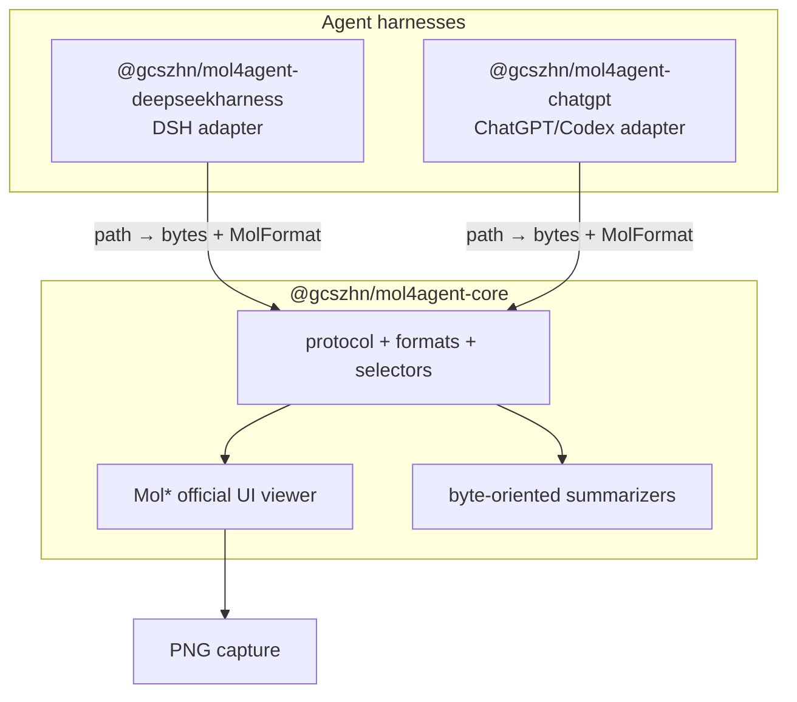

# mol4agent

[English](README.md) | 中文

让 agent harness 里的分子结构文件从「一大段纯文本」变成「可预览、可被 agent 直接操作的 3D 页面」。

- **人工打开**：在 harness 的文件预览器里点开 `.pdb` / `.cif` / `.sdf` / `.mol2` / `.xyz` / `.gro`，右侧直接显示 Mol* 官方 3D 界面；「打开方式」里仍可切回纯文本/代码。
- **agent 操作**：LLM 通过 `mol_*` 工具改表示、配色、高亮残基/配体、聚焦镜头、测量、截图，人只看着页面变化。
- **agent 主动打开**：指定文件后页面自动打开该结构。
- **跨 harness**：渲染与命令协议在 `@gcszhn/mol4agent-core`，每个 harness 一个薄适配包。

## 架构



**核心边界（最重要的一条）**：`core` 只接收字节 + 显式 format：

```ts
viewer.load({ data: bytes, format: 'pdb', label: '1crn.pdb' })
```

- DSH 从预览接口拿到 path，由 DSH 适配包用 DSH 自己的 API 读成字节；
- ChatGPT/Codex 从 `mol_*` 工具调用拿到 path，由 MCP server 读成字节；
  MCP App 只接收字节 + format；
- `.pdb → pdb` 的路径/扩展名判断、鉴权、文件系统、session、UI 全部在适配包；
- core 不含任何路径识别/判断逻辑，也不引用任何 harness 包。

## 包

| 包 | 作用 | 状态 |
|---|---|---|
| [`@gcszhn/mol4agent-core`](packages/core) | 与 harness 无关的 Mol* 渲染引擎、命令协议、选择器、字节摘要、PNG 截图 | 已实现；用真实 1CRN/1ATP/aspirin 验证 |
| [`@gcszhn/mol4agent-deepseekharness`](packages/deepseek-harness) | DSH 适配：右侧文档预览、session projection、`mol_*` 工具、截图回传 | 已实现并安装到 Desktop profile |
| [`@gcszhn/mol4agent-chatgpt`](packages/chatgpt) | ChatGPT/Codex 适配：MCP App viewer、`mol_*` 工具、长轮询场景更新、截图回传 | 已实现；本地 marketplace 安装，协议测试与真实 MCP Apps 冒烟测试通过 |

## 快速开始（DSH Desktop）

插件已安装到当前 `desktop` profile：

1. 在文件树里打开 `fixtures/1crn.pdb`（或 `fixtures/1atp.pdb`、`fixtures/aspirin.sdf`、`fixtures/1crn.cif`）。
   - 默认显示「结构预览」；预览器工具栏的「打开方式」可切回纯文本/代码。
2. 让 agent 执行：
   > 打开 fixtures/1atp.pdb，用卡通表示、chain-id 配色，高亮配体 ATP 并聚焦，然后截图给我看。
3. 截图保存到工作区 `.mol4agent/captures/`；如果当前模型声明了图片输入，也会作为图片返回。

**生效方式**：Host 侧代码（`lib/host.js`）变更需要重启 DSH；client 侧代码（`lib/client.js`）变更刷新页面即可。

## 快速开始（ChatGPT/Codex）

构建并安装到本地 Codex marketplace：

```sh
pnpm --filter @gcszhn/mol4agent-core build
pnpm --filter @gcszhn/mol4agent-chatgpt build
node packages/chatgpt/scripts/install-local.mjs
codex plugin marketplace add ~/.codex/mol4agent-marketplace
codex plugin add mol4agent@mol4agent-local
```

新开会话后让 agent 执行：

> 打开 fixtures/1atp.pdb，用卡通表示、chain-id 配色，高亮配体 ATP 并聚焦，
> 然后截图。

也可以直接在文件树点 `fixtures/1atp.pdb`。首次打开会询问是否用 mol4agent
打开 `.pdb`，选一次 **Yes** 后结构默认在侧栏打开；**Open with** 仍可切回
内置文本/代码预览。工具参考与文件处理器细节见
[ChatGPT 适配 README](packages/chatgpt/README_zh.md)。

## 开发

```sh
pnpm install
pnpm typecheck   # 先构建 core，再对所有包做 typecheck
pnpm build       # 所有包：core、DSH host/client、ChatGPT server/app
```

`build` 产出：

- `lib/host.js`（DSH Host，ESM，`@deepseek-ai/*` external）
- `lib/client.js`（DSH lazy-CJS browser bundle，含 Mol* 官方 UI，约 3.65 MiB；单 bundle，无懒加载 chunk）

## 文档

- [Core API](packages/core/README_zh.md)：`createMolViewer`、`StructureData`、命令、选择器、摘要、截图、React 绑定。
- [DSH agent 接口](packages/deepseek-harness/README_zh.md)：`mol_*` 工具、session projection、文档预览、截图回传。
- [ChatGPT/Codex 适配](packages/chatgpt/README_zh.md)：MCP App、文件树结构预览、
  `mol_*` 工具、长轮询场景更新、截图会合、本地安装。
- [总体架构](docs/architecture_zh.md)（[English](docs/architecture.md)）：产品目标、分层、跨 harness 契约和高层流程；具体实现见各包文档。
- [DSH 适配细节](packages/deepseek-harness/docs/DETAIL.md)：工具行为、选择器示例、限制。

English: [README.md](README.md), [core](packages/core/README.md),
[DSH adapter](packages/deepseek-harness/README.md).
