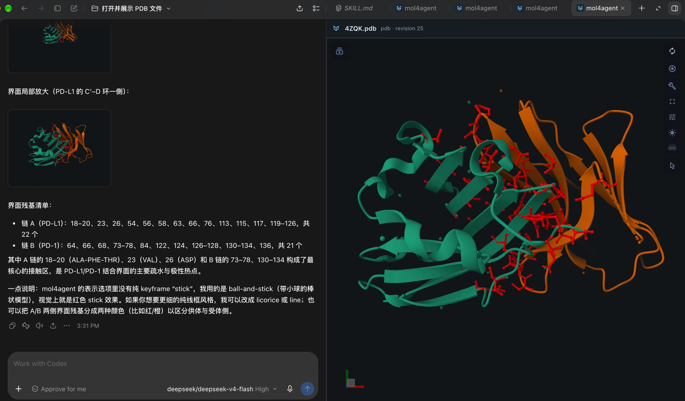
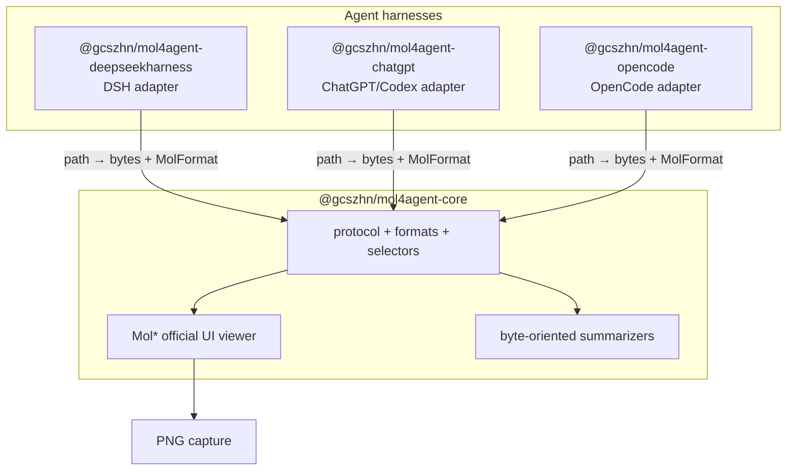

# mol4agent

[English](README.md) | 中文

让 agent harness 里的分子结构文件从「一大段纯文本」变成「可预览、可被 agent 直接操作的 3D 页面」。

- **人工打开**：在 harness 的文件预览器里点开 `.pdb` / `.cif` / `.sdf` / `.mol2` / `.xyz` / `.gro`（含 `.gz` 变体），右侧直接显示 Mol* 官方 3D 界面；「打开方式」里仍可切回纯文本/代码。
- **agent 操作**：LLM 通过 `mol_*` 工具改表示、配色、高亮残基/配体、聚焦镜头、测量、截图，人只看着页面变化。
- **agent 主动打开**：指定文件后页面自动打开该结构。
- **多结构、叠合与实时检查**：在同一场景追加多个结构，用 Mol* TM-align 或序列引导叠合，按结构 id 独立着色和选择；用只读的 `mol_tmscore` 比较两个选择，用 `mol_inspect` 读取运行中视图的残基、坐标、样式与可见颜色。
- **跨 harness**：渲染与命令协议在 `@gcszhn/mol4agent-core`，每个 harness 一个薄适配包。



*ChatGPT/Codex：agent 在侧栏 Mol* 视图中标注 PD-L1/PD-1 界面。*

## 架构



**核心边界（最重要的一条）**：`core` 只接收字节 + 显式 format：

```ts
viewer.load({ data: bytes, format: 'pdb', label: '1crn.pdb' })
```

- DSH 从预览接口拿到 path，由 DSH 适配包用 DSH 自己的 API 读成字节；
- ChatGPT/Codex 从 `mol_*` 工具调用拿到 path，由 MCP server 读成字节；
  MCP App 只接收字节 + format；
- `.pdb → pdb` 的路径/扩展名判断、鉴权、文件系统、session、UI 全部在适配包；
- core 不含任何路径识别/判断逻辑，也不引用任何 harness 包。

## 包

| 包 | 作用 | 状态 |
|---|---|---|
| [`@gcszhn/mol4agent-core`](packages/core) | 与 harness 无关的 Mol* 渲染引擎、命令协议、选择器、字节摘要、数据库来源解析、多结构场景、叠合、PNG 截图 | 已实现；用真实 1CRN/1ATP/aspirin 及 7CZD/4ZQK 多结构叠合验证 |
| [`@gcszhn/mol4agent-deepseekharness`](packages/deepseek-harness) | DSH 适配：右侧文档预览、session projection、`mol_*` 工具、截图回传 | 已实现并安装到 Desktop profile |
| [`@gcszhn/mol4agent-chatgpt`](packages/chatgpt) | ChatGPT/Codex 适配：MCP App viewer、`mol_*` 工具、长轮询场景更新、截图回传 | 已实现；本地 marketplace 安装，协议测试与真实 MCP Apps 冒烟测试通过 |
| [`@gcszhn/mol4agent-opencode`](packages/opencode) | OpenCode 2.2+ 适配：侧栏 Mol* viewer、`mol_*` 工具、RPC 场景更新、截图回传 | 已实现；在 OpenCode 桌面端（2.3.0）完成 server + GUI 端到端验证 |

## 快速开始（DSH Desktop）

### 安装 / 重装

在本仓库根目录执行：

```sh
cd /path/to/mol4agent
pnpm build
dsh plugin --profile desktop add link:"$PWD/packages/deepseek-harness"
```

`dsh plugin` 会把参数转发给 `~/.dsh/profiles/<profile>` 下的 pnpm。还需要把
`@gcszhn/mol4agent-deepseekharness` 放进该 profile `package.json` 的
`dsh.profile.bundles`（DSH Plugin manager 安装/启用时会自动处理）；安装或更新
Host bundle 后重启 DSH。

npm 形式（0.4.1，已发布）：

```sh
dsh plugin --profile desktop add @gcszhn/mol4agent-deepseekharness@0.4.1
```

卸载：`dsh plugin --profile desktop remove @gcszhn/mol4agent-deepseekharness`，
并从 `dsh.profile.bundles` 中移除。

当前 `desktop` profile 已安装并启用：

1. 在文件树里打开 `fixtures/1crn.pdb`（或 `fixtures/1atp.pdb`、`fixtures/aspirin.sdf`、`fixtures/1crn.cif`）。
   - 默认显示「结构预览」；预览器工具栏的「打开方式」可切回纯文本/代码。
2. 让 agent 执行：
   > 打开 fixtures/1atp.pdb，用卡通表示、chain-id 配色，高亮配体 ATP 并聚焦，然后截图给我看。
3. 截图保存到工作区 `.mol4agent/captures/`；如果当前模型声明了图片输入，也会作为图片返回。

**生效方式**：Host 侧代码（`lib/host.js`）变更需要重启 DSH；client 侧代码（`lib/client.js`）变更刷新页面即可。

## 快速开始（ChatGPT/Codex）

### 从 GitHub marketplace 安装

Codex 读取仓库里的 `.agents/plugins/marketplace.json`。当 ChatGPT 包版本在
`main` 上变化时，release workflow 会把可安装的插件产物发布到自动生成的
`plugin-dist` 分支，因此这条安装路径不使用 npm，也不需要在本地构建：

```sh
codex plugin marketplace add GCS-ZHN/mol4agent
codex plugin add mol4agent@mol4agent-github
```

新开会话（若插件列表不刷新则重启 app）后让 agent 执行：

> 打开 fixtures/1atp.pdb，用卡通表示、chain-id 配色，高亮配体 ATP 并聚焦，
> 然后截图。

首次预览分子文件时，Codex 会询问是否用 mol4agent 打开该扩展名，选一次
**Yes** 即可。**Open with** 仍可切回内置文本/代码预览，每个结构 tab 保持
自己的 scene。

### 本地开发安装

构建插件，并通过本地 marketplace 安装构建产物：

```sh
pnpm --filter @gcszhn/mol4agent-core build
pnpm --filter @gcszhn/mol4agent-chatgpt build
node packages/chatgpt/scripts/install-local.mjs
codex plugin marketplace add ~/.codex/mol4agent-marketplace
codex plugin add mol4agent@mol4agent-local
```

也可以直接在文件树点 `fixtures/1atp.pdb`。首次打开会询问是否用 mol4agent
打开 `.pdb`，选一次 **Yes** 后结构默认在侧栏打开；**Open with** 仍可切回
内置文本/代码预览。每个结构 tab 保持自己的 scene，再打开一个结构不会重载已有
tab。工具参考与文件处理器细节见
[ChatGPT 适配 README](packages/chatgpt/README_zh.md)。

## 快速开始（OpenCode）

需要 OpenCode 2.2+（`./gui` 插件 API；已在 2.3.0 验证）。安装到全局配置：

```sh
opencode plugin add @gcszhn/mol4agent-opencode
```

本地源码开发时，先构建，再把包目录加到全局 `opencode.json(c)`（`opencode
plugin add` 只接受 npm/Git spec）：

```sh
pnpm --filter @gcszhn/mol4agent-core build
pnpm --filter @gcszhn/mol4agent-opencode build
# "plugins": ["/path/to/mol4agent/packages/opencode"]
```

用 **Ctrl+P**（`/open`）文件检索或「Open molecular structure」命令打开结构；
内置文件树不会把 `.pdb` 点击路由给插件。然后让 agent：

> 打开 fixtures/1atp.pdb，用 cartoon 和 chain-id 着色，高亮 ATP，聚焦并截图。

**远程（SSH）会话**需要把插件同时安装在桌面机（全局配置：面板与选文件）和远程
server（`mol_*` 工具）。viewer 的 RPC 会路由到会话所属 server，路径也在那里解析；
只装在远程时 agent 有工具，但桌面端没有面板。浏览器端（`opencode serve`）**只有
工具**：Mol* 面板依赖桌面端的本地 GUI 插件宿主，`mol_open` 在网页端可用，但没有
viewer 挂载，`mol_capture` 会超时。详见
[远程 server 与网页端](packages/opencode/README_zh.md#远程-server-与网页端)。

每个结构标签在打开期间保留相机、样式和选择；不用的标签记得关闭（每个常驻
viewer 占用一个 WebGL context）。工具与限制见
[OpenCode 适配 README](packages/opencode/README_zh.md)。

## 开发

```sh
pnpm install
pnpm typecheck   # 先构建 core，再对所有包做 typecheck
pnpm build       # 所有包：core、DSH host/client、ChatGPT server/app、OpenCode server/GUI/RPC
```

`build` 产出：

- `lib/host.js`（DSH Host，ESM，`@deepseek-ai/*` external）
- `lib/client.js`（DSH lazy-CJS browser bundle，含 Mol* 官方 UI，约 3.65 MiB；单 bundle，无懒加载 chunk）

## 文档

- [Core API](packages/core/README_zh.md)：`createMolViewer`、`StructureData`、命令、选择器、摘要、截图、React 绑定。
- [DSH agent 接口](packages/deepseek-harness/README_zh.md)：`mol_*` 工具、session projection、文档预览、截图回传。
- [ChatGPT/Codex 适配](packages/chatgpt/README_zh.md)：MCP App、文件树结构预览、
  `mol_*` 工具、长轮询场景更新、截图会合、本地安装。
- [OpenCode 适配](packages/opencode/README_zh.md)：侧栏 viewer、`mol_*` 工具、
  RPC 场景更新、截图会合、本地安装。
- [总体架构](docs/architecture_zh.md)（[English](docs/architecture.md)）：产品目标、分层、跨 harness 契约和高层流程；具体实现见各包文档。
- [DSH 适配细节](packages/deepseek-harness/docs/DETAIL.md)：工具行为、选择器示例、限制。

English: [README.md](README.md), [core](packages/core/README.md),
[DSH adapter](packages/deepseek-harness/README.md).
