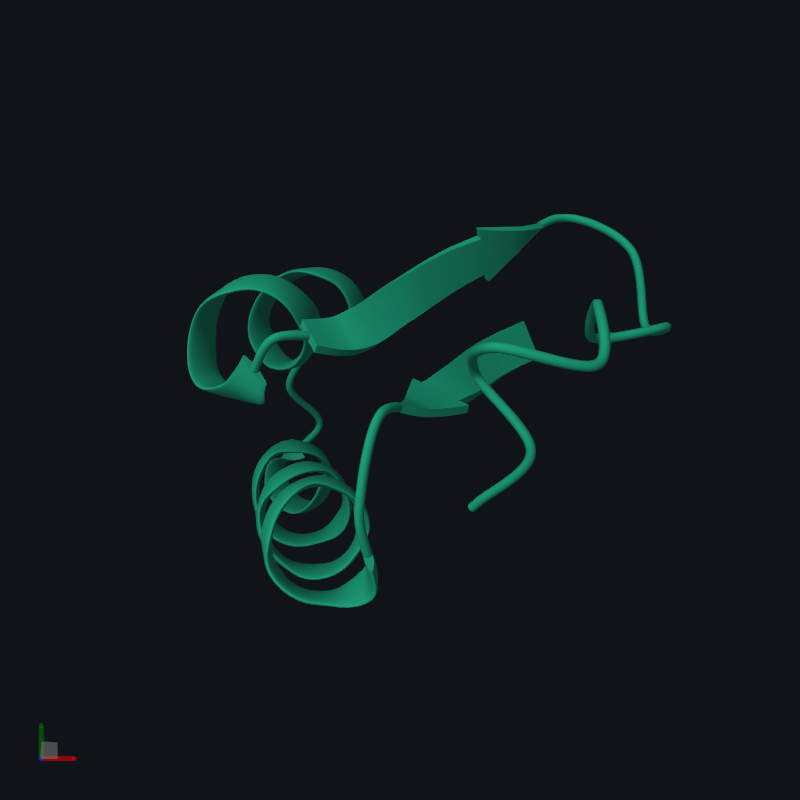
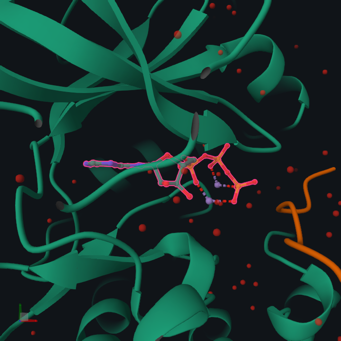

# mol4agent 架构方案（v0.1 评审稿）

> 中文设计说明。英文项目概览见 [README.md](../README.md)，Core API 见 [core README](../packages/core/README.md)，DSH 接口见 [DSH README](../packages/deepseek-harness/README.md)。

- 日期：2026-11-15
- 事实基准：DeepSeek Harness `0.2.2-rc.3`（本机 Desktop 安装）、Mol* `5.13.1`（npm latest）
- 目标：为不同 agent harness 提供分子结构文件的可视化与 agent 交互能力；先落 DeepSeek Harness，其余 harness 后接。

---

## 0. 结论（TL;DR）

1. **产品形态**：不是一个独立的分子查看器网站，而是「harness 里的预览面 + agent 可编程的活页面」。
   - 人手动打开 `.pdb/.cif/.sdf/...` → 右侧文档预览直接渲染 3D，而不是纯文本。
   - agent 通过工具改表示、改颜色、选残基、聚焦、量距离、截图、主动打开页面；人只看页面变化。
2. **分层**：`@gcszhn/mol4agent-core` 只做**与路径/扩展名/文件系统/harness 无关**的渲染引擎与命令协议；**格式识别、文件读取、授权、页面挂载、消息传输全部在适配包**（`@gcszhn/mol4agent-deepseekharness` 等）里。
3. **core 的核心契约**：只接收 `StructureData { data, format, label? }`——**字节 + 显式 format**，外加一组可序列化命令。DSH 能拿到 path 并由适配包自行读取；ChatGPT/Codex 直接给 raw data。core 既不认识 `path`，也不知道 `.pdb` 意味着什么，更不包含任何路径识别/判断逻辑。
4. **DSH 人工打开路径**：注册一个 `documentPreviews` 实现（`loading: 'renderer'`）+ `sidebar.right.tab.document` 的同名 body。DSH 自带的 `text` tab 类型会按扩展名在候选实现里选中我们。**这是官方扩展点，不是 hack。**
5. **DSH agent 操作路径**：Host 工具只写「意图」到 **session projection**（durable、可回放），Client 的活页面订阅 projection 并声明式应用；不需要 Host→Client RPC。
6. **DSH 截图回传路径**：Client 用 `plugin.helpers.viewportScreenshot` 出 PNG → 通过 `ctx.remote.commands.execute` 带一个 image 附件（base64）回传 → Host 命令处理器唤醒阻塞中的工具 → 工具把图片作为 image block 返回给模型。这条链路只用了 DSH 官方「UI 操作 → 会话命令」入口，避免了自建 Remote 代码生成。
7. **渲染策略**：core 直接挂 **Mol* 官方 UI**（`createPluginUI` + `DefaultPluginUISpec`），右侧 viewport controls 就是官网那套；不再自绘工具栏。代价是 client bundle 约 3.65 MiB，并需要注入 Mol* 的 `theme/{light,dark}.css`。
8. **打包**：DSH 客户端产物是 loader 的 lazy-CJS factory 格式；Mol* 与官方 UI 全部打进单个 `client.js`（约 3.65 MiB）。早期曾拆成按需加载的 `client.molstar.js`，但在 Desktop 的 `dsh-app://` 自定义协议下不稳定，已合并。

---

## 1. 需求拆解与验收标准

### 1.1 两个基本需求

| # | 场景 | 验收 |
|---|---|---|
| R1 | 人在 harness 里手动打开分子文件 | 右侧预览面板出现可旋转/缩放的 3D 结构；不再是纯文本；支持 PDB/mmCIF/SDF/MOL2/XYZ/GRO 等 |
| R2 | agent 操作可视化页面 | agent 一次工具调用后，**已经打开的页面**发生变化：表示方式、配色、残基高亮、镜头聚焦、距离测量、背景；人无需点按钮 |
| R3 | agent 主动打开页面 | agent 指定文件后，右侧预览自动打开该结构；人能看到 |
| R4 | agent 导出 PNG | agent 触发截图；图片既回传给模型（能「看」到），也可落盘/展示给人 |
| R5 | 其他 harness 复用 | core 不改，新增 `@gcszhn/mol4agent-chatgpt` 等只做「格式识别 + 取字节 + 挂载 + 传命令」 |

### 1.2 非目标（v1）

- 结构编辑、对接、分子动力学。
- 轨迹动画编辑（先支持静态结构；多模型 SDF 只展示/切换）。
- 在 Host 端做无头 WebGL 渲染（截图一律在浏览器端完成）。
- 体积/表面分析（后续可用 Mol* 内置能力或 Python 侧车）。

---

## 2. 事实核查（实现依据）

### 2.1 DSH 的文档预览扩展点（R1 的落点）

DSH 右侧栏的文档预览不是写死的 iframe，而是一个「按扩展名选择渲染器」的注册表：

- `@deepseek-ai/dsh-client-ui-sidebar-documentpreview/src/client/document/registry.ts`
  - `DocumentPreviewRegistry.register({ id, extensions, binaryExtensions?, priority, title, loading, wrap? })`
  - `loading` 三选一：`text-pages`（共享分页文本读取）、`bytes-complete`（共享完整字节）、`renderer`（渲染器自己取字节）。
  - `priority: 'extension'` 的外部实现会排在内置实现之前；同优先级按后缀长度排序。
- `.../src/client/TextPreview.tsx`：`candidates = documentPreviews.candidates(path)`，`selected = state.rendererId ?? candidates[0]`，然后把 `content` 与 `topic` 传给 `sidebar.right.tab.document` 的同名 body。
- `sidebar.right.tab.document` 是一个 **keyed slot**，key 就是实现的 `id`；现有占用者包括 `@deepseek-ai/dsh-client-ui-sidebar-documentpreview/text|image|pdf|office|excel|code|...`。
- `sidebar.right.tab.document.actions` 是文档工具栏扩展位（预览自己的按钮之后），`sidebar.right.tab.document.unpreviewable` 是「无法预览」时的兜底位。

**结论**：适配包只需 `ctx.documentPreviews.register(...)` + 在 `sidebar.right.tab.document` 注册同 key 的 React body，就能接管 `.pdb` 等文件的预览；扩展名判断完全在适配包。

### 2.2 DSH 的 agent 侧扩展点（R2/R3 的落点）

- 工具：`ctx.tools.register(defineTool({...}))`，带 `parameters`、`output.schema/render`、`execute(args, exec)`（`@deepseek-ai/dsh-tools`）。
- 会话投影：`ctx.sessionProjections.register({ key, stateSchema, init, apply, wire: { viewSchema, view }, stateVersion })`。
  - `apply` 同步、纯函数；对不关心的事件必须返回同一个 state 引用。
  - `wire.view` 会把值送到 Client，Client 用标准 props 的 `useProjection(key)` 读取。
  - 这是 DSH 明确推荐的「Client 需要由日志派生的状态」通道（见 `docs/subsystems/session-projection.md` 的设计口径）。
- 日志事件：`tool/call` 载荷为 `{ turn, step, callId, name, arguments: string }`（arguments 是模型产出的原始 JSON 字符串），`tool/result` 与之配对（`@deepseek-ai/dsh-session/src/types.ts`）。
- 聊天工具卡片：`tool.call.toolview`（key = 工具名）可自定义每个工具的结果卡；卡片能拿到 `phase/start|result`、`args`、`openFile(path)` 等。
- 会话头部：`conversation.session.header.utilities`（list, session scope）是常驻的会话级挂载点，适合放「分子页面桥」。
- 右侧栏打开：`ctx.sidebarRight.openResource(address, { placement? })`，服务只作用于**当前屏上会话**；地址为 `dsh-resource://file/session/<sessionId>/<path>`，由内置 `text` tab 类型认领。

### 2.3 DSH 的 Client → Host 通道（R4 的难点）

DSH 的 `ctx.remote` 是**构建期生成**的命名空间，第三方插件不能凭空新增 `@Remote` 方法（需要 typert 生成产物）。可用的官方入口是：

- `ctx.remote.commands.execute(sessionId, line, attachments, signal)`：会话命令执行，Host 立即执行（不排队等 turn），并写 `command/run` + `command/done` 两条 log-only 事件。
- 命令定义可声明 `input: { attachments: true }`，于是 handler 的 `invocation.attachments` 会收到已入库的 `ImageBlock | FileBlock`（base64 图片经 `EncodedImageAttachment` 准入后变成 durable 附件）。
- `ctx.remote.fileUploads.upload(sessionId, blob|bytes, name)` 也可把字节传到 Host 换 receipt，但图片附件走命令参数更直接。

**结论**：用「一个内部会话命令 + image 附件」把 PNG 从浏览器送回 Host，是本版本唯一不引入构建期代码生成的双向通道。代价是日志里每条截图多一条 `command/run|done`（可用 `recordInput: false` 把参数省掉，并用 `conversation.chat.commandview` 渲染成一行紧凑状态）。

### 2.4 Mol* 5.13 能力（core 的实现基础）

- 实例化（`molstar.org/docs/v5/plugin/instance`）：
  - `new PluginContext(DefaultPluginSpec())` → `await plugin.init()` → `await plugin.initViewerAsync(canvas, parent)`，**不需要 Mol* React UI 与 CSS**。
  - 数据流：`plugin.builders.data.rawData({ data, label })` → `plugin.builders.structure.parseTrajectory(dataObj, format)` → `plugin.builders.structure.hierarchy.applyPreset(trajectory, preset)`。
- 轨迹格式（`lib/mol-plugin-state/formats/trajectory.d.ts`）：`mmcif | cifCore | pdb | pdbqt | pqr | gro | xyz | lammps_data | lammps_traj_data | mol | sdf | mol2`（BCIF 走 mmcif 的二进制通道）。
- 选择：
  - `StructureElement.Schema`（`lib/mol-model/structure/structure/element/schema.d.ts`）：`{ auth_asym_id, beg_auth_seq_id, end_auth_seq_id, label_comp_id, ... }`，**天然适合 LLM 输出 JSON**。
  - 内置查询：`StructureSelectionQueries.ligand|polymer|protein|water|ion...`。
  - `applyStructureInteractivity(plugin, { elements|expression, action: 'select'|'highlight'|'focus'|[...] })` 可直接在 headless plugin 上用。
- 表示：`plugin.builders.structure.representation.addRepresentation(structure, { type, color, typeParams, colorParams }, { initialState })`；preset：`applyPreset`。
- 测量：`plugin.managers.structure.measurement.addDistance(lociA, lociB, options)`（还有 angle/dihedral/label）。
- 截图：`plugin.helpers.viewportScreenshot`，`getImageDataUri()`、`getPreview()`、`behaviors.values`（可设 `resolution: { name: 'custom', params: { width, height } }`）、`download()`。
- 体积：headless 入口（context + spec + selection queries + MolScript）esbuild 实测 3.0 MB minified / 885 KB gzip；完整 Viewer app 的 `build/viewer/molstar.js` 是 5.0 MB（含扩展），因此不选 Viewer wrapper。

---

## 3. 分层与职责边界（本方案的核心约束）

```
┌──────────────────── 适配层（每个 harness 一个包） ────────────────────┐
│ @gcszhn/mol4agent-deepseekharness
│   Host：工具定义 / 会话投影 / 会话命令 / 文件解析 / 摘要
│   Client：文档预览 body / 会话桥 / 工具卡 / 命令通道 / 主题与 i18n
│   只有这里知道：.pdb→pdb、右栏 tab、path、session、projection、commands
└───────────────────────────────┬─────────────────────────────────────┘
                                │ bytes + 显式 format + 命令 + 选择器
┌───────────────────────────────▼─────────────────────────────────────┐
│ @gcszhn/mol4agent-core
│   bytes + format → Mol* PluginContext → 结构 / 表示 / 选择 / PNG
│   不变量：无 path、无扩展名、无 fs、无 network、无 harness 概念
└─────────────────────────────────────────────────────────────────────┘
```

### 3.1 core 的不变量（评审时逐条检查）

1. **不接受文件路径**。core 的输入是 `StructureData { data, format, label? }`。DSH 取 path、ChatGPT/Codex 收 raw data，都是适配包先把它们变成字节再调用 core。
2. **不做路径识别/判断**。没有 `extname`、没有 MIME 猜测、没有 `.pdb` 字样、没有「按路径取文件」的回调。`format` 由适配包显式传入。
3. **不做 I/O**。不读文件、不发请求、不接触 harness API。
4. **不引用 harness 包**。core 的依赖只有 `molstar`（以及 React 作为可选 peer，仅 `core/react` 子入口）。
5. **命令可 JSON 序列化**。命令里不出现 `Uint8Array`、DOM 节点、Molecule 对象；加载是方法而不是命令。
6. **可重放**。同一份字节 + 同一串命令，在任何时候重放应得到同一画面（除用户手动旋转的镜头外）。

### 3.2 适配包必须自己做的事

- 判定「哪些文件算分子文件」「扩展名/MIME → `MolFormat`」；是否二进制。
- 读取字节、鉴权、大小上限、错误文案。
- 场景状态的持久化/传输（DSH：projection；ChatGPT/Codex：可能是 conversation state / artifact）。
- 页面挂载点与工具栏、主题、locale。
- agent 工具的 schema、描述、系统提示词。
- 截图如何交回 agent（DSH：命令+附件；其他 harness 各自实现）。

> **边界修正记录**：早期草案把「扩展名→format」放在 core 的 `formats.ts` 里，这是错的；随后又试图让 core 接受 `path + reader`，同样越界。最终规则：**DSH 从预览接口拿到 path、用 DSH 自己的 API 读成字节；ChatGPT/Codex 直接给 raw data；两者都只在适配包里完成。core 只见 `bytes + format`，不含任何路径识别/判断逻辑。**

---

## 4. `@gcszhn/mol4agent-core` 设计

### 4.1 数据模型

```ts
export const MOL_FORMATS = ['pdb','pdbqt','pqr','mmcif','bcif','mol','sdf','mol2','xyz','gro'] as const
export type MolFormat = typeof MOL_FORMATS[number]

/** 唯一的结构输入：字节 + 适配包显式选定的 format。 */
export interface StructureData {
  readonly data: string | Uint8Array
  readonly format: MolFormat
  readonly binary?: boolean   // BCIF 等；适配包决定
  readonly label?: string     // 展示名；core 不从路径推导
}
```

适配包各自的取数方式（不在 core 里）：

```ts
// DSH：预览接口给 path → 用 DSH Remote 取字节 → 显式选 format
const bytes = await remote.workspaceFiles.readBytes(sessionId, path, {}, signal)
await viewer.load({ data: bytes, format: 'pdb', label: basename(path) })

// ChatGPT/Codex：预览接口直接给 raw data
await viewer.load({ data: raw, format: 'sdf' })
```

### 4.2 生命周期与 API

```ts
export interface MolViewerOptions {
  readonly container: HTMLElement
  readonly theme?: 'light' | 'dark'
  readonly background?: string
  readonly onError?: (error: unknown) => void
}

export interface MolViewer {
  /** 加载字节；适配包已完成取数与 format 判定 */
  load(data: StructureData, options?: { preset?: string }): Promise<StructureSummary>
  /** 当前结构摘要（加载后可用） */
  summary(): StructureSummary | undefined
  /** 执行一条命令 */
  execute(command: MolCommand): Promise<CommandResult>
  /** 顺序执行，用于回放 */
  apply(commands: readonly MolCommand[]): Promise<readonly CommandResult[]>
  /** 导出 PNG */
  capture(options?: CaptureOptions): Promise<Uint8Array>
  /** 尺寸变化 */
  resize(): void
  dispose(): void
}

export declare function createMolViewer(options: MolViewerOptions): Promise<MolViewer>
```

回放由适配包驱动：它保存「路径/数据源 + 命令列表」，每次重建时先取字节调用 `viewer.load(...)`，再 `viewer.apply(commands)`。core 不持有场景状态。

### 4.3 命令协议（v1，全部 JSON 可序列化）

```ts
export type MolCommand =
  | { op: 'represent'; style: StyleSpec; target?: StructureSelector }
  | { op: 'select'; target: StructureSelector; mode?: 'select' | 'highlight'; focus?: boolean }
  | { op: 'clear-selection'; mode?: 'select' | 'highlight' }
  | { op: 'focus'; target?: StructureSelector }        // 省略 = 整体
  | { op: 'camera'; action: 'reset' }
  | { op: 'background'; color: string | 'theme' }
  | { op: 'measure'; kind: 'distance' | 'angle' | 'dihedral'; targets: StructureSelector[] }
  | { op: 'label'; target: StructureSelector; text?: string }

export interface StyleSpec {
  type?: RepresentationType       // 'cartoon' | 'ball-and-stick' | 'licorice' | 'spacefill' | 'line' | 'point' | 'surface' | ...
  color?: ColorTheme              // 'chain-id' | 'element-symbol' | 'residue-name' | 'uniform' | ...
  colorParams?: { value?: string | number }
  quality?: 'low' | 'medium' | 'high' | 'auto'
}
```

命令语义要点：

- **加载不是命令**：`viewer.load(bytes, format)` 是方法；命令只作用于已加载结构，因此命令列表始终可 JSON 序列化。
- `represent` 默认**替换**当前结构的全部表示（agent 说「换成表面」应该是替换，而不是叠加）；需要叠加时用 `target` + `append`（v2）。
- `select` 与 `focus` 分开：改色/高亮不应该动镜头，除非显式 `focus: true`。
- `measure` 的 `targets` 用选择器而不是原子坐标，避免 agent 编造坐标；core 解析成 Loci 后交给 measurement manager。
- 命令在 core 里做**防御性校验**：未知 `format`、未知表示名、无法解析的选择器都返回结构化错误，让工具把「支持哪些值」告诉模型。

#### 选择集着色（P1）

「把某个残基变红」不能用一个全局 `represent` 表达。P1 增加：

```ts
{ op: 'color'; target: StructureSelector; color: string }
```

实现方式：把选择集转成子结构（`StructureElement.Schema.toLoci` → 子结构），叠加一个 `uniform` 颜色的 representation；全局 `represent` 仍然只改整体风格。这样「整体卡通 + 活性位点红色球棍」可以同时存在。着色是场景命令的一部分，重复回放结果一致。

### 4.4 选择器 DSL

```ts
export type StructureSelector =
  | { kind: 'all' }
  | { kind: 'polymer' } | { kind: 'protein' } | { kind: 'nucleic' }
  | { kind: 'ligand' } | { kind: 'water' } | { kind: 'ion' }
  | { kind: 'chain'; chain: string }
  | { kind: 'residue'; chain?: string; index: number; auth?: boolean }
  | { kind: 'residues'; chain?: string; start: number; end: number; auth?: boolean }
  | { kind: 'comp'; compId: string }              // 按残基名，如 ATP / HEM
  | { kind: 'schema'; schema: StructureElementSchema }  // 逃生口，直接给 Mol* Schema
```

编译规则：

- 语义类别 → `StructureSelectionQueries.ligand|polymer|protein|water|...`（Mol* 自带，行为与 UI 一致）。
- `chain`/`residues`/`comp` → `StructureElement.Schema`：`{ auth_asym_id, beg_auth_seq_id, end_auth_seq_id }` / `{ label_comp_id }`。
- 复杂/未来 → `schema` 直通。
- 多选择器组合用 `StructureSelectionQueries` 的 merge 或 `SchemaItems`，v1 先不暴露布尔组合，避免协议过早复杂化。

### 4.5 渲染策略：Mol* 官方 UI

**选型**：`createPluginUI` + `DefaultPluginUISpec`（官方 React UI），不用自绘工具栏，也不使用带全部扩展的 `Viewer` wrapper。

理由：

- `Viewer` 自带全部扩展（MVS、video-export、PDBE、skybox JPG 等），体积约 5 MB；官方 UI 的核心是 `createPluginUI`，它只挂 UI 和基础 spec，足以提供右侧 viewport controls。
- UI 皮肤使用 Mol* 预编译的 `build/viewer/theme/{light,dark}.css`，按宿主主题注入 `<style>`；UI 选择器都在 `.msp-plugin` 下，不污染 DSH。
- 面板布局按 viewer 容器的宽高选择 Mol* 的 `portrait`/`landscape`；官方控制面板组（顶部 sequence、左侧 State Tree/Home、右侧 Structure Tools）**默认关闭**（`showControls: false`），点 viewport 的滑杆按钮展开。`showControls` 为 true 时 `PluginUI` 才渲染这些 region。

官方 viewport controls 提供重置、截图、设置、选择、全屏等入口；表示/测量等仍可由 agent 命令和 Mol* 面板操作。

### 4.6 结构与摘要

加载完成后 core 从 Mol* 的 `managers.structure.hierarchy.current.structures` 提取：

```ts
export interface StructureSummary {
  readonly format: MolFormat
  readonly label?: string
  readonly atomCount: number
  readonly residueCount: number
  readonly modelCount: number
  readonly chains: readonly ChainSummary[]   // id / kind / residues / atoms / compIds
  readonly ligands: readonly { compId: string; count: number }[]
  readonly title?: string
}
```

同一形状在 `@gcszhn/mol4agent-core/parse` 由**字节 + format** 直接解析（不启动浏览器、不加载 Mol*，Node 与浏览器通用）：

```ts
export function summarizeStructure(data: StructureData): StructureSummary
```

用途：Host 工具在**打开页面前**就能把「有几条链、配体是什么、多少原子」告诉模型，模型才能正确选择残基/配体。解析器自写（PDB/mmCIF/SDF/MOL2/XYZ/GRO），无第三方依赖；BCIF 抛 `SUMMARY_UNSUPPORTED`，工具降级为「已打开，摘要不可用」。

> 注意：这是「内容格式解析」，不是「扩展名识别」，仍在 core 的职责内。适配包负责在调用前把 path 变成字节并选定 format。

### 4.7 打包产物

- `@gcszhn/mol4agent-core`：ESM 源码导出（monorepo 内直接 bundling）；发布时用 tsc/tsup 出 `dist`。
- `@gcszhn/mol4agent-core/react`：可选 React 入口，peer `react >= 18`。
- `@gcszhn/mol4agent-core/parse`：纯字节摘要解析，Node 与浏览器通用，`molstar` 不进入该入口。
- Mol* 是 `peerDependency`，由适配包的最终 bundle 决定版本，避免多份 Mol*。

---

## 5. `@gcszhn/mol4agent-deepseekharness` 适配包

### 5.1 人工打开（R1）

```ts
// client：名字和 id 都归适配包所有
ctx.documentPreviews.register({
  id: 'mol4agent/molstar',
  extensions: ['pdb','ent','pdbqt','cif','mmcif','mcif','bcif','sdf','sd','mol','mol2','xyz','gro','pqr'],
  binaryExtensions: ['bcif'],
  priority: 'extension',       // 压过内置 text/code
  title: () => t('viewerName'),
  loading: 'renderer',         // body 自己用 remote.workspaceFiles.readBytes 取字节
  wrap: false,
})
```

- body 注册到 `sidebar.right.tab.document`，key 同上。
- body 从 tab 地址解析 `sessionId + path`（`dsh-resource://file/session/<id>/<path>`），按适配包自己的扩展名表得到 `format`，用 `ctx.remote.workspaceFiles.readBytes(sessionId, path, {}, signal)` 取字节，然后 `viewer.load({ data, format, label })`。**path 只活在 DSH 适配包里。**
- 扩展名 → `MolFormat` 的表在 `packages/deepseek-harness/src/formats.ts`，core 不参与。
- 没有候选项的 `.pdb` 之前会落到 `text`；现在 `priority: 'extension'` 且后缀更长，自动选中 Mol*。用户仍可通过预览工具栏的「打开方式」切回文本。

### 5.2 agent 操作活页面（R2）

```
agent tool call
   │  (Host) mol_open / mol_style / mol_select ...
   ▼
session event: tool/call { name, arguments }
   │  projection.apply 解析 arguments，折叠成 MolSessionState
   ▼
session projection key "mol4agent"  ──(DSH 既有 carriers)──▶  Client
                                                                 │ useProjection('mol4agent')
                                                                 ▼
                                                     适配包：取字节 load + 按已应用前缀 apply
                                                                 │
                                                                 ▼
                                                     core MolViewer.execute(...)
```

投影状态（Host，纯 JSON）：

```ts
export interface MolSessionState {
  readonly revision: number
  readonly scene: null | {
    readonly sceneKey: string                 // 适配包定义，DSH 用 path + openNonce
    readonly path: string                     // DSH 语义：工作区/绝对路径
    readonly format: MolFormat                // DSH 的扩展名表判定
    readonly label: string                    // 展示名（basename）
    readonly commands: readonly MolCommand[]  // 加载后的命令；截断到最近 N 条
    readonly updatedAt: number
  }
  readonly pending: Readonly<Record<string, PendingCapture>>  // callId → 截图请求
}
```

折叠规则：

- `tool/call` 且 `name` 在 `mol_*` 集合 → `JSON.parse(arguments)`，按工具语义生成命令，追加到 `scene.commands`。
- `mol_open` → 新建 scene（`sceneKey = path@nonce`，记录 `path/format/label`），命令列表清空；加载由 Client body 取字节后 `viewer.load(...)` 完成。
- 其它 `mol_*` 在 scene 为空时忽略（Host 工具本身会先报错，不会产生 call）。
- `tool/result` 且 callId 在 `pending` → 清除 pending（超时/失败也不残留）。
- 其它事件返回同一个 state 引用（投影性能要求）。

Client 侧：

- body 只在自己的 tab 路径等于 `scene.path` 时同步；不是当前 scene 的 tab 显示「agent 正在查看另一个文件」的提示，不抢状态。
- body 按 `sceneKey` 判断是否重新取字节 + `load`；同 scene 内只应用新增命令，避免重复加载。
- 用户手动旋转镜头不会被命令冲掉，除非收到 `focus`/`camera:reset`。
- 投影是 durable 的：重开会话时，页面可以恢复 agent 最后一次场景（由 bridge 决定是否自动打开）。

### 5.3 agent 主动打开页面（R3）

`conversation.session.header.utilities` 注册一个常驻的 **MolSessionBridge**（会话级、不依赖聊天滚动位置）：

- `useProjection('mol4agent')` 观察 `scene.sceneKey`。
- 变化且 `autoOpen` 开启 → `ctx.sidebarRight.openResource(fileAddress(sessionId, path), { placement: 'right' })`。
- 渲染一个小 chip：「分子 · 1abc.pdb」+ 点击手动打开。
- 这是「agent 不经过聊天卡片也能开页」的关键；工具卡上的按钮只是备用入口。

为什么不用工具卡直接开：`tool.call.toolview` 只有在聊天卡片挂载时才执行，用户滚到历史/折叠面板时不可靠；header bridge 是会话级常驻。

### 5.4 截图回传（R4）

```
Host tool mol_capture(callId 由框架分配)
  ├─ 在 captureHub 里登记 pending Promise（sessionId + callId）
  └─ 等待（默认 15s）
        ▲
        │ ctx.remote.commands.execute(
        │   sessionId,
        │   `/mol4agent_capture ${callId}`,
        │   [{ type: 'image', mediaType: 'image/png', data: base64 }],
        │ )
        │
Client body 看到 projection.pending[callId]
  ├─ viewer.capture({ width, height })  // plugin.helpers.viewportScreenshot
  ├─ base64 编码
  └─ 执行上面的命令
        │
Host command handler（input.attachments = true, recordInput = false）
  ├─ 从 invocation.attachments 取 ImageBlock
  └─ captureHub.deliver(sessionId, callId, block.attachment)
        │
tool 唤醒 → output.render 返回 [text, image]
```

细节与约束：

- 截图尺寸默认 1024×768，可由工具参数/插件配置覆盖；透明背景可选（`transparent: true`）。
- 图片走命令附件，**不进 `command/run.args`**（`recordInput: false`），日志只多一条命令生命周期；用 `conversation.chat.commandview` 把它渲染成一行「已截图」。
- 超时/页面未打开/未加载完成 → 工具返回可操作的错误：「先 mol_open 并等待页面就绪」。
- 可选 `save_as`：命令处理器拿到 ImageAttachmentRef 后，用 attachments 读字节、`ctx.fs` 写入工作区，供人直接打开；工具结果里同时给路径。
- 备选方案（记录在案，不在 v1）：自建 `@Remote` 服务（需要 typert 生成）；插件 HTTP 路由（需要自己接鉴权）；轮询附件目录（脆弱）。选命令通道是因为它只依赖已文档化的 UI→Host 入口。

### 5.5 工具清单（Host）

| 工具 | 作用 | 关键参数 | 返回给模型 |
|---|---|---|---|
| `mol_info` | 只读摘要，不打开页面 | `path` | 链/配体/原子数/建议 |
| `mol_interface` | 8 Å 界面残基 | `path`、`chainsA`、`chainsB`、`cutoff` | 残基/区间 |
| `mol_open` | 打开或切换页面 + 初始场景 | `path`、`type`、`color`、`select`、`focus` | 摘要 + 当前场景描述 |
| `mol_style` | 改表示/配色；`target` 叠加 | `type`、`color`、`colorParams`、`target` | 变更摘要 |
| `mol_select` | 选择/高亮 | `target`（选择器 DSL）、`mode`、`focus` | 命中范围 |
| `mol_focus` | 聚焦选择/整体 | `target?` | 镜头状态 |
| `mol_measure` | 距离/角度/二面角 | `kind`、`targets` | 测量值 |
| `mol_capture` | 截图并回传 | `width`、`height`、`transparent` | image + 路径 |

系统提示词（`ctx.systemPrompt.section()`）写清：

- 遇到结构文件优先用 `mol_*`，不要 `read` 整份 PDB 文本。
- 选择残基/链之前先 `mol_info`/`mol_open` 拿到摘要。
- 「展示」与「分析」的区别：改表示/高亮/聚焦是展示；量距离是分析。
- 一次工具调用只做一件事，便于回放。

### 5.6 文件解析与安全（Host）

- 路径解析：相对路径按 `ctx.workingDirectory.get(session)` 解析；返回绝对路径给 Client 读取。
- 大小上限：默认 64 MB（`maxFileBytes`）；超过直接拒绝并提示可用 `mol_info` 的范围。
- 只读：不写文件（除 `save_as` 截图的显式写入）。
- 读取失败/格式不支持：结构化错误，不抛裸异常。
- 摘要解析在 Host 完成，避免把整份结构塞进模型上下文。

### 5.7 插件配置

```yaml
- id: mol4agent
  name: '@gcszhn/mol4agent-deepseekharness'
  config:
    autoOpen: true
    autoApply: true
    defaultPreset: default
    defaultStyle: { type: cartoon, color: chain-id }
    capture: { width: 1024, height: 768, timeoutMs: 15000, transparent: false }
    maxFileBytes: 67108864
    extraExtensions: []
```

---

## 6. 目录结构

包名统一使用 `@gcszhn/mol4agent-*`；目录名可以更短（`core`、`deepseek-harness`）。

```
mol4agent/
├─ package.json                  # private workspace root
├─ pnpm-workspace.yaml
├─ tsconfig.base.json
├─ docs/
│  └─ architecture.md            # 本文
├─ packages/
│  ├─ core/                      # @gcszhn/mol4agent-core —— 路径无关
│  │  ├─ package.json
│  │  ├─ src/
│  │  │  ├─ protocol.ts          # MolFormat / StructureData / MolCommand / Selector / Summary
│  │  │  ├─ formats.ts           # format → Mol* loader 参数（无后缀表）
│  │  │  ├─ viewer.ts            # Mol* 官方 UI 生命周期/命令执行/截图
│  │  │  ├─ select.ts            # Selector → Mol* Schema/Queries
│  │  │  ├─ react.tsx            # <Mol4AgentViewer>（可选）
│  │  │  ├─ index.ts
│  │  │  └─ parse/               # 字节+format 摘要解析（无 Mol*，Node/浏览器通用）
│  │  │     ├─ index.ts
│  │  │     ├─ aggregate.ts
│  │  │     ├─ pdb.ts
│  │  │     ├─ cif.ts
│  │  │     ├─ sdf.ts
│  │  │     └─ small.ts          # xyz / gro / mol2
│  │  └─ README.md
│  └─ deepseek-harness/          # @gcszhn/mol4agent-deepseekharness —— DSH 适配
│     ├─ package.json            # dsh.bundle + dsh.client
│     ├─ cordis.patch.yml
│     ├─ icon.svg
│     ├─ locale/{en,zh}.json
│     ├─ docs/DETAIL.md
│     ├─ scripts/build.mjs
│     └─ src/
│        ├─ formats.ts           # 仅适配层：.pdb→pdb、二进制判定、扩展名清单
│        ├─ state.ts            # 共享投影状态类型
│        ├─ selector.ts         # 选择器 JSON 校验
│        ├─ host/
│        │  ├─ index.ts          # apply: projection + tools + prompt + capture command
│        │  ├─ projection.ts     # tool/call → 场景命令
│        │  ├─ tools.ts          # mol_info/open/style/select/measure/capture
│        │  ├─ capture.ts        # 截图 rendezvous
│        │  ├─ commands.ts       # mol4agent_capture
│        │  ├─ prompt.ts         # 系统提示词
│        │  └─ paths.ts          # path 解析/读取/大小校验
│        └─ client/
│           ├─ index.tsx         # 注册 document preview / bridge / locale
│           ├─ document.tsx      # 右栏 body：path → bytes → viewer.load
│           ├─ bridge.tsx        # conversation.session.header.utilities
│           ├─ core-loader.ts    # 静态 core（单 bundle）
│           ├─ address.ts        # dsh-resource 地址
│           └─ locale.ts         # 文案
├─ examples/                     # 后续：最小 harness / fixture
└─ scripts/
   └─ verify-client-bundle.mjs   # 校验 __ModuleLoader__ 包装、chunk 命名、外部依赖
```

未来新增适配包时，只加 `packages/chatgpt/`、`packages/codex/`，不碰 core。

---

## 7. 构建、安装与验证

### 7.1 客户端 bundle 格式

DSH 的浏览器插件不是普通 ESM，而是 loader 的 lazy-CJS factory：

```js
window.__ModuleLoader__.load({
  id: '@gcszhn/mol4agent-deepseekharness',
  factory: (require) => {
    var module = { exports: {} }; var exports = module.exports;
    /* esbuild CJS 产物 */
    return module.exports;
  },
});
```

- 外部依赖只允许来自宿主模块表：`react`、`react/jsx-runtime`、`react-dom`、`react-dom/client`（React 18.3.1）。其余全部打进包内。
- 当前实现把 **core + Mol* + 官方 UI + 主题 CSS 全部打进一个 `lib/client.js`**（约 3.65 MiB），不使用 `require.async` chunk。原因：Desktop 的 `dsh-app://` 自定义协议下动态 chunk 加载不稳定，且构建期间重建 chunk 会与页面加载竞态。
- 构建脚本用 esbuild：`format=cjs`、`external=[react/react-dom...]`、`CSS` 用 text loader，再套 `__ModuleLoader__.load` 包装；产物先写临时文件再原子 rename，避免页面读到半截文件。
- 后续如需恢复懒加载，应使用带内容 hash 的 chunk 名并验证 `dsh-app://` 下的加载。

### 7.2 Host bundle

- `@deepseek-ai/*` 保持 external，由 profile loader 从 DSH 安装解析（同 `@gcszhn/mcp-sentinel-deepseek-harness-plugin` 的 peerDependencies 模式）。
- `scripts/build.mjs` 一次产出 `lib/host.js`（ESM）与两个 browser bundle；`package.json` 的 `exports["."]` 指向 host。
- P0 引入 `zod`（投影 schema）与 `@deepseek-ai/dsh-tools` 等 peer。

### 7.3 安装与验证

1. `pnpm install && pnpm -r build`。
2. 用 `plugin_manager install_bundle` 安装 `packages/deepseek-harness`（安装前完成 locale/icon/DETAIL 清单）。
3. 新会话验证：
   - 打开任意 `.pdb`（如 1crn）→ 右栏出现 3D；
   - 让 agent `mol_open` → 页面自动打开并高亮指定残基；
   - `mol_capture` → 工具结果出现图片；
   - 关闭页面再 `mol_capture` → 明确的可恢复错误；
   - 重新打开会话 → 场景恢复（bridge 行为按配置）。
4. 不能实际控制浏览器时，按 dsh-doc 的 verification 指引记录未验证项，不声称视觉通过。

---

## 8. 关键决策记录

| 决策 | 选择 | 备选 | 理由 |
|---|---|---|---|
| core 边界 | 只收 bytes + 显式 format；路径取数/扩展名/IO 全在适配包 | core 内置格式识别或 path 读取 | DSH 能拿 path、ChatGPT/Codex 给 raw data；用户明确要求 core 不含路径判断 |
| 渲染入口 | Mol* `createPluginUI` 官方 UI | headless + 自绘工具栏；`Viewer` wrapper | 用户要求原生 UI；`createPluginUI` 不含 Viewer 的重扩展，单 client bundle 3.65 MiB |
| agent→页面 | session projection（日志派生） | 工具卡内嵌 viewer；Host→Client RPC | 可回放、可恢复、与聊天滚动解耦；DSH 官方通道 |
| 页面打开 | header session bridge | 工具卡按钮 | 常驻、可靠；卡片只是备用 |
| 截图回传 | 内部会话命令 + image 附件 | 自建 Remote / HTTP 路由 / 目录轮询 | 不引入构建期 codegen；走已文档化 UI→Host 入口 |
| 客户端打包 | 单 bundle（含 Mol*） | 懒加载 chunk | Desktop `dsh-app://` 下 chunk 加载不稳定，优先可用性 |
| 打开方式 | document preview 注册 | 独立 tab 类型 / iframe | 与 DSH 文件树/预览工具栏/「打开方式」一致；官方扩展点 |
| 摘要 | Host 端自写解析器 | Host 加载 Mol* commonjs / 只在 Client 算 | 模块小、快、无 DOM/WebGL；模型打开前就能拿到信息 |

---

## 9. 风险与缓解

| 风险 | 影响 | 缓解 |
|---|---|---|
| Mol* 依赖 WebGL2，部分远程桌面/旧 GPU 不可用 | 页面白屏 | 启动探测 `WEBGL_lose_context`/`getContext('webgl2')`，失败时降级提示；配置 `preferWebgl1`（Mol* 支持） |
| 客户端 bundle 体积（~3MB min / 0.9MB gzip） | 首次打开慢 | 懒 chunk；只在预览分子文件时加载；后续可按需裁剪 Mol* 模块 |
| 文档预览 body 的父容器滚动 | canvas 尺寸为 0 | body 用 `position:absolute; inset:0` + `ResizeObserver`；不设置 `scrollportRef` |
| 投影命令与用户手动操作冲突 | 用户旋转被重置 | 命令只改被点名的属性；`focus` 才动镜头；适配包按已应用前缀 diff |
| 截图命令导致日志噪音 | 会话变长 | `recordInput:false` + 紧凑 commandview；必要时合并/限流 |
| 模型参数过长/过频 | token 消耗 | 工具描述精简、参数扁平；`mol_open` 返回摘要而非全量原子 |
| 大文件（>64MB） | 内存/传输 | 上限 + 明确错误；后续按 chain 切片 |
| 第三方插件解析 `@deepseek-ai/*` 失败 | 插件加载失败 | 按已验证的 peerDependencies 模式；安装后检查 `application` 结果 |
| 快照尺寸小（侧栏 ~400px） | agent 看不清楚 | 截图按 1024×768 渲染，不受 DOM 尺寸限制 |
| 多标签/多会话 | 状态串台 | 投影按 session；body 只认自己路径；bridge 只认屏上 session |

---

## 10. 里程碑

**P0（core + 人工预览）**
- core 协议、Mol* 官方 UI viewer、PDB/mmCIF/SDF 加载、默认表示、重置/缩放。
- core/node 摘要（PDB/mmCIF/SDF）。
- DSH document preview 注册 + body；`mol_open`/`mol_info` 工具 + projection。
- 验收：手动打开 `.pdb`/`.cif`/`.sdf` 出 3D；agent `mol_open` 自动开页。

**P1（agent 操作 + 截图）**
- `mol_style`/`mol_select`/`mol_measure`；选择器 DSL；选择集着色（子结构 + uniform 叠加）。
- bridge 自动打开；capture 命令通道；`mol_capture` 返回图片。
- 验收：一句话改残基颜色/聚焦配体/量距离；截图回到模型。

**P2（打磨）**
- 主题/多语言/配置页；错误与空状态；性能（大结构）；轨迹/多模型；`save_as` 落盘；跨 harness 抽象抽第二轮。

---

## 11. 待确认的问题

1. **页面位置**：只在右栏文档预览，还是还要一个「全屏分子工作台」？（本方案先右栏，fullscreen 用 CSS 覆盖）
2. **截图是否必须回传给模型**，还是「落盘 + 聊天里展示给人」即可？（本方案按回传设计，成本是命令通道）
3. **默认自动打开**：agent 一调用 `mol_open` 就弹右栏，还是需要用户开启 `autoOpen`？
4. **支持的格式优先级**：PDB/mmCIF/SDF 之外，MOL2/XYZ/GRO 是否 v1 必须？
5. **测量结果的展示**：Mol* 3D 标签就够，还是要在聊天里给结构化表格？

---

## 12. 当前实现状态（2026-11-15）

- **core**：`protocol`、`formats`、`parse`（PDB/mmCIF/SDF/XYZ/GRO/MOL2）、Mol* 官方 UI viewer、selector 编译、PNG capture 均已实现。用真实文件（1CRN 的 PDB/CIF、1ATP、PubChem aspirin SDF）在 headless Chrome + SwiftShader 下验证了官方 UI、加载、卡通/球棍表示、配体高亮、聚焦和截图。
- **deepseek-harness**：右侧文档预览注册、投影、`mol_info/mol_interface/mol_open/mol_style/mol_select/mol_focus/mol_measure/mol_capture`、内部 `mol4agent_capture` 命令、session header bridge、自动打开、截图落盘均已实现；`pnpm -r typecheck` 与 host 端投影/工具注册的 fake-context 冒烟测试通过。
- **安装状态**：已通过 `plugin_manager` 安装到 Desktop profile（`dsh.profile.bundles` 含 `@gcszhn/mol4agent-deepseekharness`）。安装改变了 package 解析目录，**需要重启 DSH** 才能加载 Host 行；客户端 bundle 走 `/plugins` 的 revision 机制。
- **尚未验证**：截图命令在真实模型路由下的行为；WebGL 在目标机器上的兼容性；多 tab 缓存（2 个）在长时间使用下的内存占用。
- **已修正**：文本 format 的 `Uint8Array` 需要先解码（否则 PDB 被当 Binary 解析）；cartoon 用 `polymer-and-ligand` preset 保留配体；`showControls:true` 才能渲染官方面板并让切换按钮生效；主题通过 `theme/change` 动态切换；tab 切换复用 viewer（不再重新加载）；单 client bundle 避免 Desktop `dsh-app://` 下 chunk 加载失败。
- **本轮新增的已知缺口**：`bcif` 无 Host 摘要；`mol_interface` 目前只支持 PDB-like；多模型 SDF/轨迹没有专门的模型切换 UI。`mol_style target` 已支持选择集叠加着色。

无头 Chrome（SwiftShader）下的实际渲染结果，用于对照 DSH 侧栏中的预期效果：




