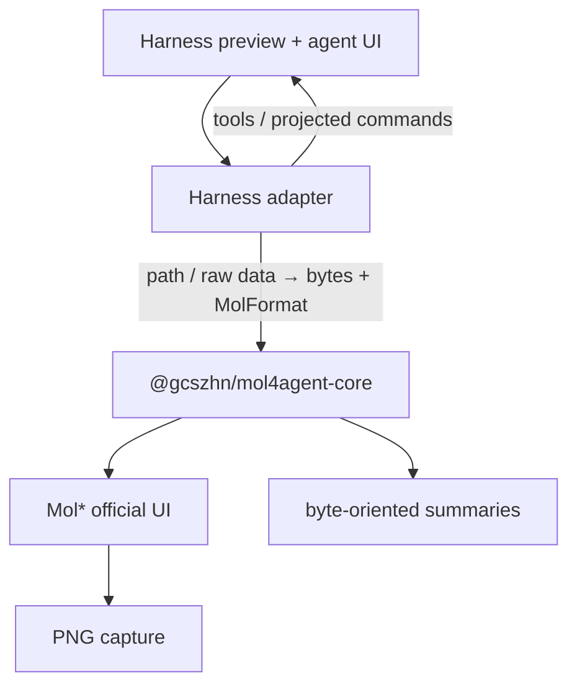
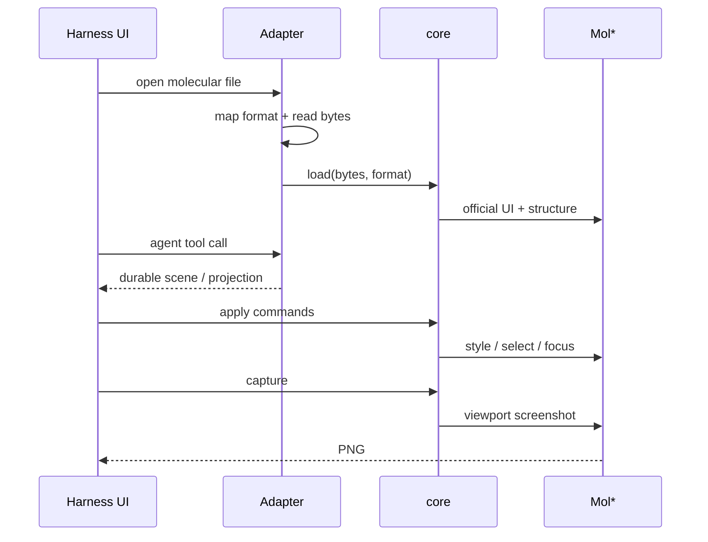

# mol4agent 总体架构（v0.2）

> 中文总体设计说明。英文项目概览见 [README.md](../README.md)，Core API 见 [core README](../packages/core/README.md)，DSH 接口见 [DSH README](../packages/deepseek-harness/README.md)。
>
> 本文只保留**产品目标、总体分层、跨 harness 契约和高层流程**。具体实现、协议字段、工具参数、生命周期陷阱和构建细节都在各 package 的文档里，不在这里重复。

- 日期：2026-11-15
- 事实基准：DeepSeek Harness `0.2.2-rc.3`、Mol* `5.13.1`
- 包版本：`0.1.0`

---

## 1. 产品目标与验收

### 1.1 基本需求

| # | 场景 | 验收 |
|---|---|---|
| R1 | 人在 harness 里手动打开分子文件 | 预览器默认显示官方 Mol* 3D UI，而不是纯文本；「打开方式」仍可切回文本/代码 |
| R2 | agent 操作已打开的可视化页面 | 一次工具调用后页面发生变化：表示、配色、选择/高亮、聚焦、测量等；人无需点按钮 |
| R3 | agent 主动打开页面 | agent 指定结构后，预览自动显示/打开 |
| R4 | agent 导出 PNG | 截图回传给模型；同时可落盘或展示给人 |
| R5 | 其他 harness 复用 | 新增适配器只做「格式识别 + 取字节 + 挂载 + 传命令」，core 语义不变 |

### 1.2 非目标（v1）

- 结构编辑、对接、分子动力学。
- 轨迹动画编辑；多模型轨迹只做基础展示。
- Host 端无头 WebGL 渲染；截图在浏览器端完成。
- 体积/表面等专门分析（可后续接 Mol* 或 Python 侧车）。

### 1.3 跨 harness 功能目标（唯一来源）

R1–R5 是验收基线；任何一个 harness 适配器都必须满足，而不是只让 DSH 可用。具体实现可以因传输、鉴权、预览 API 不同而不同，但**分子行为必须一致**：

1. **结构预览是一等公民**：在 harness 预览器里打开受支持的分子文件，默认进入 Mol* 官方 3D UI；宿主原有的「打开方式」仍可切回纯文本/代码。
2. **agent 操作人看到的同一页面**：打开、改表示/配色、选择/高亮、聚焦、测量、截图都走适配器的 agent 工具；人在旁边看页面变化，不以页面级代码注入作为 agent 接口。
3. **agent 主动打开**：agent 指定结构后，预览自动显示/打开，不需要人再点一次。
4. **harness 一致性**：所有适配器共享同一套 `MolFormat`、选择器、命令、选择集着色和 capture 语义。DSH 与未来的 ChatGPT/Codex 适配器只在传输、鉴权、预览接口上不同；适配器特有行为必须写进该适配器的 README/AGENTS，不得泄漏进 core。
5. **可预期的 UX**：使用 Mol* 官方 UI/controls；跟随宿主 light/dark；官方控制面板组默认关闭；切换文档 tab 保留 viewer 状态；截图通过工具结果返回 PNG，或明确给出保存路径。
6. **可靠边界**：core 只接收 bytes + 显式 format；路径、后缀识别、鉴权、IO、session、UI 属于适配器。错误要结构化、模型可行动；不要把整份结构文件当纯文本输出。

新增 selector/command/tool 是跨包变更：core 语义、所有适配器、prompt 和对应 README 必须在同一次变更里同步。

### 1.4 文档分工

| 文档 | 只负责 |
|---|---|
| `README.md` / `README_zh.md`、各包 README | 用法、API、工具参考、快速开始 |
| `docs/architecture.md`（本文） | 产品目标、验收标准、跨 harness 语义、总体架构 |
| `AGENTS.md`（根） | agent 工作路由、跨包约束；不重复产品目标细节 |
| `packages/*/AGENTS.md` | 该包的实现要求、生命周期/构建陷阱 |
| `packages/deepseek-harness/docs/DETAIL.md` | DSH 适配器的行为细节与限制 |

功能目标以本节为唯一规范来源；README 只描述怎么用，不重复定义目标。实现要求写进对应包的 AGENTS。

---

## 2. 总体分层

| 层 | 负责 | 不负责 | 详情 |
|---|---|---|---|
| core | 官方 Mol* UI viewer、命令/选择器语义、字节摘要、PNG capture | 路径、后缀、IO、session、harness UI | [core README](../packages/core/README.md)、[core AGENTS](../packages/core/AGENTS.md) |
| harness adapter | 格式识别、读字节、预览挂载、agent 工具、状态投影、截图回传、宿主 UI 生命周期 | Mol* 内部实现、core 协议语义 | [DSH README](../packages/deepseek-harness/README.md)、[DETAIL](../packages/deepseek-harness/docs/DETAIL.md)、[DSH AGENTS](../packages/deepseek-harness/AGENTS.md) |
| 未来 ChatGPT/Codex | 其预览/传输接口下的同一套语义 | 另起一套分子行为 | 未来包文档 |

**稳定边界**：core 的输入永远是 `bytes + 显式 format`；适配器负责把「路径」或「raw data」变成这个输入。适配器可以不同，分子语义不能分叉。

---

## 3. 跨 harness 契约

### 3.1 core 契约

- 输入 `StructureData` 与显式 `MolFormat`；不包含 path、suffix、IO 或 harness 依赖。
- 提供稳定的命令、选择器、style、summary、capture 语义；命令 JSON 可序列化、可回放。
- 使用 Mol* 官方 UI 和官方 controls；不引入自定义工具栏或另一套渲染栈。
- 具体类型、命令表、选择器表见 [core README](../packages/core/README.md)。

### 3.2 adapter 契约

- 负责「文件/预览 → bytes + format」以及「agent 意图 → 页面状态」。
- 负责宿主 UI 生命周期：预览器注册、面板/主题/tab 状态、错误呈现。
- 负责把页面截图送回等待中的工具调用；传输方式由 harness 决定。
- 适配器特有行为写进自己的 README/AGENTS；不得为省事把路径/IO/状态塞进 core。
- 具体机制见 [DSH README](../packages/deepseek-harness/README.md) 与 [DETAIL](../packages/deepseek-harness/docs/DETAIL.md)。

### 3.3 一致性规则

- 新 selector/command/tool 必须同时更新 core 语义、所有适配器、prompt 和 README。
- 如果某个 harness 暂时无法支持某能力，在它的 README/AGENTS 明确写限制，而不是改 core 行为。
- 宿主差异只允许出现在传输、鉴权、预览接口、UI 生命周期；选择器/命令/着色/capture 的语义保持一致。

---

## 4. 高层流程

### 4.1 人工打开

1. harness 预览器识别受支持的分子文件。
2. 适配器完成格式映射并读取字节。
3. 适配器调用 core 加载；core 用官方 Mol* UI 显示结构。
4. 宿主的「打开方式」仍可切回文本/代码。

### 4.2 agent 操作

1. 模型调用适配器的 agent 工具。
2. 适配器把意图写入可回放的会话状态/投影。
3. 已打开的页面跟随状态，向 core 发出命令。
4. 人看到页面变化；工具结果返回简短状态，而不是把结构文件当文本。

### 4.3 截图

1. 模型调用截图工具。
2. 页面渲染当前 viewport，把 PNG 交回适配器。
3. 工具唤醒，返回图片；如果模型不支持图片输入，则给保存路径。

具体 DSH 的 projection 事件、CaptureHub、documentPreviews 挂载等机制属于适配器细节，见 [DETAIL](../packages/deepseek-harness/docs/DETAIL.md)。

---

## 5. 兼容性、版本与发布

- core 是共享语义源；adapter 不复制协议实现，只做转换与挂载。
- 语义变更（命令、选择器、style、capture）按跨包变更处理，并提升 core/适配器版本。
- 当前包版本 `0.1.0`；npm 包只包含编译后的 JS/`.d.ts`、必要配置/文档，不包含源码或 `AGENTS.md`。
- 发布/打包细节见各包 AGENTS；DSH 的 `engines.dsh` 约束其兼容的宿主版本。

---

## 6. 质量与验收

- 验收以 §1.3 为准；新增适配器必须逐条满足，或在自身文档中明确限制。
- 使用真实结构（1CRN、1ATP、aspirin、7CZD）验证加载、样式、选择/聚焦、截图。
- UI 行为要在真实 harness 页面验证（面板默认/切换、主题、tab 状态、截图回传），不能只看一张 canvas 截图。
- 具体测试命令、fixture 用法、构建/打包检查在包级 AGENTS 与 README 中。

## 7. 实现状态

- **core**：协议、Mol* 官方 UI viewer、选择器、摘要、per-selection 样式、PNG capture 已实现。
- **DSH adapter**：文档预览、agent 工具、session projection、截图回传、面板/主题/tab 生命周期已实现。
- **ChatGPT/Codex**：未来适配器，复用 core 语义，只实现其传输/预览接口。

下一步不是继续扩写本文，而是把新能力写进对应 package 的 README/AGENTS，并只在这里更新总体目标或分层的变化。
