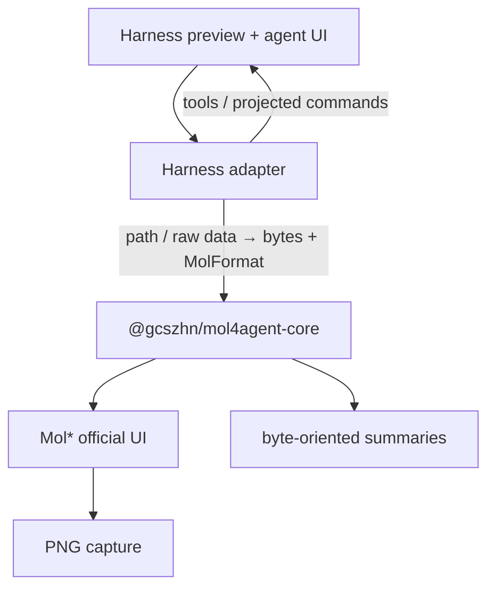
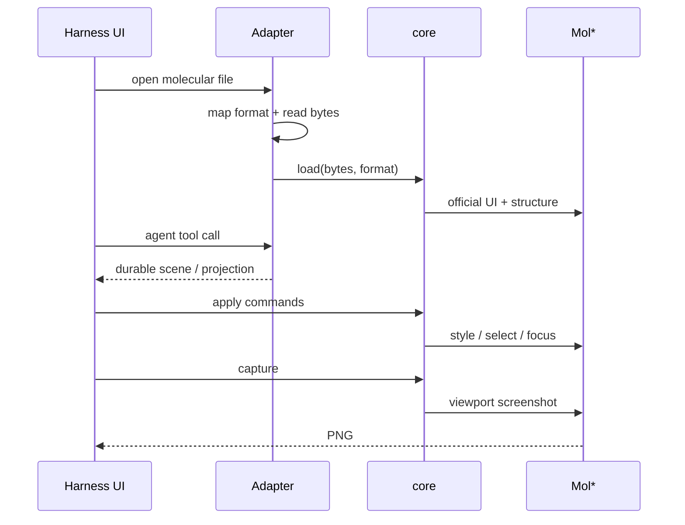

# mol4agent Architecture Overview (v0.2)

[English](architecture.md) | [中文](architecture_zh.md)

> English overview. Project introduction: [README.md](../README.md); Core API:
> [core README](../packages/core/README.md); DSH interface:
> [DSH README](../packages/deepseek-harness/README.md).
>
> This document covers **product goals, overall layering, the cross-harness
> contract, and high-level flows** only. Implementation details, protocol
> fields, tool parameters, lifecycle traps, and build specifics live in each
> package's documentation and are not repeated here.

- Date: 2026-11-15
- Baseline: DeepSeek Harness `0.2.2-rc.3`, Mol* `5.13.1`
- Package version: `0.1.0`

---

## 1. Product goals and acceptance

### 1.1 Basic requirements

| # | Scenario | Acceptance |
|---|---|---|
| R1 | A human opens a molecular file in the harness previewer | The official Mol* 3D UI is shown by default instead of plain text; "Open with" still offers text/code |
| R2 | The agent operates the open visual page | One tool call changes the page: representation, colors, selection/highlight, focus, measurement; no human clicking required |
| R3 | The agent opens a page proactively | Naming a structure makes its preview appear/open automatically |
| R4 | The agent exports a PNG | The screenshot is returned to the model and can also be saved or shown to the human |
| R5 | Other harnesses reuse the work | A new adapter only maps formats, obtains bytes, mounts the page, and passes commands; core semantics stay unchanged |

### 1.2 Non-goals (v1)

- Structure editing, docking, or molecular dynamics.
- Trajectory animation editing; multi-model trajectories are display-only.
- Headless WebGL rendering on the Host; screenshots are produced in the browser.
- Dedicated volume/surface analysis (Mol* or a Python sidecar can be added later).

### 1.3 Cross-harness goals (single source)

R1–R5 are the acceptance baseline; every harness adapter must satisfy them, not
just DSH. Implementations may differ in transport, authorization, and preview
APIs, but **molecular behavior must be consistent**:

1. **Structure preview is first-class.** Opening a supported molecular file in a
   harness previewer enters the official Mol* 3D UI by default; the host's
   existing "Open with" affordance still offers text/code.
2. **The agent operates the same page the human sees.** Opening, styling,
   selecting/highlighting, focusing, measuring, and capturing go through the
   adapter's agent tools; the human watches the page change. Page-level code
   injection is not an agent interface.
3. **Agent-initiated open.** Naming a structure makes the preview appear/open
   without another human click.
4. **Harness parity.** All adapters share the same `MolFormat`, selectors,
   commands, per-selection styling, and capture semantics. DSH and the future
   ChatGPT/Codex adapter differ only in transport, authorization, and preview
   APIs; adapter-specific behavior belongs in that adapter's README/AGENTS and
   must not leak into core.
5. **Predictable UX.** Use the official Mol* UI and controls; follow the host
   light/dark theme; start with the official control-panel set closed; preserve
   viewer state across document tabs; return a PNG through the tool result, or
   an explicit saved path.
6. **Reliable boundaries.** Core receives bytes plus an explicit format only;
   paths, suffix detection, authorization, IO, sessions, and UI belong to
   adapters. Errors are structured and model-actionable; never dump a whole
   structure file as plain text.

A new selector/command/tool is a cross-package change: core semantics, every
adapter, the prompt, and the relevant READMEs must be updated together.

#### 1.3.1 Sidebar, tab state, and file-open paths

These are acceptance requirements for every adapter with a document-preview
surface; adapter-specific APIs and limits stay in that adapter's README.

- **Sidebar visualization.** A supported molecular file opened through the
  harness's file preview renders in the host's right sidebar with the official
  Mol* UI, not in a separate window or a custom app shell. An agent-initiated
  open reveals that page proactively.
- **Tab-page state.** One preview tab is one independent viewer instance and one
  scene. Its tab page id (for DSH: the absolute path) owns its commands, pending
  captures, camera, representations, measurements, and control-panel state.
  Switching tabs reattaches/preserves its viewer; it must not reload the file,
  copy commands into another tab, or deliver a capture as another tab's. Only
  host services such as the light/dark theme are shared. An adapter may cap
  retained viewers (DSH: LRU 2) and must evict them without touching the active
  tab.
- **Human open and preview mode.** Structure preview is the default for a
  supported molecular file. The host's existing **Open with** affordance can
  switch that tab to plain text/code (binary-only formats such as BCIF have no
  text fallback), and switching back returns to the structure preview without
  losing the tab's viewer state. A human opening a file must not be silently
  replaced by an agent tab for a different path.
- **Agent open.** `mol_open` creates or updates a tab page keyed by the
  structure path, makes it the active agent tab, and returns that tab page id;
  the page opens without a human click. Scene tools (style/select/focus/measure/
  capture) accept the id and default to the active agent tab. Operating one tab
  must not change another; capture activates its target tab.
- **Human/agent coexistence.** Both open paths use the same preview body and
  scene model. Reopening the same path updates that tab (new scene key); opening
  a different path creates an independent tab. Agent operations stay `mol_*`
  tool calls, never page-code injection.

### 1.4 Documentation ownership

| Document | Owns |
|---|---|
| `README.md` / `README_zh.md`, package READMEs | Usage, API, tool reference, quick start |
| `docs/architecture.md` / `architecture_zh.md` (this document) | Product goals, acceptance, cross-harness semantics, overall architecture |
| `AGENTS.md` (root) | Agent routing and cross-cutting constraints; no duplicated goal detail |
| `packages/*/AGENTS.md` | Package implementation requirements, lifecycle/build traps |
| `packages/deepseek-harness/docs/DETAIL.md` | DSH adapter behavior details and limitations |

This section is the single source for product goals. READMEs describe how to use
the project; package AGENTS describe how to implement it.

---

## 2. Overall layering

| Layer | Owns | Does not own | Details |
|---|---|---|---|
| core | Official Mol* UI viewer, command/selector semantics, byte summaries, PNG capture | Paths, suffixes, IO, sessions, harness UI | [core README](../packages/core/README.md), [core AGENTS](../packages/core/AGENTS.md) |
| harness adapter | Format detection, byte reads, preview mounting, agent tools, state projection, screenshot delivery, host UI lifecycle | Mol* internals, core protocol semantics | [DSH README](../packages/deepseek-harness/README.md), [DETAIL](../packages/deepseek-harness/docs/DETAIL.md), [DSH AGENTS](../packages/deepseek-harness/AGENTS.md) |
| future ChatGPT/Codex | The same semantics behind its preview/transport APIs | A second molecular behavior | Future package docs |

**Stable boundary**: core input is always `bytes + explicit format`. Adapters turn
a path or raw data into that input. Adapters may differ; molecular semantics may
not fork.

---

## 3. Cross-harness contract

### 3.1 Core contract

- Takes `StructureData` plus an explicit `MolFormat`; no path, suffix, IO, or
  harness dependency.
- Provides stable command, selector, style, summary, and capture semantics;
  commands are JSON-serializable and replayable.
- Uses the official Mol* UI and controls; no custom toolbar or second rendering
  stack.
- Types, command tables, and selector tables live in the
  [core README](../packages/core/README.md).

### 3.2 Adapter contract

- Owns "file/preview → bytes + format" and "agent intent → page state".
- Owns host UI lifecycle: preview registration, panel/theme/tab state, error
  presentation.
- Delivers page screenshots back to waiting tool calls; the transport is
  harness-specific.
- Adapter-specific behavior goes in its README/AGENTS; do not move paths, IO, or
  state into core for convenience.
- Concrete mechanisms are documented in the
  [DSH README](../packages/deepseek-harness/README.md) and
  [DETAIL](../packages/deepseek-harness/docs/DETAIL.md).

### 3.3 Consistency rules

- A new selector/command/tool updates core semantics, every adapter, the prompt,
  and the READMEs together.
- If a harness cannot support a capability yet, state the limitation in its
  README/AGENTS; do not change core behavior for that harness.
- Host differences are limited to transport, authorization, preview APIs, and UI
  lifecycle. Selector/command/color/capture semantics stay consistent.

---

## 4. High-level flows

### 4.1 Manual open

1. The harness previewer recognizes a supported molecular file.
2. The adapter maps the format and reads the bytes.
3. The adapter asks core to load; core displays the structure in the official
   Mol* UI.
4. The host's "Open with" affordance can still switch to text/code.

### 4.2 Agent operation

1. The model calls an adapter agent tool.
2. The adapter records the intent in replayable session state/projection.
3. The open page follows the state and issues commands to core.
4. The human sees the page change; the tool result returns a short status instead
   of dumping the structure file as text.

### 4.3 Capture

1. The model calls the capture tool.
2. The page renders the current viewport and hands the PNG back to the adapter.
3. The tool resumes and returns the image; if the model does not accept images,
   it returns the saved path instead.

DSH-specific projection events, CaptureHub, and documentPreviews mounting are
adapter details; see [DETAIL](../packages/deepseek-harness/docs/DETAIL.md).

---

## 5. Compatibility, versioning, and release

- Core is the shared semantic source; adapters convert and mount, not duplicate
  the protocol.
- Semantic changes (commands, selectors, style, capture) are cross-package
  changes and bump core/adapter versions.
- Current package version: `0.1.0`. npm packages contain compiled JS/`.d.ts`,
  required configuration/docs, and no source or `AGENTS.md`.
- Packaging/release details live in package AGENTS; DSH's `engines.dsh` pins the
  supported host range.

---

## 6. Quality and acceptance

- Acceptance follows §1.3; a new adapter must satisfy every goal or document a
  limitation in its own docs.
- Use real structures (1CRN, 1ATP, aspirin, 7CZD) to verify loading, styling,
  selection/focus, and capture.
- Verify UI behavior in the real harness page (panel default/toggle, theme, tab
  state, capture delivery), not just a canvas screenshot.
- Concrete test commands, fixtures, and build/package checks live in package
  AGENTS and READMEs.

## 7. Implementation status

- **core**: protocol, official Mol* UI viewer, selectors, summaries,
  per-selection styling, and PNG capture are implemented.
- **DSH adapter**: document preview, agent tools, session projection, screenshot
  delivery, and panel/theme/tab lifecycle are implemented.
- **ChatGPT/Codex**: future adapter, reusing core semantics and implementing only
  its transport/preview APIs.

The next step is not to grow this document further. Put new capabilities in the
relevant package README/AGENTS, and update this document only when overall goals
or layering change.
