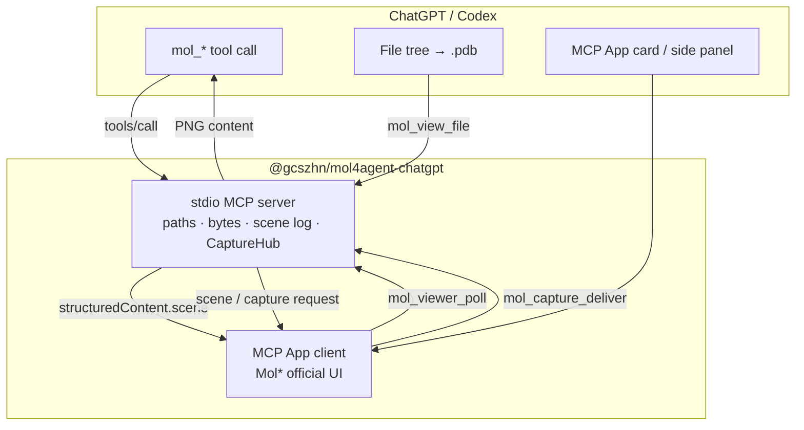

# @gcszhn/mol4agent-chatgpt

[English](README.md) | [中文](README_zh.md)

ChatGPT/Codex adapter for mol4agent: an MCP App that puts Mol*'s official 3D UI
in the conversation and lets the agent operate it with `mol_*` tools.

- **Agent-opened 3D page**: `mol_open` renders a structure in a conversation
  card (expandable to the side panel) instead of returning a wall of PDB text.
- **Database fetch**: `mol_fetch` downloads PDB entries (PDB/mmCIF/BinaryCIF),
  AlphaFold DB predictions, PubChem compounds, and ChEMBL molecules into the
  workspace, so an agent can start from an entry id instead of a local file.
- **File-tree preview**: `.pdb` / `.cif` / `.sdf` / ... files, including
  `.pdb.gz` / `.cif.gz` / `.sdf.gz` variants, open in the **Structure preview**
  side-panel tab by default (after Codex's one-time per-extension permission);
  **Open with** still offers the built-in text/code viewer.
- **Agent-operated page**: representation, color, selection/highlight, focus,
  measurement, and capture all run through tools while the human watches the
  same page change.
- **Screenshot round trip**: `mol_capture` blocks while the open app renders the
  viewport, then returns the PNG in the tool result and saves a copy under
  `.mol4agent/captures/`.
- **Same molecular semantics as DSH**: the adapter passes the same
  `MolFormat`, selectors, commands, per-selection styling, and capture
  semantics to `@gcszhn/mol4agent-core`.

## Architecture



**Boundary**: the server is the only place that sees a path, chooses a
`MolFormat`, reads bytes, and writes captures. Core receives only
`{ data, format, label }` plus JSON commands. The app owns WebGL and never
touches the filesystem.

### File-tree preview (MCP extension file viewer)

Codex exposes **MCP extension file viewers**. The plugin registers
`mol_view_file` as a file handler:

```json
"openai/ui": {
  "entrypoints": [{
    "type": "file",
    "extensions": [".pdb", ".cif", ".sdf", ".mol2", ".xyz", ".gro", ".pdb.gz", "..."]
  }]
}
```

The host matches the selected file's suffix, opens an `mcp-extension` tab, and
calls `mol_view_file` with `{ file: { name, resourceUri } }`. The server resolves
the tool-call path, publishes the bytes on `mol4agent://structure/{sceneId}`,
and falls back to the host file resource only when the path is unavailable. The
server decodes gzip inputs before core sees them; the app only decodes a raw
gzip host-resource fallback with the browser `DecompressionStream`. The human
can rotate/zoom the official Mol* UI while the agent operates its scene through
`mol_style` / `mol_select` / `mol_focus` / `mol_capture`.

On the first `.pdb` open, Codex asks **“Use mol4agent to open .pdb files?”** and
stores the answer in `preferred-file-viewers`. Choose **Yes** once; afterwards
the file tree opens the structure preview by default. If the prompt is not
shown, use **Settings → File type handlers** and set `.pdb` to
**Structure preview**. The built-in text/code preview remains available from
**Open with**.

### Independent scenes per tab, per-tab long poll

The store keeps one **active agent scene** plus independent **file-viewer
scenes**. `mol_open` creates an agent scene; `mol_view_file` creates a file
scene. Each app instance binds to the scene it was opened for and polls by
`sceneId`, so opening another structure never replaces or reloads an existing
tab. Switching one tab to text/code with **Open with** leaves the other tabs and
their scenes untouched.

- `mol_style` / `mol_select` / `mol_focus` / `mol_measure` mutate the active
  agent scene only; file-viewer tabs are unaffected.
- A later `mol_open` creates a new agent scene/tab; older agent tabs keep their
  own structure.
- File tabs never follow agent styling and never claim an agent capture.
- `mol_capture` captures the active agent scene (the latest `mol_open`).

Each app loads its structure resource once and applies only new commands; a
newly mounted card reconstructs its picture from a full snapshot.

### Capture rendezvous

`mol_capture` enqueues a request and waits. The agent tab opened by `mol_open`
claims it from its next poll, renders the viewport through core, and commits the
PNG with `mol_capture_deliver`; the waiting tool then returns the image.
`mol_capture` deliberately has no viewer `_meta`, so the host never mounts a
second card for a screenshot and the capture keeps the camera pose the human is
looking at. Internal tools are marked `_meta.ui.visibility: ["app"]` so the
model does not call them.

## Tools

Model-facing tools:

| Tool | Parameters | Behavior |
|---|---|---|
| `mol_info` | `path` | Summarize chains, residues, atoms, ligands. Does not open a viewer. |
| `mol_interface` | `path`, `chainsA`, `chainsB`, `cutoff?` | Find interface residues between two chain groups (default 8 Å) in PDB-like files. |
| `mol_fetch` | `entry_id`, `target_path`, `source_db?` | Download a structure from an online database and save it at `target_path`. `source_db` defaults to `rcsb-pdb`; see [database sources](#database-sources). A directory target (or trailing slash) appends the source file name, and a suffix-less path gets the source suffix. Returns the saved path plus a summary. |
| `mol_open` | `path`, `type?`, `color?`, `colorParams?`, `select?`, `focus?` | Open a scene, render the MCP App card, and optionally highlight/focus a selection. |
| `mol_style` | `type?`, `color?`, `target?`, `replace?`, `colorParams?` | Replace the current representations by default (`replace: true`), or overlay one with `replace: false`. `target` only narrows the new representation's coverage. `colorParams.value` applies to `uniform` and accepts a CSS name (`"red"`), hex (`"#ff0000"`), or an integer (`16711680`); invalid colours are rejected and the result echoes the resolved hex. |
| `mol_select` | `target`, `mode?`, `focus?` | Apply select/highlight interactivity. |
| `mol_focus` | `target?` | Focus a selection or the whole structure. |
| `mol_measure` | `kind`, `targets` | Add a distance (2), angle (3), or dihedral (4) measurement. |
| `mol_capture` | `width?`, `height?`, `transparent?` | Return a PNG from the open app and save it under `.mol4agent/captures/`. |
| `mol_view_file` | `file` | Host file-tree entrypoint; opens the selected file in the structure preview. Not model-callable. |

App/host-only internal tools: `mol_viewer_poll`, `mol_capture_deliver`,
`mol_capture_fail`, and `mol_view_file` (the file-tree entrypoint).

`color` selects the Mol* colour theme; `colorParams.value` only affects the
`uniform` theme. Besides CSS names and hex strings it accepts `0x`/bare hex,
`rgb()`/`rgba()`, and 24-bit integers. See the
[core colour reference](../core/README.md#colours) for the full list.

Selectors use the same JSON shapes as the DSH adapter:

```json
{ "kind": "ligand" }
{ "kind": "chain", "chain": "A" }
{ "kind": "residues", "chain": "A", "start": 10, "end": 25 }
{ "kind": "residue", "chain": "A", "index": 42 }
{ "kind": "comp", "compId": "ATP" }
```

### Database sources

| `source_db` | `entry_id` | Saved format |
|---|---|---|
| `rcsb-pdb` (default) | 4-character PDB id, e.g. `1crn` | `.pdb` |
| `rcsb-cif` | 4-character PDB id, e.g. `1crn` | `.cif` (mmCIF) |
| `rcsb-bcif` | 4-character PDB id, e.g. `1crn` | `.bcif` (BinaryCIF) |
| `alphafold` | UniProt accession, e.g. `P00533` | `.pdb` |
| `pubchem` | CID (`2244`) or compound name (`aspirin`) | `.sdf` (3D) |
| `chembl` | ChEMBL id (`CHEMBL25`) or bare number (`25`) | `.sdf` |

Entry ids are normalized and validated in core
(`@gcszhn/mol4agent-core/sources`); the MCP server performs the HTTPS download,
caps it at 64 MiB, times out after 30 s, and writes through a temporary file so
a failed fetch leaves no partial structure. Existing targets are overwritten.
AlphaFold file names are versioned, so the server resolves `0.pdbUrl` through
the AlphaFold JSON API before downloading.

`mol_fetch` examples:

```json
{ "entry_id": "1crn", "target_path": "fixtures/1crn.pdb" }
{ "entry_id": "aspirin", "source_db": "pubchem", "target_path": "fixtures/" }
{ "entry_id": "P00533", "source_db": "alphafold", "target_path": "egfr.pdb" }
```

## Resources

| URI | Purpose |
|---|---|
| `ui://mol4agent/viewer.html` | Self-contained MCP App HTML (core + Mol* + official UI CSS, about 4.4 MiB). |
| `mol4agent://structure/{sceneId}` | Raw bytes for the current scene, read by the app through the host. |

The MCP App MIME type is `text/html;profile=mcp-app`. The app resource declares no
external CSP domains; the viewer and Mol* assets are inlined.

## Install

### From the GitHub marketplace (recommended)

Codex installs plugins from Git, not npm. This repository exposes
`.agents/plugins/marketplace.json`; the `mol4agent` entry points at the
generated `plugin-dist` branch, where the release workflow publishes the built
`lib/` payload whenever the ChatGPT package version changes:

```sh
codex plugin marketplace add GCS-ZHN/mol4agent
codex plugin add mol4agent@mol4agent-github
```

Start a new conversation (or restart the app if the plugin list does not
refresh). The plugin contributes the `mol_*` tools and the viewer MCP App.

### Local development install

Build the package first:

```sh
pnpm install
pnpm --filter @gcszhn/mol4agent-core build
pnpm --filter @gcszhn/mol4agent-chatgpt build
```

Install through a local Codex marketplace:

```sh
node packages/chatgpt/scripts/install-local.mjs
codex plugin marketplace add ~/.codex/mol4agent-marketplace
codex plugin add mol4agent@mol4agent-local
```

The install script copies the built plugin to a stable local marketplace and
rewrites `.mcp.json` with absolute paths. The repository `.mcp.json` remains
portable.

## Limitations

- **Per-extension permission**: Codex asks once whether the plugin may open an
  extension. The answer is stored per host + extension; choose it in
  **File type handlers** if the prompt is skipped.
- **Host resource fallback**: the file viewer prefers the host metadata path so
  the server can read bytes once and share `mol4agent://structure/{sceneId}`;
  if the path is unavailable it falls back to the app-scoped host resource.
- **One active agent scene**: `mol_open` replaces the agent scene targeted by
  model tools. Older agent tabs and file tabs stay on their own bound scenes.
  `mol_capture` captures the active agent scene.
- **Capture needs a viewer**: `mol_capture` uses the agent tab that `mol_open`
  already mounted. Reopen the structure with `mol_open` if that tab was closed
  and retry. If the host blocks app→tool calls, the tool times out.
- **App→tool capability**: live updates and capture require the host to allow
  `serverTools`; the README notes this fallback for restricted hosts.
- BCIF renders but `mol_info` cannot summarize it from raw bytes yet.
- `mol_interface` only parses PDB-like ATOM records.
- `mol_fetch` needs outbound HTTPS from the MCP server host. Downloads are
  capped at 64 MiB and time out after 30 s; a failed fetch does not write a
  partial file. PubChem is requested as a 3D SDF (`record_type=3d`), so
  compounds without a 3D conformer return HTTP 404. Downloaded bytes are stored
  uncompressed, so a `.gz` target is rejected.
- Files are capped at 64 MiB, including the decompressed size of `.gz` inputs;
  the browser fallback needs `DecompressionStream`, and WebGL is required.
- No multi-model/trajectory switching UI; labels are supported by core but not
  exposed as a tool here.

## Development

```sh
pnpm --filter @gcszhn/mol4agent-chatgpt typecheck
pnpm --filter @gcszhn/mol4agent-chatgpt build
pnpm --filter @gcszhn/mol4agent-chatgpt test
```

`build` produces:

- `lib/viewer.html` — one self-contained MCP App (no external chunks).
- `lib/server.js` — stdio MCP server with dependencies bundled.

`test` runs format/gzip unit tests, protocol-level MCP tests, and a real
headless-Chrome MCP Apps smoke test (skipped when Chrome is unavailable). The
smoke test drives the official `AppBridge`, loads `fixtures/1atp.pdb`, requests
a capture, and checks the PNG.

## Files

- Server: `src/{server,tools,scene,capture,paths,fetch,formats,selector,interface}.ts`, `src/host/gzip.ts`
- App: `src/client/{index.html,main.ts,gzip.ts}`
- Build: `scripts/build.mjs`
- Install: `scripts/install-local.mjs`
- Tests: `test/{formats,gzip}.test.ts`, `test/{server,ui}.test.mjs`, `test/host/*`
- Playbook: [AGENTS.md](AGENTS.md)

Chinese translation: [README_zh.md](README_zh.md).
