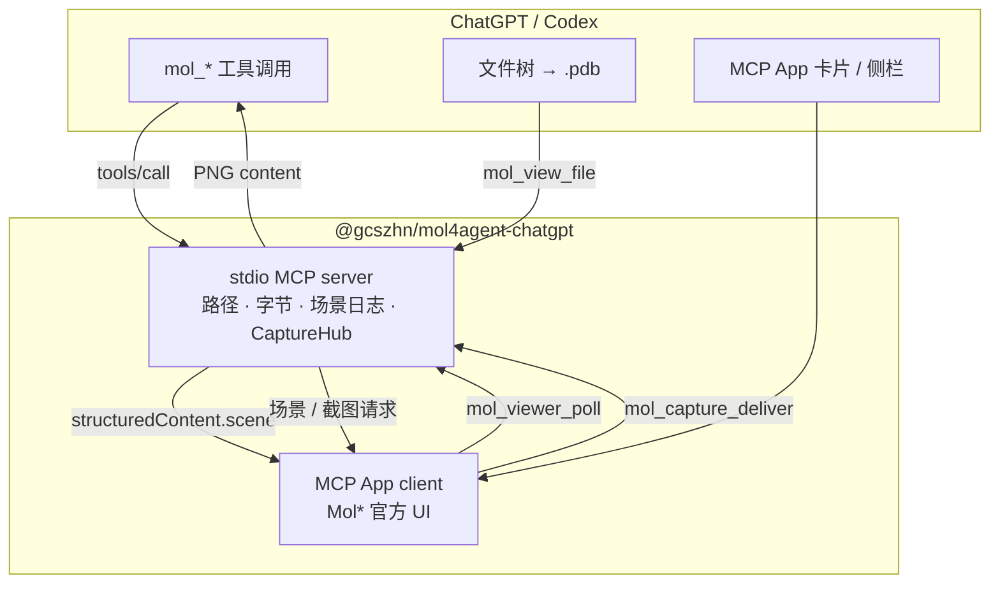

# @gcszhn/mol4agent-chatgpt

[English](README.md) | [中文](README_zh.md)

mol4agent 的 ChatGPT/Codex 适配器：用 MCP App 在会话里放一个 Mol* 官方 3D 页面，
agent 通过 `mol_*` 工具直接操作它。

- **agent 打开 3D 页面**：`mol_open` 在会话卡片（可展开到侧栏）里渲染结构，
  而不是把整份 PDB 文本塞回上下文。
- **文件树预览**：`.pdb` / `.cif` / `.sdf` / ...（含 `.pdb.gz` / `.cif.gz` /
  `.sdf.gz` 等 gzip 变体）默认在侧栏的 **Structure preview** 标签页打开
  （Codex 首次会按扩展名询问一次）；**Open with** 仍可切回内置文本/代码查看器。
- **agent 操作同一页面**：表示、配色、选择/高亮、聚焦、测量、截图都走工具，
  人看到的是同一页面的实时变化。
- **截图回传**：`mol_capture` 阻塞等待打开页渲染视口，把 PNG 放回工具结果，
  同时保存到 `.mol4agent/captures/`。
- **与 DSH 相同的分子语义**：适配器把相同的 `MolFormat`、选择器、命令、
  选择集着色和截图语义交给 `@gcszhn/mol4agent-core`。

## 架构



**边界**：只有 server 接触路径、判断 `MolFormat`、读取字节、写截图。core 只收到
`{ data, format, label }` 和 JSON 命令；app 只负责 WebGL，不碰文件系统。

### 文件树预览（MCP extension file viewer）

Codex 支持 **MCP extension file viewer**。插件把 `mol_view_file` 注册为文件处理器：

```json
"openai/ui": {
  "entrypoints": [{
    "type": "file",
    "extensions": [".pdb", ".cif", ".sdf", ".mol2", ".xyz", ".gro", ".pdb.gz", "..."]
  }]
}
```

宿主按后缀匹配，打开 `mcp-extension` 标签页，并以
`{ file: { name, resourceUri } }` 调用 `mol_view_file`。server 解析工具调用里的
文件路径，把字节发布到 `mol4agent://structure/{sceneId}`，只有路径不可用时才
回退到宿主文件资源。gzip 输入由 server 先解压，core 只看到解码后的字节；只有
回退到宿主原始资源时，app 才用浏览器 `DecompressionStream` 解压。人可以
旋转/缩放 Mol* 官方 UI，agent 通过 `mol_style` / `mol_select` / `mol_focus` /
`mol_capture` 操作自己的场景。

首次打开 `.pdb` 时 Codex 会问 **“Use mol4agent to open .pdb files?”**，并把答案
存进 `preferred-file-viewers`。选一次 **Yes** 后，文件树默认打开结构预览。若没有
弹出提示，在 **Settings → File type handlers** 把 `.pdb` 设为
**Structure preview**。内置文本/代码预览仍可从 **Open with** 选择。

### 每个 tab 独立场景 + 独立长轮询

store 保留一个**活跃 agent scene** 和多个独立的 **file-viewer scene**。
`mol_open` 创建 agent scene，`mol_view_file` 创建 file scene。每个 app 实例绑定
到自己打开时的 scene，并按 `sceneId` 轮询；再打开一个结构不会替换或重载已有 tab。
用 **Open with** 把某个 tab 切到纯文本/代码，不影响其他 tab 及其场景。

- `mol_style` / `mol_select` / `mol_focus` / `mol_measure` 只修改活跃 agent
  scene；文件树 tab 不受影响。
- 后续 `mol_open` 创建新的 agent scene/tab；旧 agent tab 保持自己的结构。
- 文件 tab 不跟随 agent 样式，也不会抢 agent 的截图请求。
- `mol_capture` 截取活跃 agent scene（最近一次 `mol_open`）。

每个 app 只加载一次结构资源，之后只应用新增命令；新挂载的卡片用完整快照重建
自己的画面。

### 截图会合

`mol_capture` 入队后等待；`mol_open` 打开的 agent tab 在下一次轮询里 claim，
请求 core 渲染视口，再用 `mol_capture_deliver` 提交 PNG；等待中的工具随后返回
图片。`mol_capture` 刻意不带 viewer `_meta`，宿主不会为每次截图再挂载一张
卡片，截图也保留人眼看到的相机视角。内部工具标了
`_meta.ui.visibility: ["app"]`，模型不会调用它们。

## 工具

模型可见工具：

| 工具 | 参数 | 行为 |
|---|---|---|
| `mol_info` | `path` | 汇总链/残基/原子/配体，不打开页面。 |
| `mol_interface` | `path`、`chainsA`、`chainsB`、`cutoff?` | 找两组链之间的界面残基（默认 8 Å），仅 PDB-like。 |
| `mol_open` | `path`、`type?`、`color?`、`select?`、`focus?` | 打开场景、渲染 MCP App 卡片，可选高亮/聚焦。 |
| `mol_style` | `type?`、`color?`、`target?`、`colorParams?` | 替换全局表示，或给选择集叠加表示。 |
| `mol_select` | `target`、`mode?`、`focus?` | 选择/高亮。 |
| `mol_focus` | `target?` | 聚焦选择集或整体。 |
| `mol_measure` | `kind`、`targets` | 距离（2）/角度（3）/二面角（4）。 |
| `mol_capture` | `width?`、`height?`、`transparent?` | 从打开页返回 PNG，并保存到 `.mol4agent/captures/`。 |
| `mol_view_file` | `file` | 文件树入口；在结构预览中打开选中的文件。模型不可调用。 |

app/宿主专用内部工具：`mol_viewer_poll`、`mol_capture_deliver`、
`mol_capture_fail`，以及文件树入口 `mol_view_file`。

选择器与 DSH 适配器完全一致：

```json
{ "kind": "ligand" }
{ "kind": "chain", "chain": "A" }
{ "kind": "residues", "chain": "A", "start": 10, "end": 25 }
{ "kind": "residue", "chain": "A", "index": 42 }
{ "kind": "comp", "compId": "ATP" }
```

## 资源

| URI | 用途 |
|---|---|
| `ui://mol4agent/viewer.html` | 自包含 MCP App HTML（core + Mol* + 官方 UI CSS，约 4.4 MiB）。 |
| `mol4agent://structure/{sceneId}` | 当前场景原始字节，由 app 经宿主持有者读取。 |

MCP App MIME 为 `text/html;profile=mcp-app`；资源不声明外部 CSP 域，viewer 与
Mol* 资源全部内联。

## 安装

### 从 GitHub marketplace 安装（推荐）

Codex 通过 Git 安装插件，不使用 npm。仓库根目录的
`.agents/plugins/marketplace.json` 把 `mol4agent` 指向自动生成的
`plugin-dist` 分支；ChatGPT 包版本变化时，release workflow 会在该分支发布
构建好的 `lib/` 产物：

```sh
codex plugin marketplace add GCS-ZHN/mol4agent
codex plugin add mol4agent@mol4agent-github
```

然后新开一个会话（若插件列表不刷新则重启 app）。插件会提供 `mol_*` 工具和
viewer MCP App。

### 本地开发安装

先构建：

```sh
pnpm install
pnpm --filter @gcszhn/mol4agent-core build
pnpm --filter @gcszhn/mol4agent-chatgpt build
```

通过本地 Codex marketplace 安装：

```sh
node packages/chatgpt/scripts/install-local.mjs
codex plugin marketplace add ~/.codex/mol4agent-marketplace
codex plugin add mol4agent@mol4agent-local
```

安装脚本把构建产物复制到稳定的本地 marketplace，并把 `.mcp.json` 改写为绝对
路径；仓库里的 `.mcp.json` 保持可移植。

## 限制

- **按扩展名授权一次**：Codex 首次会询问是否允许插件打开该扩展名，答案按
  host + 扩展名保存；若跳过提示，可在 **File type handlers** 里设置。
- **宿主资源回退**：文件树 viewer 优先用宿主 metadata 路径，让 server 读一次
  字节并通过 `mol4agent://structure/{sceneId}` 共享；路径不可用时才回退到
  app 作用域的宿主资源。
- **只有一个活跃 agent scene**：`mol_open` 替换的是模型工具操作的 agent scene；
  旧 agent tab 和文件 tab 保持各自绑定的 scene。`mol_capture` 截取活跃
  agent scene。
- **截图需要 viewer**：`mol_capture` 复用 `mol_open` 已挂载的 agent tab。
  该 tab 被关闭时先用 `mol_open` 重新打开，再重试截图。宿主禁止
  app→tool 调用时才会超时。
- **依赖宿主 `serverTools`**：实时更新和截图需要宿主允许 app 回调 server；
  受限宿主只能显示静态场景。
- BCIF 可渲染，但 `mol_info` 暂不能从原始字节汇总。
- `mol_interface` 只解析 PDB-like ATOM。
- 文件上限 64 MiB，`.gz` 解压后同样受 64 MiB 限制；宿主资源回退需要
  `DecompressionStream`，渲染需要 WebGL。
- 没有多模型/轨迹切换 UI；core 支持 label，但这里没有暴露 label 工具。

## 开发

```sh
pnpm --filter @gcszhn/mol4agent-chatgpt typecheck
pnpm --filter @gcszhn/mol4agent-chatgpt build
pnpm --filter @gcszhn/mol4agent-chatgpt test
```

`build` 产物：

- `lib/viewer.html` —— 单个自包含 MCP App（无外部 chunk）。
- `lib/server.js` —— 依赖已打包的 stdio MCP server。

`test` 包含格式/gzip 单元测试、协议级 MCP 测试和真实 headless Chrome +
MCP Apps 冒烟测试（无 Chrome 时跳过）。冒烟测试用官方 `AppBridge` 加载
`fixtures/1atp.pdb`，请求截图并校验 PNG。

## 文件

- Server：`src/{server,tools,scene,capture,paths,formats,selector,interface}.ts`、`src/host/gzip.ts`
- App：`src/client/{index.html,main.ts,gzip.ts}`
- 构建：`scripts/build.mjs`
- 安装：`scripts/install-local.mjs`
- 测试：`test/{formats,gzip}.test.ts`、`test/{server,ui}.test.mjs`、`test/host/*`
- 实施约束：[AGENTS.md](AGENTS.md)

英文版：[README.md](README.md)。
