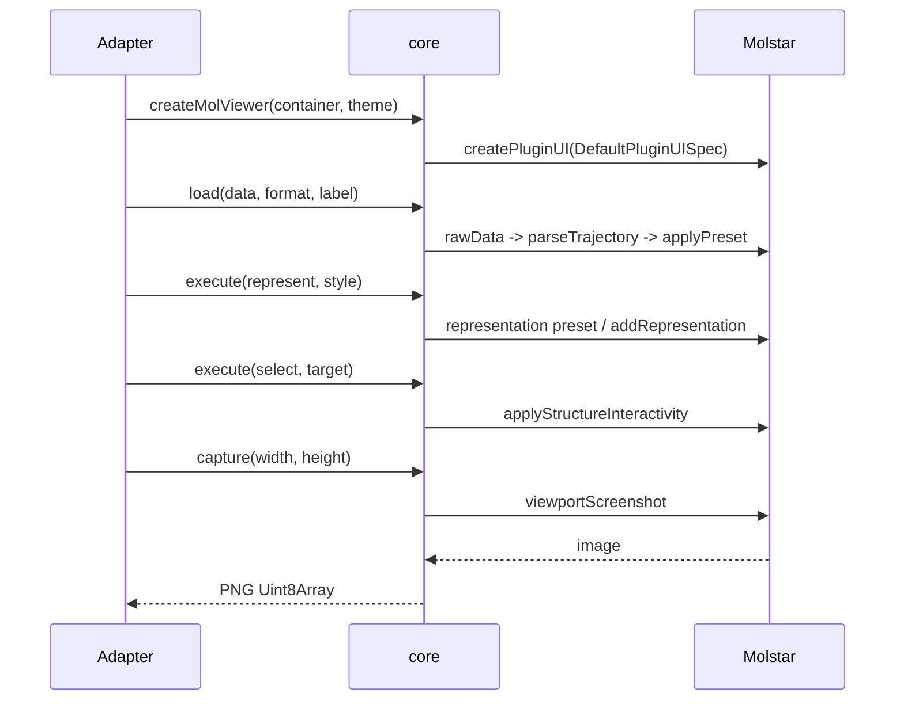

# @gcszhn/mol4agent-core

[English](README.md) | [中文](README_zh.md)

Harness-neutral molecular viewer engine. It mounts Mol*'s **official React UI**
(`createPluginUI` + `DefaultPluginUISpec`), owns the viewer lifecycle, commands,
selections, measurements, and PNG capture. It does **not** know about files,
paths, extensions, harness SDKs, sessions, or UI chrome.

```text
adapter (DSH / ChatGPT/Codex)
  |
  +-- decides that a file is a molecule and maps it to MolFormat
  +-- obtains the bytes (DSH: workspace path; ChatGPT/Codex: raw data)
  |
  v
viewer.load({ data, format, label })
  |
  v
core: createPluginUI -> Mol* state tree -> commands -> capture
```

## Boundary rules

- Input is always `StructureData { data: string | Uint8Array, format, binary?, label? }`.
- `format` is explicit; core never inspects a suffix or a MIME type.
- No filesystem, network, session, or harness package imports.
- Commands are JSON-serializable; **loading and adding structures are methods,
  not commands**, because adapter-owned bytes may not be serializable.
- `@gcszhn/mol4agent-core/parse` is pure and works in Node and the browser.
- `@gcszhn/mol4agent-core/sources` is pure too: it turns an entry id into a
  download plan (`url`, optional JSON `indexField`, format, file name). Network
  access and file writes stay in the adapter.

## Install

```sh
pnpm add @gcszhn/mol4agent-core molstar
# only when using the React binding:
pnpm add react
```

The package is published on npm as `@gcszhn/mol4agent-core@0.4.0`; inside this
monorepo, pnpm links the workspace copy instead. `molstar` and `react` are peer
dependencies. The DSH adapter bundles Mol* into a single client script; a plain
web app can use the package directly.

Build and pack:

```sh
pnpm --filter @gcszhn/mol4agent-core build
# emits lib/*.js + lib/*.d.ts
```

Package `exports` point at `lib`, and the npm `files` allowlist includes only
`lib` plus the READMEs. `src/`, `AGENTS.md`, and build scripts are not packed;
`prepack` builds first.

## Entrypoints

| Import | Exports |
|---|---|
| `@gcszhn/mol4agent-core` | `createMolViewer`, protocol types, format helpers, source helpers, `summarizeStructure`, `compileSelector`, `selectorSchema`, inspection helpers (`buildInspectResult`, `kindOfEntity`, `countCompIds`) |
| `@gcszhn/mol4agent-core/protocol` | `MOL_FORMATS`, `StructureData`, `MolCommand`, `StructureSelector`, `StructureSummary`, `InspectRequest` / `InspectResult` / `InspectTarget`, `Mol4AgentError`, `parseColor` / `formatColor` / `COLOR_SYNTAX`, and the `isMolFormat` / `isStructureData` / `isMolCommandOp` / `isPresetName` / `isInspectDetail` guards |
| `@gcszhn/mol4agent-core/parse` | `summarizeStructure`, `summarizePdbLike`, `summarizeCif`, `summarizeSdf`, `summarizeMol2`, `summarizeXyz`, `summarizeGro` |
| `@gcszhn/mol4agent-core/sources` | `SOURCE_DATABASES`, `SOURCE_DATABASE_INFO`, `resolveSource`, `normalizeSourceDb`, `readSourceIndexField`, and the `isSourceDatabase` guard |
| `@gcszhn/mol4agent-core/react` | `Mol4AgentViewer`, `Mol4AgentViewerHandle`, `Mol4AgentScene` |

## `createMolViewer`

```ts
import { createMolViewer } from '@gcszhn/mol4agent-core'

const viewer = await createMolViewer({
  container,          // HTMLElement with a real width/height
  theme: 'dark',      // 'light' | 'dark'; default dark
  background: '#101418', // optional; default follows theme
})

await viewer.load({ data: bytes, format: 'pdb', label: '1crn.pdb' })
// Optional: add a second structure and align it to the first.
await viewer.addStructure({ data: otherBytes, format: 'pdb', label: 'target.pdb' }, { id: 'target' })
await viewer.execute({ op: 'align', reference: 'structure', target: 'target', method: 'tm-align' })
await viewer.apply([
  { op: 'represent', style: { type: 'cartoon', color: 'chain-id' } },
  { op: 'select', target: { kind: 'ligand' }, mode: 'highlight', focus: true },
])
const png = await viewer.capture({ width: 1024, height: 768 })
viewer.dispose()
```

`createMolViewer` waits up to 3 s for the container to get a non-zero box, mounts
the official Mol* UI, and follows later resizes. It injects Mol*'s light/dark
stylesheet once per viewer and removes it on `dispose()`.

### `MolViewerOptions`

| Field | Type | Meaning |
|---|---|---|
| `container` | `HTMLElement` | Host element; the viewer fills it with `position:relative;width:100%;height:100%` |
| `theme` | `'light' \| 'dark'` | Initial Mol* skin and canvas background |
| `background` | `string \| number` | Optional explicit canvas background (same colour syntax as `colorParams.value`) |

### `MolViewer`

| Method | Signature | Meaning |
|---|---|---|
| `load` | `(data: StructureData, options?: { preset?: string; id?: string }) => Promise<StructureSummary>` | Replace the displayed scene. Clears previous structures, components, and measurements. Text formats passed as bytes are UTF-8 decoded; `binary` is respected. `preset` defaults to `default`; built-ins are `default`, `auto`, `illustrative`, `atomic-detail`, `polymer-and-ligand`, or an adapter-registered preset name. `id` defaults to `structure`. |
| `addStructure` | `(data: StructureData, options?: { preset?: string; id?: string }) => Promise<LoadedStructure>` | Add another structure without clearing the scene. The id must be unique; when omitted it becomes `structure-2`, `structure-3`, ... |
| `removeStructure` | `(id: string) => Promise<void>` | Remove one structure and its components |
| `listStructures` | `() => readonly LoadedStructure[]` | Structures in the scene, in load order |
| `summary` | `() => StructureSummary \| undefined` | Summary of the most recently loaded structure |
| `inspect` | `(request?: InspectRequest) => InspectResult` | Read the loaded structure and the way Mol* currently draws it; read-only, see [Inspection](#inspection) |
| `tmScore` | `(request: TmScoreRequest) => TmScoreResult` | Compute TM-align RMSD/TM-score for two selections without moving either; read-only |
| `execute` | `(command: MolCommand) => Promise<CommandResult>` | Run one command; failures are returned as `{ ok: false, code, message }` |
| `apply` | `(commands: readonly MolCommand[]) => Promise<readonly CommandResult[]>` | Run commands in order |
| `capture` | `(options?: CaptureOptions) => Promise<Uint8Array>` | Render the viewport to PNG |
| `setTheme` | `(theme: 'light' \| 'dark') => void` | Swap UI skin and canvas background without rebuilding |
| `resize` | `() => void` | Ask Mol* to re-measure the viewport |
| `diagnostics` | `() => ViewerDiagnostics` | Canvas/host sizes and Mol* hierarchy counts |
| `dispose` | `() => void` | Unmount the UI, remove styles, release Mol* |

### `ViewerDiagnostics`

```ts
{
  canvas: { width, height, clientWidth, clientHeight },
  host: { clientWidth, clientHeight },
  structures: number,       // Mol* structure hierarchy entries
  components: number,
  representations: number,
  atoms: number,            // sum of every loaded structure's summary
}
```

## Data protocol

### `StructureData`

```ts
interface StructureData {
  data: string | Uint8Array
  format: MolFormat
  binary?: boolean   // adapter override; default from the format table
  label?: string     // display only; core never derives it from a path
}
```

`MolFormat` values:

| format | Mol* parser | binary by default |
|---|---|---|
| `pdb`, `pdbqt`, `pqr` | `pdb` / `pdbqt` / `pqr` | no |
| `mmcif` | `mmcif` | no |
| `bcif` | `mmcif` | **yes** |
| `mol`, `sdf` | `mol` / `sdf` | no |
| `mol2`, `xyz`, `gro` | same name | no |

Text formats are decoded with a non-fatal UTF-8 decoder when an adapter passes
bytes. This matters for DSH: its workspace reader returns `Uint8Array` even for
`.pdb`; without decoding, Mol* would parse the PDB as a Binary data object and
produce an empty hierarchy.

## Commands

`MolCommand` is a discriminated union. All examples are JSON-serializable and
can be stored in a session log, then replayed after `load()`.

| `op` | Fields | Effect |
|---|---|---|
| `represent` | `style: StyleSpec`, optional `target`, optional `replace` | `replace` defaults to `true`: remove the current representations, then draw the new one. `target` only narrows which part the new representation covers; with `replace: true` the whole scene is still cleared first; when `target.structureId` is set, only that structure is cleared. `replace: false` keeps every existing representation and overlays the new one, on the whole structure or on `target` (a new Mol* component). For `cartoon` (or omitted `type`) core uses Mol*'s `polymer-and-ligand` preset so HETATM ligands stay visible. `quality` is accepted but not applied yet. |
| `select` | `target`, `mode?: 'select' \| 'highlight'`, `focus?` | Apply Mol* selection interactivity; `focus` moves the camera |
| `clear-selection` | `mode?` | Clear select/highlight interactivity |
| `focus` | optional `target` | Focus camera on the selection or the whole structure |
| `camera` | `action: 'reset'` | Reset the camera |
| `background` | `color: string \| number \| 'theme'` | Set the canvas background |
| `measure` | `kind: 'distance' \| 'angle' \| 'dihedral'`, `targets` 2/3/4 | Add a measurement |
| `label` | `target`, optional `text` | Add a 3D label |
| `align` | `reference`, `target`, optional `method`, `referenceChain`, `targetChain` | Superpose target onto reference; `method` is `tm-align` (default) or `sequence` |
| `remove-structure` | `structureId` | Remove one structure from the scene |
| `visibility` | `structureId`, `visible` | Show/hide one structure without removing it |

Examples:

```ts
{ op: 'represent', style: { type: 'cartoon', color: 'chain-id' } }
{ op: 'represent', style: { type: 'ball-and-stick', color: 'element-symbol' } }
{ op: 'select', target: { kind: 'ligand' }, mode: 'highlight', focus: true }
{ op: 'select', target: { kind: 'residues', chain: 'A', start: 10, end: 25 } }
{ op: 'focus', target: { kind: 'chain', chain: 'B' } }
{ op: 'camera', action: 'reset' }
{ op: 'background', color: '#101418' }
{ op: 'measure', kind: 'distance', targets: [
  { kind: 'residue', chain: 'A', index: 42 },
  { kind: 'residue', chain: 'A', index: 87 },
] }
{ op: 'label', target: { kind: 'ligand' }, text: 'ATP' }
{ op: 'align', reference: 'structure', target: 'target', method: 'tm-align', referenceChain: 'A', targetChain: 'A' }
{ op: 'visibility', structureId: 'target', visible: false }
{ op: 'remove-structure', structureId: 'target' }
```

### `StyleSpec`

```ts
{
  type?: 'cartoon' | 'ball-and-stick' | 'licorice' | 'spacefill' | 'line'
       | 'point' | 'surface' | 'gaussian-surface' | 'molecular-surface'
  color?: 'chain-id' | 'element-symbol' | 'residue-name' | 'uniform'
        | 'secondary-structure' | 'entity-id' | 'molecule-type' | 'hydrophobicity'
  colorParams?: { value?: string | number }
  quality?: 'low' | 'medium' | 'high' | 'auto' // reserved; Mol* auto quality is used
}
```

### Colours

`color` selects a Mol* colour **theme** (`chain-id`, `element-symbol`, ...).
`colorParams.value` only affects the `uniform` theme; `color: "uniform"` alone
is a theme name, not a colour.

`colorParams.value` accepts one of:

| Form | Examples |
|---|---|
| CSS colour name (case-insensitive) | `red`, `lightgrey`, `rebeccapurple` |
| Hex, optionally with alpha | `#f00`, `#ff0000`, `#ff000080`, `#f008` |
| `0x` or bare hex | `0xB0B0B0`, `B0B0B0` |
| `rgb()` / `rgba()` | `rgb(255, 0, 0)`, `rgb(100%, 0%, 0%)`, `rgba(255, 0, 0, 0.5)` |
| 24-bit integer | `16711680`, `0xff0000` |

Alpha is accepted but ignored because Mol* colours and the canvas are opaque.
The `background` command and `capture({ background })` accept the same forms
(the command additionally accepts `'theme'`). Values that cannot be parsed
return `INVALID_COMMAND` instead of silently rendering black; a successful
`represent` echoes the resolved hex, for example
`Applied cartoon / uniform #ff0000 to polymer.`

Common values: red `0xff0000`, blue `0x0000ff`, white `0xffffff`, grey
`0x808080`, light grey `0xd3d3d3`.

### `CommandResult`

```ts
type CommandResult =
  | { ok: true; op: MolCommand['op']; message?: string; data?: unknown }
  | { ok: false; op: MolCommand['op']; code: Mol4AgentErrorCode; message: string }
```

Error codes: `INVALID_COMMAND`, `UNSUPPORTED_FORMAT`, `UNSUPPORTED_REPRESENTATION`,
`REPRESENT_FAILED`, `NO_STRUCTURE`, `LOAD_FAILED`, `CAPTURE_FAILED`,
`SUMMARY_UNSUPPORTED`, `UNSUPPORTED_SOURCE`, `INVALID_ENTRY_ID`, `DISPOSED`,
`UNKNOWN_STRUCTURE`, `DUPLICATE_STRUCTURE_ID`, `ALIGN_FAILED`, `TM_SCORE_FAILED`.

## Selectors

Selectors are the stable agent-facing shape; adapters pass them through and core
compiles them to Mol* selection queries or element schemas.

| Selector | Meaning |
|---|---|
| `{ kind: 'all' }` | Every atom |
| `{ kind: 'polymer' }` | Polymer atoms |
| `{ kind: 'protein' }` | Protein polymer |
| `{ kind: 'nucleic' }` | Nucleic acid polymer |
| `{ kind: 'ligand' }` | Non-polymer ligands (ATP, HEM, ...) |
| `{ kind: 'water' }` | Water |
| `{ kind: 'ion' }` | Ions |
| `{ kind: 'chain', chain }` | One chain |
| `{ kind: 'residue', chain?, index, auth? }` | One residue; `auth` selects author numbering |
| `{ kind: 'residues', chain?, start, end, auth? }` | Inclusive residue range |
| `{ kind: 'comp', compId }` | All residues with a component id |
| `{ kind: 'schema', schema }` | Low-level subset of `StructureElement.Schema` |

Every variant accepts an optional `structureId` to target one structure in a
multi-structure scene. Omitted means "all loaded structures" for `select`/
`focus` and "the first matching structure" for `measure`/`label`; `represent`
with a `target` applies to each structure. This disambiguates two structures
that both contain chain `A`.

`schema` fields: `auth_asym_id`, `label_asym_id`, `auth_seq_id`, `label_seq_id`,
`label_comp_id`, `auth_comp_id`, `beg_auth_seq_id`, `end_auth_seq_id`,
`beg_label_seq_id`, `end_label_seq_id`, `label_atom_id`, `auth_atom_id`,
`type_symbol`.

```ts
import { compileSelector, selectorSchema } from '@gcszhn/mol4agent-core'

const compiled = compileSelector({ kind: 'ligand' })
const schema = selectorSchema({ kind: 'residues', chain: 'A', start: 10, end: 25 })
```

## Inspection

`viewer.inspect(request)` reads the loaded structure and the way Mol* currently
draws it. It is the read counterpart of `execute`: nothing changes, and unlike a
replayed command log it samples **live** state, so a selection or style a human
made by clicking or through the Mol* panel is included. In a multi-structure
scene, a selector with `structureId` inspects only that structure, and
coordinates come from the transformed (aligned) structure when one is present.

```ts
const summary = viewer.inspect()
// summary.counts → [{ compId: 'HOH', kind: 'water', residues: 103, atoms: 103 }, ...]

const residue = viewer.inspect({
  target: { kind: 'residue', chain: 'E', index: 355 },
  detail: 'atoms',
})
// residue.residueRows[0].atomRows → [{ name: 'PG', element: 'P', x: 16.223, ... }]
// residue.styles → [{ component: 'Structure', type: 'cartoon', color: 'chain-id',
//                     size: 'physical', baseColor: '#1b9e77', visibleColor: '#22bb5b',
//                     overlays: [{ source: 'selection', color: '#33ff1a', strength: 0.3 }] }]
// residue.appearance → { baseColor: '#1b9e77', visibleColor: '#22bb5b', overlays: [...] }

const selected = viewer.inspect({ target: { kind: 'selection' }, detail: 'residues' })
// selected.selection → { entries: 3, residues: 6, atoms: 74,
//                        groups: [{ residues: 4, atoms: 36 }, ...] }
```

| Request field | Meaning |
|---|---|
| `target?` | Any [selector](#selectors), or `{ kind: 'selection' }` / `{ kind: 'focus' }` for the live selection manager / the last clicked location. Defaults to the whole structure. |
| `detail?` | `summary` (default): totals, per-component counts, and styles, no rows. `residues`: additionally residue rows. `atoms`: residue rows with per-atom coordinates. |
| `limit?` | Residue-row budget, default `DEFAULT_INSPECT_LIMIT` (200). Totals and counts always cover the whole target; `truncated` says whether rows were dropped. |

`InspectResult` fields: `target`, `detail`, `atoms`, `residues`, `chains`,
`models`, `counts`, `residueRows?`, `styles`, `appearance?`, `selection?`,
`focus?`, `truncated`. `counts` is always present and always complete: it
answers "how many waters / Cys / ligands" in the default call.

Rows carry structure identity (`chain`, `seqId` = auth numbering, `labelSeqId`,
`compId`, `kind`) and the drawn centre (`x`, `y`, `z`). Atom rows add `name`,
`element`, coordinates, and `occupancy` / `bFactor` / `altId` when the format
provides them. Coordinates come from the unit conformation, so they match where
Mol* draws the atom.

Each style reports the representation type, colour theme, size theme,
colour-theme parameters, `hidden` when Mol* is not drawing it, and both colours
that matter:

| Field | Meaning |
|---|---|
| `baseColor` | The colour the representation's own theme gives the inspected element. |
| `visibleColor` | The colour actually seen: overlays applied to `baseColor`. |
| `overlays` | The overlays that apply to the inspected element. |

Overlays are resolved from live viewer state, in this precedence:

1. **overpaint** (`source: 'overpaint'`) replaces the theme colour for the
   regions a Mol* overpaint layer covers — the last covering layer wins, and a
   `clear` layer removes the paint below it;
2. **selection** (`source: 'selection'`) then mixes over the result using
   `canvas3d.props.renderer.selectColor` and `selectStrength`, matching Mol*'s
   marker shader (`#33ff1a` at strength `0.3` in the default theme). A marker
   that only outlines geometry is reported with `hidden: true` and does not
   change `visibleColor`.

`appearance` reports the same pair for the target as a whole, using the last
drawn representation. Colours are sampled at one matched element of the target,
so under `chain-id` a multi-chain target reports the first chain's colour; query
the residue itself when its exact colour matters. Per-selection transparency,
emissive, and substance layers, and script-based overpaint layers, are not
resolved yet.

`inspect` throws `Mol4AgentError` with `NO_STRUCTURE` when nothing is loaded. An
empty selection or focus is a valid empty result. Low-resolution coarse
(sphere/gaussian) units have no atom hierarchy and are not listed.

## Summaries

`summarizeStructure` parses bytes without a viewer. It is useful for `mol_info`
and for giving the model chain/residue/ligand facts before opening a heavy 3D
viewer. It works in Node and the browser.

```ts
import { summarizeStructure } from '@gcszhn/mol4agent-core/parse'

const summary = summarizeStructure({ data: pdbText, format: 'pdb', label: '1atp.pdb' })
// { atomCount, residueCount, modelCount, chains, ligands, complete, ... }
```

`StructureSummary`:

```ts
{
  format: MolFormat
  label?: string
  title?: string
  atomCount: number
  residueCount: number
  modelCount: number
  chains: { id, kind, atoms, residues, compIds }[]
  ligands: { compId, count }[]
  complete: boolean   // false only for a viewer fallback summary; summarizeStructure throws for BCIF
}
```

BCIF can be rendered but not summarized from raw bytes yet; `summarizeStructure`
throws `SUMMARY_UNSUPPORTED`. A post-load viewer fallback may still expose
`complete: false`.

## Database sources

`mol_fetch` starts from an entry id instead of a local file. Core validates the
id and returns a download plan; it never performs the request or writes a file.
Adapters execute the plan with their own HTTPS and filesystem APIs.

```ts
import { resolveSource } from '@gcszhn/mol4agent-core/sources'

resolveSource({ entryId: '1crn' })
// { sourceDb: 'rcsb-pdb', entryId: '1CRN', format: 'pdb',
//   fileName: '1CRN.pdb',
//   plan: { url: 'https://files.rcsb.org/download/1CRN.pdb' },
//   description: 'RCSB PDB entry 1CRN (PDB format)' }

resolveSource({ entryId: 'P00533', sourceDb: 'alphafold' })
// plan: { url: 'https://alphafold.ebi.ac.uk/api/prediction/P00533',
//         indexField: '0.pdbUrl' }
```

| `source_db` | `entry_id` | Format |
|---|---|---|
| `rcsb-pdb` (default) | 4-character PDB id (`1crn`) | `pdb` |
| `rcsb-cif` | 4-character PDB id (`1crn`) | `mmcif` |
| `rcsb-bcif` | 4-character PDB id (`1crn`) | `bcif` |
| `alphafold` | UniProt accession (`P00533`) | `pdb` |
| `pubchem` | CID (`2244`) or compound name (`aspirin`) | `sdf` |
| `chembl` | `CHEMBL25`, or a bare number (`25`) | `sdf` |

`plan.indexField` marks a JSON index document: the adapter reads that dot path
and downloads the URL it names. AlphaFold file names are versioned, so
`0.pdbUrl` skips the API's array wrapper and selects the current PDB URL. Use
`readSourceIndexField(payload, field)` for that lookup.

`SOURCE_DATABASE_INFO` supplies the label, description, entry hint, and format
for tool descriptions. `normalizeSourceDb` enforces the closed list, and invalid
ids raise `Mol4AgentError` with `UNSUPPORTED_SOURCE` or `INVALID_ENTRY_ID`.

## Capture

```ts
const png = await viewer.capture({
  width: 1024,       // optional; default 1024
  height: 768,       // optional; default 768
  transparent: true, // optional
  background: '#101418', // optional; colour names and integers also work
})
```

`capture` uses Mol*'s viewport screenshot helper. Width/height default to
1024×768. A failed render rejects with `CAPTURE_FAILED`.

`measure` and `label` accept `chain`, `residue`, `residues`, `comp`, or `schema`
selectors; semantic categories such as `ligand`/`protein` cannot be converted to
a single atom position and return `INVALID_COMMAND`.

Overlay a selection with `replace: false`:

```ts
// gray cartoon for the rest
{ op: 'represent', style: { type: 'cartoon', color: 'uniform', colorParams: { value: 0x808080 } } }
// red sticks for one interface range, keeping the cartoon
{ op: 'represent',
  style: { type: 'ball-and-stick', color: 'uniform', colorParams: { value: 0xff0000 } },
  target: { kind: 'residues', chain: 'A', start: 28, end: 54 },
  replace: false }
```

A global `cartoon` uses the `polymer-and-ligand` preset; `colorParams` is passed
through its theme so `uniform` colors work. A targeted `represent` with
`replace: false` creates a separate selection component and leaves the rest of
the scene untouched. Without `replace: false` a targeted `represent` replaces
the scene like any other command, so the target only limits the new
representation's coverage.

## React binding

```tsx
import { Mol4AgentViewer } from '@gcszhn/mol4agent-core/react'

<Mol4AgentViewer
  scene={{ data, commands }}
  theme="dark"
  onViewer={viewer => { /* keep for capture */ }}
  style={{ height: 600 }}
/>
```

The component owns the viewer lifecycle. **Memoize `scene`**; changing the object
reloads the structure and replays commands. The DSH adapter chooses not to use
this binding because it needs session-projection fidelity, per-tab caching, and a
custom capture path.

## Internal flow



## Status

- `protocol`, `formats`, `parse/*`, `sources`, `viewer`, `select`, `react` are
  implemented and typechecked.
- Verified in headless Chrome + SwiftShader with real 1CRN PDB/CIF, 1ATP, and a
  PubChem aspirin SDF: official UI, load, cartoon/polymer-and-ligand, ligand
  highlight, focus, and PNG capture.
- The DSH adapter bundles core into one client script; see
  [`packages/deepseek-harness`](../deepseek-harness).

## TM-score and RMSD

`tmScore()` compares two selections without changing the scene. It is useful
for scoring chains or regions that were never aligned, or for a read-only check
after an alignment.

```ts
const score = viewer.tmScore({
  reference: { kind: 'chain', chain: 'B', structureId: 'reference' },
  target: { kind: 'chain', chain: 'A', structureId: 'target' },
})
// { method: 'tm-align', rmsd, tmScoreA, tmScoreB, alignedLength,
//   referenceAtoms, targetAtoms, reference, target }
```

Both selections are reduced to polymer trace atoms (CA/C4'/P). `rmsd` is
measured after TM-align's optimal superposition of the aligned trace atoms, not
in the current camera frame. This is the structure-level `tmAlign` wrapper from
Mol* (`mol-model/structure/structure/util/tm-align`), not a separate
reimplementation; no transform is applied to the viewer.

## Multiple structures and alignment

`load()` starts a fresh scene; `addStructure()` appends another structure to the
same Mol* scene. Every structure keeps its own id, components, representations,
visibility, and measurements.

```ts
await viewer.load({ data: referenceBytes, format: 'pdb', label: '7czd.pdb' }, { id: 'reference' })
await viewer.addStructure({ data: targetBytes, format: 'pdb', label: '4zqk.pdb' }, { id: 'target' })
await viewer.execute({
  op: 'represent',
  style: { type: 'cartoon', color: 'uniform', colorParams: { value: 0xef4444 } },
  target: { kind: 'all', structureId: 'target' },
})
const aligned = await viewer.execute({
  op: 'align',
  reference: 'reference',
  target: 'target',
  method: 'tm-align',
  referenceChain: 'B',
  targetChain: 'A',
})
// aligned.data: { method, rmsd, alignedLength, tmScoreA, tmScoreB }
```

Both methods use Mol*'s own superposition utilities
(`mol-model/structure/structure/util/{superposition,tm-align}`) and its
`TransformStructureConformation` decorator; no alignment or rendering engine is
reimplemented here. Alignment moves the target using the polymer trace (CA/C4'/P),
leaves the reference fixed, and frames the aligned pair. When the reference is already transformed, its
displayed coordinate system is composed into the target transform.

See [`docs/architecture.md`](../../docs/architecture.md) for the overall
architecture; implementation details live in this package's README/AGENTS and
in [`packages/deepseek-harness/README.md`](../deepseek-harness/README.md) for
DSH.
