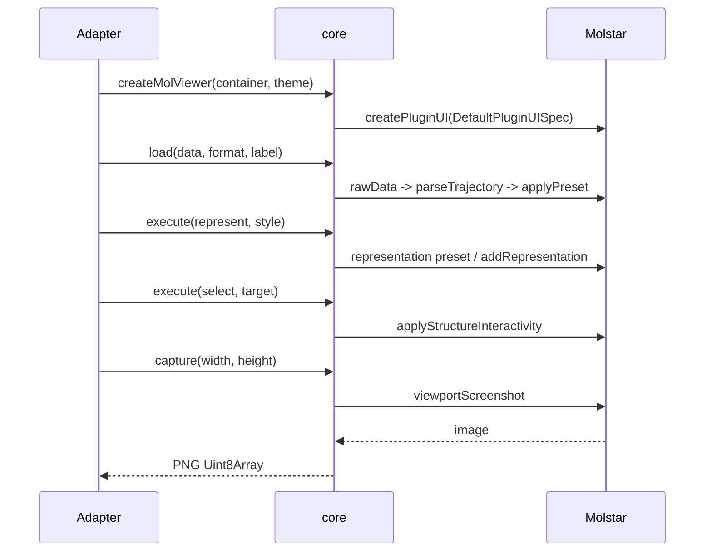

# @gcszhn/mol4agent-core

[English](README.md) | [中文](README_zh.md)

Harness-neutral molecular viewer engine. It mounts Mol*'s **official React UI**
(`createPluginUI` + `DefaultPluginUISpec`), owns the viewer lifecycle, commands,
selections, measurements, and PNG capture. It does **not** know about files,
paths, extensions, harness SDKs, sessions, or UI chrome.

```text
adapter (DSH / ChatGPT/Codex)
  |
  +-- decides that a file is a molecule and maps it to MolFormat
  +-- obtains the bytes (DSH: workspace path; ChatGPT/Codex: raw data)
  |
  v
viewer.load({ data, format, label })
  |
  v
core: createPluginUI -> Mol* state tree -> commands -> capture
```

## Boundary rules

- Input is always `StructureData { data: string | Uint8Array, format, binary?, label? }`.
- `format` is explicit; core never inspects a suffix or a MIME type.
- No filesystem, network, session, or harness package imports.
- Commands are JSON-serializable; **loading is a method, not a command**, because
  adapter-owned bytes may not be serializable.
- `@gcszhn/mol4agent-core/parse` is pure and works in Node and the browser.

## Install

```sh
pnpm add @gcszhn/mol4agent-core molstar
# only when using the React binding:
pnpm add react
```

The package is not published to npm yet; from this monorepo use the workspace
link. The command above applies once `0.1.0` is published. `molstar` and `react`
are peer dependencies. The DSH adapter bundles Mol* into a single client script;
a plain web app can use the package directly.

Build and pack:

```sh
pnpm --filter @gcszhn/mol4agent-core build
# emits lib/*.js + lib/*.d.ts
```

Package `exports` point at `lib`, and the npm `files` allowlist includes only
`lib` plus the READMEs. `src/`, `AGENTS.md`, and build scripts are not packed;
`prepack` builds first.

## Entrypoints

| Import | Exports |
|---|---|
| `@gcszhn/mol4agent-core` | `createMolViewer`, protocol types, format helpers, `summarizeStructure`, `compileSelector`, `selectorSchema` |
| `@gcszhn/mol4agent-core/protocol` | `MOL_FORMATS`, `StructureData`, `MolCommand`, `StructureSelector`, `StructureSummary`, `Mol4AgentError`, and the `isMolFormat` / `isStructureData` / `isMolCommandOp` / `isPresetName` guards |
| `@gcszhn/mol4agent-core/parse` | `summarizeStructure`, `summarizePdbLike`, `summarizeCif`, `summarizeSdf`, `summarizeMol2`, `summarizeXyz`, `summarizeGro` |
| `@gcszhn/mol4agent-core/react` | `Mol4AgentViewer`, `Mol4AgentViewerHandle`, `Mol4AgentScene` |

## `createMolViewer`

```ts
import { createMolViewer } from '@gcszhn/mol4agent-core'

const viewer = await createMolViewer({
  container,          // HTMLElement with a real width/height
  theme: 'dark',      // 'light' | 'dark'; default dark
  background: '#101418', // optional; default follows theme
})

await viewer.load({ data: bytes, format: 'pdb', label: '1crn.pdb' })
await viewer.apply([
  { op: 'represent', style: { type: 'cartoon', color: 'chain-id' } },
  { op: 'select', target: { kind: 'ligand' }, mode: 'highlight', focus: true },
])
const png = await viewer.capture({ width: 1024, height: 768 })
viewer.dispose()
```

`createMolViewer` waits up to 3 s for the container to get a non-zero box, mounts
the official Mol* UI, and follows later resizes. It injects Mol*'s light/dark
stylesheet once per viewer and removes it on `dispose()`.

### `MolViewerOptions`

| Field | Type | Meaning |
|---|---|---|
| `container` | `HTMLElement` | Host element; the viewer fills it with `position:relative;width:100%;height:100%` |
| `theme` | `'light' \| 'dark'` | Initial Mol* skin and canvas background |
| `background` | `string` | Optional explicit canvas background |

### `MolViewer`

| Method | Signature | Meaning |
|---|---|---|
| `load` | `(data: StructureData, options?: { preset?: string }) => Promise<StructureSummary>` | Replace the displayed structure. Text formats passed as bytes are UTF-8 decoded; `binary` is respected. `preset` defaults to `default`; built-ins are `default`, `auto`, `illustrative`, `atomic-detail`, `polymer-and-ligand`, or an adapter-registered preset name. |
| `summary` | `() => StructureSummary \| undefined` | Summary of the current structure, when loaded |
| `execute` | `(command: MolCommand) => Promise<CommandResult>` | Run one command; failures are returned as `{ ok: false, code, message }` |
| `apply` | `(commands: readonly MolCommand[]) => Promise<readonly CommandResult[]>` | Run commands in order |
| `capture` | `(options?: CaptureOptions) => Promise<Uint8Array>` | Render the viewport to PNG |
| `setTheme` | `(theme: 'light' \| 'dark') => void` | Swap UI skin and canvas background without rebuilding |
| `resize` | `() => void` | Ask Mol* to re-measure the viewport |
| `diagnostics` | `() => ViewerDiagnostics` | Canvas/host sizes and Mol* hierarchy counts |
| `dispose` | `() => void` | Unmount the UI, remove styles, release Mol* |

### `ViewerDiagnostics`

```ts
{
  canvas: { width, height, clientWidth, clientHeight },
  host: { clientWidth, clientHeight },
  structures: number,
  components: number,
  representations: number,
  atoms: number,
}
```

## Data protocol

### `StructureData`

```ts
interface StructureData {
  data: string | Uint8Array
  format: MolFormat
  binary?: boolean   // adapter override; default from the format table
  label?: string     // display only; core never derives it from a path
}
```

`MolFormat` values:

| format | Mol* parser | binary by default |
|---|---|---|
| `pdb`, `pdbqt`, `pqr` | `pdb` / `pdbqt` / `pqr` | no |
| `mmcif` | `mmcif` | no |
| `bcif` | `mmcif` | **yes** |
| `mol`, `sdf` | `mol` / `sdf` | no |
| `mol2`, `xyz`, `gro` | same name | no |

Text formats are decoded with a non-fatal UTF-8 decoder when an adapter passes
bytes. This matters for DSH: its workspace reader returns `Uint8Array` even for
`.pdb`; without decoding, Mol* would parse the PDB as a Binary data object and
produce an empty hierarchy.

## Commands

`MolCommand` is a discriminated union. All examples are JSON-serializable and
can be stored in a session log, then replayed after `load()`.

| `op` | Fields | Effect |
|---|---|---|
| `represent` | `style: StyleSpec`, optional `target` | Without `target`, replace the scene representation. For `cartoon` (or omitted `type`) core uses Mol*'s `polymer-and-ligand` preset so HETATM ligands stay visible. With `target`, add the representation only to that selection (a new Mol* component), leaving the rest untouched. `quality` is accepted but not applied yet. |
| `select` | `target`, `mode?: 'select' \| 'highlight'`, `focus?` | Apply Mol* selection interactivity; `focus` moves the camera |
| `clear-selection` | `mode?` | Clear select/highlight interactivity |
| `focus` | optional `target` | Focus camera on the selection or the whole structure |
| `camera` | `action: 'reset'` | Reset the camera |
| `background` | `color: string \| 'theme'` | Set the canvas background |
| `measure` | `kind: 'distance' \| 'angle' \| 'dihedral'`, `targets` 2/3/4 | Add a measurement |
| `label` | `target`, optional `text` | Add a 3D label |

Examples:

```ts
{ op: 'represent', style: { type: 'cartoon', color: 'chain-id' } }
{ op: 'represent', style: { type: 'ball-and-stick', color: 'element-symbol' } }
{ op: 'select', target: { kind: 'ligand' }, mode: 'highlight', focus: true }
{ op: 'select', target: { kind: 'residues', chain: 'A', start: 10, end: 25 } }
{ op: 'focus', target: { kind: 'chain', chain: 'B' } }
{ op: 'camera', action: 'reset' }
{ op: 'background', color: '#101418' }
{ op: 'measure', kind: 'distance', targets: [
  { kind: 'residue', chain: 'A', index: 42 },
  { kind: 'residue', chain: 'A', index: 87 },
] }
{ op: 'label', target: { kind: 'ligand' }, text: 'ATP' }
```

### `StyleSpec`

```ts
{
  type?: 'cartoon' | 'ball-and-stick' | 'licorice' | 'spacefill' | 'line'
       | 'point' | 'surface' | 'gaussian-surface' | 'molecular-surface'
  color?: 'chain-id' | 'element-symbol' | 'residue-name' | 'uniform'
        | 'secondary-structure' | 'entity-id' | 'molecule-type' | 'hydrophobicity'
  colorParams?: { value?: string | number }
  quality?: 'low' | 'medium' | 'high' | 'auto' // reserved; Mol* auto quality is used
}
```

### `CommandResult`

```ts
type CommandResult =
  | { ok: true; op: MolCommand['op']; message?: string; data?: unknown }
  | { ok: false; op: MolCommand['op']; code: Mol4AgentErrorCode; message: string }
```

Error codes: `INVALID_COMMAND`, `UNSUPPORTED_FORMAT`, `UNSUPPORTED_REPRESENTATION`,
`REPRESENT_FAILED`, `NO_STRUCTURE`, `LOAD_FAILED`, `CAPTURE_FAILED`,
`SUMMARY_UNSUPPORTED`, `DISPOSED`.

## Selectors

Selectors are the stable agent-facing shape; adapters pass them through and core
compiles them to Mol* selection queries or element schemas.

| Selector | Meaning |
|---|---|
| `{ kind: 'all' }` | Every atom |
| `{ kind: 'polymer' }` | Polymer atoms |
| `{ kind: 'protein' }` | Protein polymer |
| `{ kind: 'nucleic' }` | Nucleic acid polymer |
| `{ kind: 'ligand' }` | Non-polymer ligands (ATP, HEM, ...) |
| `{ kind: 'water' }` | Water |
| `{ kind: 'ion' }` | Ions |
| `{ kind: 'chain', chain }` | One chain |
| `{ kind: 'residue', chain?, index, auth? }` | One residue; `auth` selects author numbering |
| `{ kind: 'residues', chain?, start, end, auth? }` | Inclusive residue range |
| `{ kind: 'comp', compId }` | All residues with a component id |
| `{ kind: 'schema', schema }` | Low-level subset of `StructureElement.Schema` |

`schema` fields: `auth_asym_id`, `label_asym_id`, `auth_seq_id`, `label_seq_id`,
`label_comp_id`, `auth_comp_id`, `beg_auth_seq_id`, `end_auth_seq_id`,
`beg_label_seq_id`, `end_label_seq_id`, `label_atom_id`, `auth_atom_id`,
`type_symbol`.

```ts
import { compileSelector, selectorSchema } from '@gcszhn/mol4agent-core'

const compiled = compileSelector({ kind: 'ligand' })
const schema = selectorSchema({ kind: 'residues', chain: 'A', start: 10, end: 25 })
```

## Summaries

`summarizeStructure` parses bytes without a viewer. It is useful for `mol_info`
and for giving the model chain/residue/ligand facts before opening a heavy 3D
viewer. It works in Node and the browser.

```ts
import { summarizeStructure } from '@gcszhn/mol4agent-core/parse'

const summary = summarizeStructure({ data: pdbText, format: 'pdb', label: '1atp.pdb' })
// { atomCount, residueCount, modelCount, chains, ligands, complete, ... }
```

`StructureSummary`:

```ts
{
  format: MolFormat
  label?: string
  title?: string
  atomCount: number
  residueCount: number
  modelCount: number
  chains: { id, kind, atoms, residues, compIds }[]
  ligands: { compId, count }[]
  complete: boolean   // false only for a viewer fallback summary; summarizeStructure throws for BCIF
}
```

BCIF can be rendered but not summarized from raw bytes yet; `summarizeStructure`
throws `SUMMARY_UNSUPPORTED`. A post-load viewer fallback may still expose
`complete: false`.

## Capture

```ts
const png = await viewer.capture({
  width: 1024,       // optional; default 1024
  height: 768,       // optional; default 768
  transparent: true, // optional
  background: '#101418', // optional
})
```

`capture` uses Mol*'s viewport screenshot helper. Width/height default to
1024×768. A failed render rejects with `CAPTURE_FAILED`.

`measure` and `label` accept `chain`, `residue`, `residues`, `comp`, or `schema`
selectors; semantic categories such as `ligand`/`protein` cannot be converted to
a single atom position and return `INVALID_COMMAND`.

Per-selection styling is additive:

```ts
// gray cartoon for the rest
{ op: 'represent', style: { type: 'cartoon', color: 'uniform', colorParams: { value: 0x808080 } } }
// red sticks for one interface range
{ op: 'represent',
  style: { type: 'ball-and-stick', color: 'uniform', colorParams: { value: 0xff0000 } },
  target: { kind: 'residues', chain: 'A', start: 28, end: 54 } }
```

A global `cartoon` uses the `polymer-and-ligand` preset; `colorParams` is passed
through its theme so `uniform` colors work. A targeted `represent` creates a
separate selection component and does not remove other representations.

## React binding

```tsx
import { Mol4AgentViewer } from '@gcszhn/mol4agent-core/react'

<Mol4AgentViewer
  scene={{ data, commands }}
  theme="dark"
  onViewer={viewer => { /* keep for capture */ }}
  style={{ height: 600 }}
/>
```

The component owns the viewer lifecycle. **Memoize `scene`**; changing the object
reloads the structure and replays commands. The DSH adapter chooses not to use
this binding because it needs session-projection fidelity, per-tab caching, and a
custom capture path.

## Internal flow



## Status

- `protocol`, `formats`, `parse/*`, `viewer`, `select`, `react` are implemented
  and typechecked.
- Verified in headless Chrome + SwiftShader with real 1CRN PDB/CIF, 1ATP, and a
  PubChem aspirin SDF: official UI, load, cartoon/polymer-and-ligand, ligand
  highlight, focus, and PNG capture.
- The DSH adapter bundles core into one client script; see
  [`packages/deepseek-harness`](../deepseek-harness).

See [`docs/architecture.md`](../../docs/architecture.md) for the overall
architecture; implementation details live in this package's README/AGENTS and
in [`packages/deepseek-harness/README.md`](../deepseek-harness/README.md) for
DSH.
