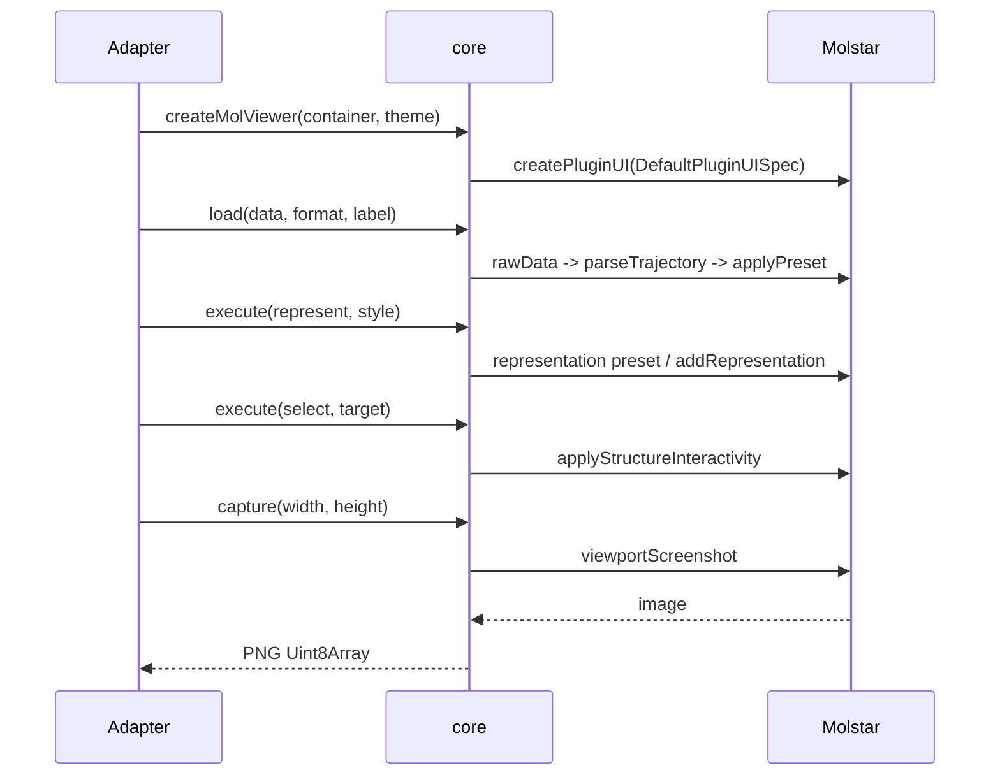

# @gcszhn/mol4agent-core

[English](README.md) | 中文

与 harness 无关的分子查看引擎。它挂载 Mol* 的**官方 React UI**
（`createPluginUI` + `DefaultPluginUISpec`），负责 viewer 生命周期、命令、
选择、测量和 PNG 截图。它**不知道**文件、路径、扩展名、harness SDK、
session 或 UI chrome 的存在。

```text
adapter (DSH / ChatGPT/Codex)
  |
  +-- 判断这是不是分子文件，并映射成 MolFormat
  +-- 取得字节（DSH：工作区路径；ChatGPT/Codex：raw data）
  |
  v
viewer.load({ data, format, label })
  |
  v
core: createPluginUI -> Mol* state tree -> commands -> capture
```

## 边界规则

- 输入永远是 `StructureData { data: string | Uint8Array, format, binary?, label? }`。
- `format` 显式给出；core 从不检查后缀或 MIME。
- 不引用文件系统、网络、session 或任何 harness 包。
- 命令是 JSON 可序列化的；**加载是方法，不是命令**，因为适配包持有的字节
  不一定可序列化。
- `@gcszhn/mol4agent-core/parse` 是纯函数，Node 和浏览器都能用。

## 安装

```sh
pnpm add @gcszhn/mol4agent-core molstar
# 只有使用 React 绑定时才需要：
pnpm add react
```

`molstar` 和 `react` 是 peer dependencies。DSH 适配包把 Mol* 打进单个
client bundle；普通 web 应用可以直接使用本包。

构建与打包：

```sh
pnpm --filter @gcszhn/mol4agent-core build
# 产出 lib/*.js + lib/*.d.ts
```

Package `exports` 指向 `lib`，npm `files` 只包含 `lib` 和 README；`src/`、
`AGENTS.md` 和构建脚本不会被打包；`prepack` 会先构建。

## 入口

| Import | 导出 |
|---|---|
| `@gcszhn/mol4agent-core` | `createMolViewer`、协议类型、format 辅助函数、`summarizeStructure`、`compileSelector`、`selectorSchema` |
| `@gcszhn/mol4agent-core/protocol` | `MOL_FORMATS`、`StructureData`、`MolCommand`、`StructureSelector`、`StructureSummary`、`Mol4AgentError`、`COMMAND_OPS` 辅助函数 |
| `@gcszhn/mol4agent-core/parse` | `summarizeStructure`、`summarizePdbLike`、`summarizeCif`、`summarizeSdf`、`summarizeMol2`、`summarizeXyz`、`summarizeGro` |
| `@gcszhn/mol4agent-core/react` | `Mol4AgentViewer`、`Mol4AgentViewerHandle`、`Mol4AgentScene` |

## `createMolViewer`

```ts
import { createMolViewer } from '@gcszhn/mol4agent-core'

const viewer = await createMolViewer({
  container,          // 有真实宽高的 HTMLElement
  theme: 'dark',      // 'light' | 'dark'；默认 dark
  background: '#101418', // 可选；默认跟随主题
  onError: error => console.error(error),
})

await viewer.load({ data: bytes, format: 'pdb', label: '1crn.pdb' })
await viewer.apply([
  { op: 'represent', style: { type: 'cartoon', color: 'chain-id' } },
  { op: 'select', target: { kind: 'ligand' }, mode: 'highlight', focus: true },
])
const png = await viewer.capture({ width: 1024, height: 768 })
viewer.dispose()
```

`createMolViewer` 最多等待容器 3 秒拿到非零尺寸，挂载 Mol* 官方 UI，并
跟随后续 resize。每个 viewer 注入一次 Mol* light/dark 样式表，`dispose()`
时移除。

### `MolViewerOptions`

| 字段 | 类型 | 含义 |
|---|---|---|
| `container` | `HTMLElement` | 宿主元素；viewer 用 `position:relative;width:100%;height:100%` 填满 |
| `theme` | `'light' \| 'dark'` | 初始 Mol* 皮肤和画布背景 |
| `background` | `string` | 可选，显式指定画布背景 |
| `onError` | `(error: unknown) => void` | 可选的内部错误回调 |

### `MolViewer`

| 方法 | 签名 | 含义 |
|---|---|---|
| `load` | `(data: StructureData, options?: { preset?: string }) => Promise<StructureSummary>` | 替换当前结构。文本 format 以字节传入时会做 UTF-8 解码；`binary` 会被尊重。`preset` 默认 `default`；内置值有 `default`、`auto`、`illustrative`、`atomic-detail`、`polymer-and-ligand`，也可以传适配包注册的自定义 preset 名。 |
| `summary` | `() => StructureSummary \| undefined` | 当前结构的摘要（若已加载） |
| `execute` | `(command: MolCommand) => Promise<CommandResult>` | 执行一条命令；失败返回 `{ ok: false, code, message }` |
| `apply` | `(commands: readonly MolCommand[]) => Promise<readonly CommandResult[]>` | 按顺序执行多条命令 |
| `capture` | `(options?: CaptureOptions) => Promise<Uint8Array>` | 把当前视图渲染成 PNG |
| `setTheme` | `(theme: 'light' \| 'dark') => void` | 切换 UI 皮肤和画布背景，不重建 viewer |
| `resize` | `() => void` | 让 Mol* 重新测量视口 |
| `diagnostics` | `() => ViewerDiagnostics` | 画布/宿主尺寸与 Mol* 层级计数 |
| `dispose` | `() => void` | 卸载 UI、移除样式、释放 Mol* |

### `ViewerDiagnostics`

```ts
{
  canvas: { width, height, clientWidth, clientHeight },
  host: { clientWidth, clientHeight },
  structures: number,
  components: number,
  representations: number,
  atoms: number,
}
```

## 数据协议

### `StructureData`

```ts
interface StructureData {
  data: string | Uint8Array
  format: MolFormat
  binary?: boolean   // 适配包覆盖；默认取 format 表
  label?: string     // 只用于显示；core 不会从路径推导
}
```

`MolFormat` 取值：

| format | Mol* parser | 默认 binary |
|---|---|---|
| `pdb`, `pdbqt`, `pqr` | `pdb` / `pdbqt` / `pqr` | 否 |
| `mmcif` | `mmcif` | 否 |
| `bcif` | `mmcif` | **是** |
| `mol`, `sdf` | `mol` / `sdf` | 否 |
| `mol2`, `xyz`, `gro` | 同名 | 否 |

当适配包把文本 format 以字节传入时，core 会用非 fatal 的 UTF-8 解码。
这对 DSH 很关键：它的工作区读取器即使读 `.pdb` 也返回 `Uint8Array`；
不先解码的话，Mol* 会把 PDB 当成 Binary 数据对象，建出空的层级。

## 命令

`MolCommand` 是 discriminated union。下面所有例子都是 JSON 可序列化的，
可以存进 session log，在 `load()` 之后重放。

| `op` | 字段 | 效果 |
|---|---|---|
| `represent` | `style: StyleSpec`，可选 `target` | 不传 `target` 时替换整个场景的表示。`type` 为 `cartoon` 或省略时，core 用 Mol* 的 `polymer-and-ligand` preset，保证 HETATM 配体仍然可见。传 `target` 时只为该选择添加表示（新建 Mol* component），其余保持不变。`quality` 协议里有字段，但目前尚未生效。 |
| `select` | `target`，`mode?: 'select' \| 'highlight'`，`focus?` | 应用 Mol* 选择交互；`focus` 会移动镜头 |
| `clear-selection` | `mode?` | 清除 select/highlight 交互 |
| `focus` | 可选 `target` | 聚焦选择或整个结构 |
| `camera` | `action: 'reset'` | 重置镜头 |
| `background` | `color: string \| 'theme'` | 设置画布背景 |
| `measure` | `kind: 'distance' \| 'angle' \| 'dihedral'`，`targets` 2/3/4 个 | 添加测量 |
| `label` | `target`，可选 `text` | 添加 3D 标签 |

示例：

```ts
{ op: 'represent', style: { type: 'cartoon', color: 'chain-id' } }
{ op: 'represent', style: { type: 'ball-and-stick', color: 'element-symbol' } }
{ op: 'select', target: { kind: 'ligand' }, mode: 'highlight', focus: true }
{ op: 'select', target: { kind: 'residues', chain: 'A', start: 10, end: 25 } }
{ op: 'focus', target: { kind: 'chain', chain: 'B' } }
{ op: 'camera', action: 'reset' }
{ op: 'background', color: '#101418' }
{ op: 'measure', kind: 'distance', targets: [
  { kind: 'residue', chain: 'A', index: 42 },
  { kind: 'residue', chain: 'A', index: 87 },
] }
{ op: 'label', target: { kind: 'ligand' }, text: 'ATP' }
```

### `StyleSpec`

```ts
{
  type?: 'cartoon' | 'ball-and-stick' | 'licorice' | 'spacefill' | 'line'
       | 'point' | 'surface' | 'gaussian-surface' | 'molecular-surface'
  color?: 'chain-id' | 'element-symbol' | 'residue-name' | 'uniform'
        | 'secondary-structure' | 'entity-id' | 'molecule-type' | 'hydrophobicity'
  colorParams?: { value?: string | number }
  quality?: 'low' | 'medium' | 'high' | 'auto' // 预留；当前使用 Mol* auto quality
}
```

### `CommandResult`

```ts
type CommandResult =
  | { ok: true; op: MolCommand['op']; message?: string; data?: unknown }
  | { ok: false; op: MolCommand['op']; code: Mol4AgentErrorCode; message: string }
```

错误码：`INVALID_COMMAND`、`UNSUPPORTED_FORMAT`、`UNSUPPORTED_REPRESENTATION`、
`REPRESENT_FAILED`、`NO_STRUCTURE`、`LOAD_FAILED`、`CAPTURE_FAILED`、
`SUMMARY_UNSUPPORTED`、`DISPOSED`。

## 选择器

选择器是稳定的 agent 接口；适配包原样传递，core 编译成 Mol* 的 selection
query 或 element schema。

| 选择器 | 含义 |
|---|---|
| `{ kind: 'all' }` | 所有原子 |
| `{ kind: 'polymer' }` | 聚合物原子 |
| `{ kind: 'protein' }` | 蛋白质聚合物 |
| `{ kind: 'nucleic' }` | 核酸聚合物 |
| `{ kind: 'ligand' }` | 非聚合物配体（ATP、HEM 等） |
| `{ kind: 'water' }` | 水 |
| `{ kind: 'ion' }` | 离子 |
| `{ kind: 'chain', chain }` | 一条链 |
| `{ kind: 'residue', chain?, index, auth? }` | 一个残基；`auth` 使用 author 编号 |
| `{ kind: 'residues', chain?, start, end, auth? }` | 闭区间残基范围 |
| `{ kind: 'comp', compId }` | 指定 component id 的所有残基 |
| `{ kind: 'schema', schema }` | 底层 `StructureElement.Schema` 子集 |

`schema` 字段：`auth_asym_id`、`label_asym_id`、`auth_seq_id`、`label_seq_id`、
`label_comp_id`、`auth_comp_id`、`beg_auth_seq_id`、`end_auth_seq_id`、
`beg_label_seq_id`、`end_label_seq_id`、`label_atom_id`、`auth_atom_id`、
`type_symbol`。

```ts
import { compileSelector, selectorSchema } from '@gcszhn/mol4agent-core'

const compiled = compileSelector({ kind: 'ligand' })
const schema = selectorSchema({ kind: 'residues', chain: 'A', start: 10, end: 25 })
```

## 摘要

`summarizeStructure` 不需要 viewer，直接从字节解析，适合 `mol_info` 或在
打开重型 3D viewer 前给模型 chain/residue/ligand 事实。Node 和浏览器都能用。

```ts
import { summarizeStructure } from '@gcszhn/mol4agent-core/parse'

const summary = summarizeStructure({ data: pdbText, format: 'pdb', label: '1atp.pdb' })
// { atomCount, residueCount, modelCount, chains, ligands, complete, ... }
```

`StructureSummary`：

```ts
{
  format: MolFormat
  label?: string
  title?: string
  atomCount: number
  residueCount: number
  modelCount: number
  chains: { id, kind, atoms, residues, compIds }[]
  ligands: { compId, count }[]
  complete: boolean   // 字节无法完整摘要时为 false（例如 BCIF）
}
```

BCIF 可以渲染，但目前不能从 raw bytes 摘要；会抛
`SUMMARY_UNSUPPORTED`。

## 截图

```ts
const png = await viewer.capture({
  width: 1024,       // 可选；默认 1024
  height: 768,       // 可选；默认 768
  transparent: true, // 可选
  background: '#101418', // 可选
})
```

`capture` 使用 Mol* 的 viewport screenshot helper。宽高默认 1024×768。
渲染失败会以 `CAPTURE_FAILED` 拒绝。

`measure` 和 `label` 只接受 `chain`、`residue`、`residues`、`comp` 或
`schema` 选择器；`ligand`/`protein` 这类语义类别无法转换成单个原子位置，
会返回 `INVALID_COMMAND`。

按选择着色是叠加的：

```ts
// 其余区域：灰色卡通
{ op: 'represent', style: { type: 'cartoon', color: 'uniform', colorParams: { value: 0x808080 } } }
// 某段界面残基：红色球棍
{ op: 'represent',
  style: { type: 'ball-and-stick', color: 'uniform', colorParams: { value: 0xff0000 } },
  target: { kind: 'residues', chain: 'A', start: 28, end: 54 } }
```

全局 `cartoon` 使用 `polymer-and-ligand` preset；`colorParams` 会传入它的
theme，所以 `uniform` 颜色可用。带 `target` 的 `represent` 会创建独立的
selection component，不会删除其他表示。

## React 绑定

```tsx
import { Mol4AgentViewer } from '@gcszhn/mol4agent-core/react'

<Mol4AgentViewer
  scene={{ data, commands }}
  theme="dark"
  onViewer={viewer => { /* 保留用于截图 */ }}
  style={{ height: 600 }}
/>
```

组件负责 viewer 生命周期。**请 memoize `scene`**；对象变化会重新加载结构
并重放命令。DSH 适配包没有使用这个绑定，因为它需要 session projection
的保真度、按 tab 缓存和自定义截图通道。

## 内部流程



## 状态

- `protocol`、`formats`、`parse/*`、`viewer`、`select`、`react` 均已实现并通过
  typecheck。
- 在 headless Chrome + SwiftShader 下用真实 1CRN PDB/CIF、1ATP 和 PubChem
  aspirin SDF 验证过：官方 UI、加载、cartoon/polymer-and-ligand、配体高亮、
  聚焦和 PNG 截图。
- DSH 适配包把 core 打进单个 client bundle；见
  [`packages/deepseek-harness`](../deepseek-harness)。

总体架构见 [`docs/architecture.md`](../../docs/architecture.md)；具体实现见本包
README/AGENTS，DSH agent 接口见
[`packages/deepseek-harness/README_zh.md`](../deepseek-harness/README_zh.md)。
