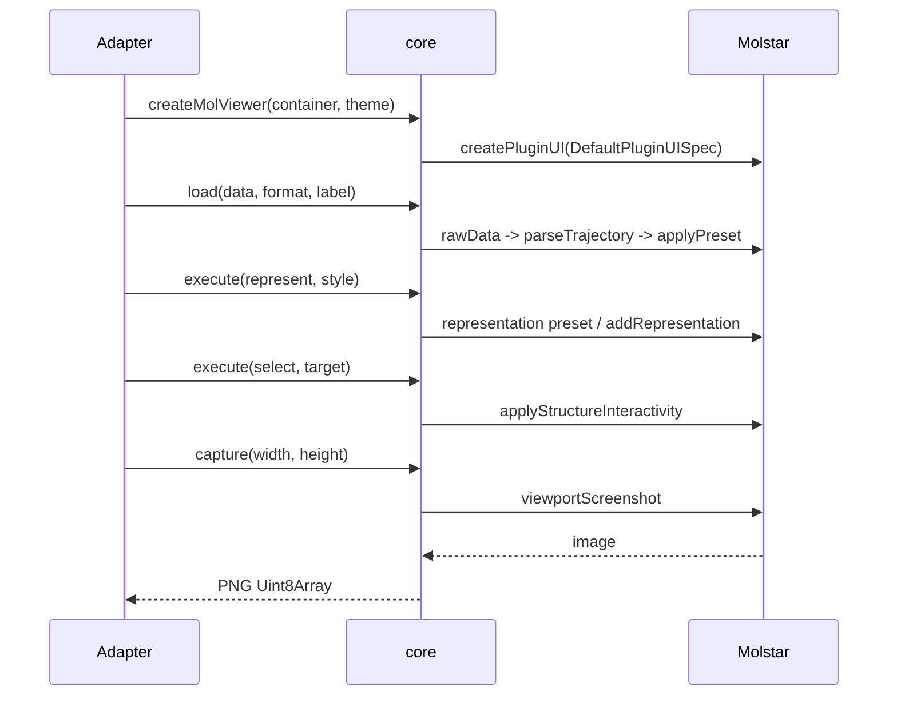

# @gcszhn/mol4agent-core

[English](README.md) | 中文

与 harness 无关的分子查看引擎。它挂载 Mol* 的**官方 React UI**
（`createPluginUI` + `DefaultPluginUISpec`），负责 viewer 生命周期、命令、
选择、测量和 PNG 截图。它**不知道**文件、路径、扩展名、harness SDK、
session 或 UI chrome 的存在。

```text
adapter (DSH / ChatGPT/Codex)
  |
  +-- 判断这是不是分子文件，并映射成 MolFormat
  +-- 取得字节（DSH：工作区路径；ChatGPT/Codex：raw data）
  |
  v
viewer.load({ data, format, label })
  |
  v
core: createPluginUI -> Mol* state tree -> commands -> capture
```

## 边界规则

- 输入永远是 `StructureData { data: string | Uint8Array, format, binary?, label? }`。
- `format` 显式给出；core 从不检查后缀或 MIME。
- 不引用文件系统、网络、session 或任何 harness 包。
- 命令是 JSON 可序列化的；**加载/添加结构是方法，不是命令**，因为适配包持有的字节
  不一定可序列化。
- `@gcszhn/mol4agent-core/parse` 是纯函数，Node 和浏览器都能用。
- `@gcszhn/mol4agent-core/sources` 同样是纯函数：把条目 id 变成下载计划
  （`url`、可选的 JSON `indexField`、格式、文件名）。网络和写文件仍由适配包
  负责。

## 安装

```sh
pnpm add @gcszhn/mol4agent-core molstar
# 只有使用 React 绑定时才需要：
pnpm add react
```

本包已发布到 npm（`@gcszhn/mol4agent-core@0.4.0`）；在 monorepo 内 pnpm 会链接
workspace 版本。`molstar` 和 `react` 是 peer dependencies。DSH 适配包把 Mol*
打进单个 client bundle；普通 web 应用可以直接使用本包。

构建与打包：

```sh
pnpm --filter @gcszhn/mol4agent-core build
# 产出 lib/*.js + lib/*.d.ts
```

Package `exports` 指向 `lib`，npm `files` 只包含 `lib` 和 README；`src/`、
`AGENTS.md` 和构建脚本不会被打包；`prepack` 会先构建。

## 入口

| Import | 导出 |
|---|---|
| `@gcszhn/mol4agent-core` | `createMolViewer`、协议类型、format 辅助函数、source 辅助函数、`summarizeStructure`、`compileSelector`、`selectorSchema`、查询辅助函数（`buildInspectResult`、`kindOfEntity`、`countCompIds`） |
| `@gcszhn/mol4agent-core/protocol` | `MOL_FORMATS`、`StructureData`、`MolCommand`、`StructureSelector`、`StructureSummary`、`InspectRequest` / `InspectResult` / `InspectTarget`、`Mol4AgentError`、`parseColor` / `formatColor` / `COLOR_SYNTAX`，以及 `isMolFormat` / `isStructureData` / `isMolCommandOp` / `isPresetName` / `isInspectDetail` 守卫 |
| `@gcszhn/mol4agent-core/parse` | `summarizeStructure`、`summarizePdbLike`、`summarizeCif`、`summarizeSdf`、`summarizeMol2`、`summarizeXyz`、`summarizeGro` |
| `@gcszhn/mol4agent-core/sources` | `SOURCE_DATABASES`、`SOURCE_DATABASE_INFO`、`resolveSource`、`normalizeSourceDb`、`readSourceIndexField`，以及 `isSourceDatabase` 守卫 |
| `@gcszhn/mol4agent-core/react` | `Mol4AgentViewer`、`Mol4AgentViewerHandle`、`Mol4AgentScene` |

## `createMolViewer`

```ts
import { createMolViewer } from '@gcszhn/mol4agent-core'

const viewer = await createMolViewer({
  container,          // 有真实宽高的 HTMLElement
  theme: 'dark',      // 'light' | 'dark'；默认 dark
  background: '#101418', // 可选；默认跟随主题
})

await viewer.load({ data: bytes, format: 'pdb', label: '1crn.pdb' })
// 可选：把第二个结构加入同一场景并做结构叠合。
await viewer.addStructure({ data: otherBytes, format: 'pdb', label: 'target.pdb' }, { id: 'target' })
await viewer.execute({ op: 'align', reference: 'structure', target: 'target', method: 'tm-align' })
await viewer.apply([
  { op: 'represent', style: { type: 'cartoon', color: 'chain-id' } },
  { op: 'select', target: { kind: 'ligand' }, mode: 'highlight', focus: true },
])
const png = await viewer.capture({ width: 1024, height: 768 })
viewer.dispose()
```

`createMolViewer` 最多等待容器 3 秒拿到非零尺寸，挂载 Mol* 官方 UI，并
跟随后续 resize。每个 viewer 注入一次 Mol* light/dark 样式表，`dispose()`
时移除。

### `MolViewerOptions`

| 字段 | 类型 | 含义 |
|---|---|---|
| `container` | `HTMLElement` | 宿主元素；viewer 用 `position:relative;width:100%;height:100%` 填满 |
| `theme` | `'light' \| 'dark'` | 初始 Mol* 皮肤和画布背景 |
| `background` | `string \| number` | 可选，显式指定画布背景（颜色语法同 `colorParams.value`） |

### `MolViewer`

| 方法 | 签名 | 含义 |
|---|---|---|
| `load` | `(data: StructureData, options?: { preset?: string; id?: string }) => Promise<StructureSummary>` | 替换整个场景，并清空旧结构、component 和测量。文本 format 以字节传入时会做 UTF-8 解码；`binary` 会被尊重。`preset` 默认 `default`；内置值有 `default`、`auto`、`illustrative`、`atomic-detail`、`polymer-and-ligand`，也可以传适配包注册的自定义 preset 名。`id` 默认 `structure`。 |
| `addStructure` | `(data: StructureData, options?: { preset?: string; id?: string }) => Promise<LoadedStructure>` | 向当前场景追加结构，不清空已有结构。id 必须唯一；省略时为 `structure-2`、`structure-3`…… |
| `removeStructure` | `(id: string) => Promise<void>` | 移除一个结构及其 component |
| `listStructures` | `() => readonly LoadedStructure[]` | 按加载顺序列出场景中的结构 |
| `summary` | `() => StructureSummary \| undefined` | 当前结构的摘要（若已加载） |
| `inspect` | `(request?: InspectRequest) => InspectResult` | 读取已加载结构和 Mol* 当前绘制方式；只读，见[查询](#查询) |
| `tmScore` | `(request: TmScoreRequest) => TmScoreResult` | 只读计算两个选择的 TM-align RMSD/TM-score，不移动任何结构 |
| `execute` | `(command: MolCommand) => Promise<CommandResult>` | 执行一条命令；失败返回 `{ ok: false, code, message }` |
| `apply` | `(commands: readonly MolCommand[]) => Promise<readonly CommandResult[]>` | 按顺序执行多条命令 |
| `capture` | `(options?: CaptureOptions) => Promise<Uint8Array>` | 把当前视图渲染成 PNG |
| `setTheme` | `(theme: 'light' \| 'dark') => void` | 切换 UI 皮肤和画布背景，不重建 viewer |
| `resize` | `() => void` | 让 Mol* 重新测量视口 |
| `diagnostics` | `() => ViewerDiagnostics` | 画布/宿主尺寸与 Mol* 层级计数 |
| `dispose` | `() => void` | 卸载 UI、移除样式、释放 Mol* |

### `ViewerDiagnostics`

```ts
{
  canvas: { width, height, clientWidth, clientHeight },
  host: { clientWidth, clientHeight },
  structures: number,       // Mol* 结构层级条目数
  components: number,
  representations: number,
  atoms: number,            // 所有已加载结构 summary 的原子数之和
}
```

## 数据协议

### `StructureData`

```ts
interface StructureData {
  data: string | Uint8Array
  format: MolFormat
  binary?: boolean   // 适配包覆盖；默认取 format 表
  label?: string     // 只用于显示；core 不会从路径推导
}
```

`MolFormat` 取值：

| format | Mol* parser | 默认 binary |
|---|---|---|
| `pdb`, `pdbqt`, `pqr` | `pdb` / `pdbqt` / `pqr` | 否 |
| `mmcif` | `mmcif` | 否 |
| `bcif` | `mmcif` | **是** |
| `mol`, `sdf` | `mol` / `sdf` | 否 |
| `mol2`, `xyz`, `gro` | 同名 | 否 |

当适配包把文本 format 以字节传入时，core 会用非 fatal 的 UTF-8 解码。
这对 DSH 很关键：它的工作区读取器即使读 `.pdb` 也返回 `Uint8Array`；
不先解码的话，Mol* 会把 PDB 当成 Binary 数据对象，建出空的层级。

## 命令

`MolCommand` 是 discriminated union。下面所有例子都是 JSON 可序列化的，
可以存进 session log，在 `load()` 之后重放。

| `op` | 字段 | 效果 |
|---|---|---|
| `represent` | `style: StyleSpec`，可选 `target`，可选 `replace` | `replace` 默认 `true`：替换已有表示后再绘制新表示。不传 `target` 时替换整个作用域内的结构（`structureId` 可限定为单个结构）。传 `target` 时只替换覆盖该 target 的表示：完全落在 target 内的 component 会被移除，部分覆盖的 component 在非 target 部分保留原样式，场景其余部分保持不变。`replace: false` 保留所有已有表示并叠加新表示，可作用于整个结构，也可作用于 `target`（新建 Mol* component）。`type` 为 `cartoon` 或省略时，core 用 Mol* 的 `polymer-and-ligand` preset，保证 HETATM 配体仍然可见。`quality` 协议里有字段，但目前尚未生效。 |
| `select` | `target`，`mode?: 'select' \| 'highlight'`，`focus?` | 应用 Mol* 选择交互；`focus` 会移动镜头 |
| `clear-selection` | `mode?` | 清除 select/highlight 交互 |
| `focus` | 可选 `target` | 聚焦选择或整个结构 |
| `camera` | `action: 'reset'` | 重置镜头 |
| `background` | `color: string \| number \| 'theme'` | 设置画布背景 |
| `measure` | `kind: 'distance' \| 'angle' \| 'dihedral'`，`targets` 2/3/4 个 | 添加测量 |
| `label` | `target`，可选 `text` | 添加 3D 标签 |
| `align` | `reference`、`target`，可选 `method`、`referenceChain`、`targetChain` | 把 target 叠合到 reference；`method` 为 `tm-align`（默认）或 `sequence` |
| `remove-structure` | `structureId` | 从场景移除一个结构 |
| `visibility` | `structureId`、`visible` | 显示/隐藏一个结构，但不移除 |

示例：

```ts
{ op: 'represent', style: { type: 'cartoon', color: 'chain-id' } }
{ op: 'represent', style: { type: 'ball-and-stick', color: 'element-symbol' } }
{ op: 'select', target: { kind: 'ligand' }, mode: 'highlight', focus: true }
{ op: 'select', target: { kind: 'residues', chain: 'A', start: 10, end: 25 } }
{ op: 'focus', target: { kind: 'chain', chain: 'B' } }
{ op: 'camera', action: 'reset' }
{ op: 'background', color: '#101418' }
{ op: 'measure', kind: 'distance', targets: [
  { kind: 'residue', chain: 'A', index: 42 },
  { kind: 'residue', chain: 'A', index: 87 },
] }
{ op: 'label', target: { kind: 'ligand' }, text: 'ATP' }
{ op: 'align', reference: 'structure', target: 'target', method: 'tm-align', referenceChain: 'A', targetChain: 'A' }
{ op: 'visibility', structureId: 'target', visible: false }
{ op: 'remove-structure', structureId: 'target' }
```

### `StyleSpec`

```ts
{
  type?: 'cartoon' | 'ball-and-stick' | 'licorice' | 'spacefill' | 'line'
       | 'point' | 'surface' | 'gaussian-surface' | 'molecular-surface'
  color?: 'chain-id' | 'element-symbol' | 'residue-name' | 'uniform'
        | 'secondary-structure' | 'entity-id' | 'molecule-type' | 'hydrophobicity'
  colorParams?: { value?: string | number }
  quality?: 'low' | 'medium' | 'high' | 'auto' // 预留；当前使用 Mol* auto quality
}
```

### 颜色

`color` 选择 Mol* 的颜色**主题**（`chain-id`、`element-symbol` 等）；
`colorParams.value` 只对 `uniform` 主题生效。单独写 `color: "uniform"` 只是主题
名，不是具体颜色。

`colorParams.value` 接受以下形式：

| 形式 | 示例 |
|---|---|
| CSS 颜色名（大小写不敏感） | `red`、`lightgrey`、`rebeccapurple` |
| 十六进制，可带 alpha | `#f00`、`#ff0000`、`#ff000080`、`#f008` |
| `0x` 或裸十六进制 | `0xB0B0B0`、`B0B0B0` |
| `rgb()` / `rgba()` | `rgb(255, 0, 0)`、`rgb(100%, 0%, 0%)`、`rgba(255, 0, 0, 0.5)` |
| 24 位整数 | `16711680`、`0xff0000` |

alpha 会被接受但忽略，因为 Mol* 颜色与画布都是不透明的。`background` 命令与
`capture({ background })` 接受相同形式（命令还额外接受 `'theme'`）。无法解析的
值返回 `INVALID_COMMAND`，不会再静默渲染成黑色；成功的 `represent` 会回显解析后
的十六进制颜色，例如 `Applied cartoon / uniform #ff0000 to polymer.`。

常用值：红 `0xff0000`、蓝 `0x0000ff`、白 `0xffffff`、灰 `0x808080`、
浅灰 `0xd3d3d3`。

### `CommandResult`

```ts
type CommandResult =
  | { ok: true; op: MolCommand['op']; message?: string; data?: unknown }
  | { ok: false; op: MolCommand['op']; code: Mol4AgentErrorCode; message: string }
```

错误码：`INVALID_COMMAND`、`UNSUPPORTED_FORMAT`、`UNSUPPORTED_REPRESENTATION`、
`REPRESENT_FAILED`、`NO_STRUCTURE`、`LOAD_FAILED`、`CAPTURE_FAILED`、
`SUMMARY_UNSUPPORTED`、`UNSUPPORTED_SOURCE`、`INVALID_ENTRY_ID`、`DISPOSED`、
`UNKNOWN_STRUCTURE`、`DUPLICATE_STRUCTURE_ID`、`ALIGN_FAILED`、`TM_SCORE_FAILED`。

## 选择器

选择器是稳定的 agent 接口；适配包原样传递，core 编译成 Mol* 的 selection
query 或 element schema。

| 选择器 | 含义 |
|---|---|
| `{ kind: 'all' }` | 所有原子 |
| `{ kind: 'polymer' }` | 聚合物原子 |
| `{ kind: 'protein' }` | 蛋白质聚合物 |
| `{ kind: 'nucleic' }` | 核酸聚合物 |
| `{ kind: 'ligand' }` | 非聚合物配体（ATP、HEM 等） |
| `{ kind: 'water' }` | 水 |
| `{ kind: 'ion' }` | 离子 |
| `{ kind: 'chain', chain }` | 一条链 |
| `{ kind: 'residue', chain?, index, auth? }` | 一个残基；`auth` 使用 author 编号 |
| `{ kind: 'residues', chain?, start, end, auth? }` | 闭区间残基范围 |
| `{ kind: 'comp', compId }` | 指定 component id 的所有残基 |
| `{ kind: 'schema', schema }` | 底层 `StructureElement.Schema` 子集 |

每个变体都接受可选的 `structureId`，用于在多结构场景中指定某一个结构。省略时：
`select`/`focus` 作用于所有已加载结构，`measure`/`label` 取第一个匹配的结构，
带 `target` 的 `represent` 逐个结构应用。这样可以区分两个都含链 `A` 的结构。

`schema` 字段：`auth_asym_id`、`label_asym_id`、`auth_seq_id`、`label_seq_id`、
`label_comp_id`、`auth_comp_id`、`beg_auth_seq_id`、`end_auth_seq_id`、
`beg_label_seq_id`、`end_label_seq_id`、`label_atom_id`、`auth_atom_id`、
`type_symbol`。

```ts
import { compileSelector, selectorSchema } from '@gcszhn/mol4agent-core'

const compiled = compileSelector({ kind: 'ligand' })
const schema = selectorSchema({ kind: 'residues', chain: 'A', start: 10, end: 25 })
```

## 查询

`viewer.inspect(request)` 读取已加载结构以及 Mol* 当前的绘制方式。它是
`execute` 的读侧对应物：不改变任何状态，而且不像回放的命令日志那样只反映
agent 自己的操作，它采样的是**实时**状态，因此人通过点击或 Mol* 面板做出的
选择和样式也会被读到。多结构场景中，带 `structureId` 的选择器只检查该结构；
如果结构已有叠合变换，坐标取变换后的当前显示位置。

```ts
const summary = viewer.inspect()
// summary.counts → [{ compId: 'HOH', kind: 'water', residues: 103, atoms: 103 }, ...]

const residue = viewer.inspect({
  target: { kind: 'residue', chain: 'E', index: 355 },
  detail: 'atoms',
})
// residue.residueRows[0].atomRows → [{ name: 'PG', element: 'P', x: 16.223, ... }]
// residue.styles → [{ component: 'Structure', type: 'cartoon', color: 'chain-id',
//                     size: 'physical', baseColor: '#1b9e77', visibleColor: '#22bb5b',
//                     overlays: [{ source: 'selection', color: '#33ff1a', strength: 0.3 }] }]
// residue.appearance → { baseColor: '#1b9e77', visibleColor: '#22bb5b', overlays: [...] }

const selected = viewer.inspect({ target: { kind: 'selection' }, detail: 'residues' })
// selected.selection → { entries: 3, residues: 6, atoms: 74,
//                        groups: [{ residues: 4, atoms: 36 }, ...] }
```

| 请求字段 | 含义 |
|---|---|
| `target?` | 任意[选择器](#选择器)，或 `{ kind: 'selection' }` / `{ kind: 'focus' }`（当前选择管理器 / 最后一次点击的位置）。缺省为整个结构。 |
| `detail?` | `summary`（默认）：总数、按 component 的计数与样式，不含行；`residues`：再加残基行；`atoms`：残基行 + 每个原子的坐标。 |
| `limit?` | 残基行上限，默认 `DEFAULT_INSPECT_LIMIT`（200）。总数和 counts 始终覆盖整个 target，`truncated` 表示行是否被截断。 |

`InspectResult` 字段：`target`、`detail`、`atoms`、`residues`、`chains`、
`models`、`counts`、`residueRows?`、`styles`、`appearance?`、`selection?`、
`focus?`、`truncated`。`counts` 总是存在且总是完整：默认调用即可回答「多少个水 /
Cys / 配体」。

行里带结构身份（`chain`、`seqId` 为 author 编号、`labelSeqId`、`compId`、
`kind`）和绘制中心坐标（`x`、`y`、`z`）。原子行额外有 `name`、`element`、
坐标，以及格式提供时的 `occupancy` / `bFactor` / `altId`。坐标取自 unit
conformation，也就是 Mol* 实际绘制的位置。

每条样式给出表示类型、配色主题、尺寸主题、配色主题参数、`hidden`（该表示当前
未被绘制），以及两个关键颜色：

| 字段 | 含义 |
|---|---|
| `baseColor` | 该表示自身配色主题给这个元素的颜色。 |
| `visibleColor` | 实际看到的颜色：在 `baseColor` 上叠加 overlay 之后的结果。 |
| `overlays` | 作用在该元素上的叠加层。 |

叠加层来自实时 viewer 状态，优先级如下：

1. **overpaint**（`source: 'overpaint'`）替换主题色，覆盖 Mol* overpaint 图层
   覆盖的区域——最后命中的图层生效，`clear` 图层会清掉下面的涂色；
2. **selection**（`source: 'selection'`）再把画布选择标记混到上面，使用
   `canvas3d.props.renderer.selectColor` 与 `selectStrength`，与 Mol* 的
   marker shader 一致（默认主题下是 `#33ff1a`、强度 `0.3`）。只描边、不改变体
   色的标记会以 `hidden: true` 报出，且不影响 `visibleColor`。

`appearance` 用最后绘制的那个表示给出 target 整体上的同一对颜色。颜色只在
target 的一个命中元素上采样，所以 `chain-id` 下多链 target 报的是第一条链的
颜色；要某个残基的准确颜色就直接查询该残基。按选择叠加的 transparency /
emissive / substance，以及基于 script 的 overpaint 图层，暂未解析。

没有加载结构时 `inspect` 抛 `Mol4AgentError`（`NO_STRUCTURE`）；空选择或空
focus 是合法的空结果。低分辨率的粗粒化（sphere/gaussian）unit 没有原子层级，
不会列出。

## 摘要

`summarizeStructure` 不需要 viewer，直接从字节解析，适合 `mol_info` 或在
打开重型 3D viewer 前给模型 chain/residue/ligand 事实。Node 和浏览器都能用。

```ts
import { summarizeStructure } from '@gcszhn/mol4agent-core/parse'

const summary = summarizeStructure({ data: pdbText, format: 'pdb', label: '1atp.pdb' })
// { atomCount, residueCount, modelCount, chains, ligands, complete, ... }
```

`StructureSummary`：

```ts
{
  format: MolFormat
  label?: string
  title?: string
  atomCount: number
  residueCount: number
  modelCount: number
  chains: { id, kind, atoms, residues, compIds }[]
  ligands: { compId, count }[]
  complete: boolean   // 仅 viewer 兜底摘要可能为 false；summarizeStructure 对 BCIF 抛错
}
```

BCIF 可以渲染，但目前不能从 raw bytes 摘要；`summarizeStructure` 会抛
`SUMMARY_UNSUPPORTED`。viewer 的兜底摘要仍可能返回 `complete: false`。

## 数据库来源

`mol_fetch` 从条目 id 而不是本地文件开始。core 只校验 id 并返回下载计划，
不发起请求、不写文件；实际请求和落盘由适配包用各自的 HTTPS/文件系统 API
完成。

```ts
import { resolveSource } from '@gcszhn/mol4agent-core/sources'

resolveSource({ entryId: '1crn' })
// { sourceDb: 'rcsb-pdb', entryId: '1CRN', format: 'pdb',
//   fileName: '1CRN.pdb',
//   plan: { url: 'https://files.rcsb.org/download/1CRN.pdb' },
//   description: 'RCSB PDB entry 1CRN (PDB format)' }

resolveSource({ entryId: 'P00533', sourceDb: 'alphafold' })
// plan: { url: 'https://alphafold.ebi.ac.uk/api/prediction/P00533',
//         indexField: '0.pdbUrl' }
```

| `source_db` | `entry_id` | 格式 |
|---|---|---|
| `rcsb-pdb`（默认） | 4 字符 PDB id（`1crn`） | `pdb` |
| `rcsb-cif` | 4 字符 PDB id（`1crn`） | `mmcif` |
| `rcsb-bcif` | 4 字符 PDB id（`1crn`） | `bcif` |
| `alphafold` | UniProt accession（`P00533`） | `pdb` |
| `pubchem` | CID（`2244`）或化合物名（`aspirin`） | `sdf` |
| `chembl` | `CHEMBL25`，或纯数字（`25`） | `sdf` |

`plan.indexField` 表示这是一个 JSON 索引文档：适配包按点路径取值，再下载其中
的 URL。AlphaFold 的文件名带版本号，所以 `0.pdbUrl` 跳过 API 的数组包装并取
当前 PDB URL。取该字段可用 `readSourceIndexField(payload, field)`。

`SOURCE_DATABASE_INFO` 提供每个来源的 label、描述、entry 提示和格式，供工具
描述使用。`normalizeSourceDb` 校验闭集；非法 id 会抛出 `Mol4AgentError`，
错误码为 `UNSUPPORTED_SOURCE` 或 `INVALID_ENTRY_ID`。

## 截图

```ts
const png = await viewer.capture({
  width: 1024,       // 可选；默认 1024
  height: 768,       // 可选；默认 768
  transparent: true, // 可选
  background: '#101418', // 可选
})
```

`capture` 使用 Mol* 的 viewport screenshot helper。宽高默认 1024×768。
渲染失败会以 `CAPTURE_FAILED` 拒绝。

`measure` 和 `label` 只接受 `chain`、`residue`、`residues`、`comp` 或
`schema` 选择器；`ligand`/`protein` 这类语义类别无法转换成单个原子位置，
会返回 `INVALID_COMMAND`。

按选择叠加表示需要显式传 `replace: false`：

```ts
// 其余区域：灰色卡通
{ op: 'represent', style: { type: 'cartoon', color: 'uniform', colorParams: { value: 0x808080 } } }
// 某段界面残基：红色球棍，保留卡通
{ op: 'represent',
  style: { type: 'ball-and-stick', color: 'uniform', colorParams: { value: 0xff0000 } },
  target: { kind: 'residues', chain: 'A', start: 28, end: 54 },
  replace: false }
```

全局 `cartoon` 使用 `polymer-and-ligand` preset；`colorParams` 会传入它的
theme，所以 `uniform` 颜色可用。带 `target` 且 `replace: false` 的 `represent`
会创建独立的 selection component，不删除场景其余表示。带 `target` 且
`replace: true` 时只替换覆盖 target 的表示：其他链保留原样式，与 target
共享的 component 会被拆分为 target 部分和剩余部分。

## React 绑定

```tsx
import { Mol4AgentViewer } from '@gcszhn/mol4agent-core/react'

<Mol4AgentViewer
  scene={{ data, commands }}
  theme="dark"
  onViewer={viewer => { /* 保留用于截图 */ }}
  style={{ height: 600 }}
/>
```

组件负责 viewer 生命周期。**请 memoize `scene`**；对象变化会重新加载结构
并重放命令。DSH 适配包没有使用这个绑定，因为它需要 session projection
的保真度、按 tab 缓存和自定义截图通道。

## 内部流程



## 状态

- `protocol`、`formats`、`parse/*`、`sources`、`viewer`、`select`、`react` 均已
  实现并通过 typecheck。
- 在 headless Chrome + SwiftShader 下用真实 1CRN PDB/CIF、1ATP 和 PubChem
  aspirin SDF 验证过：官方 UI、加载、cartoon/polymer-and-ligand、配体高亮、
  聚焦和 PNG 截图。
- DSH 适配包把 core 打进单个 client bundle；见
  [`packages/deepseek-harness`](../deepseek-harness)。

## TM-score 与 RMSD

`tmScore()` 比较两个选择但不改变场景，适合给从未叠合过的链/区域打分，或在
叠合后做只读复核。

```ts
const score = viewer.tmScore({
  reference: { kind: 'chain', chain: 'B', structureId: 'reference' },
  target: { kind: 'chain', chain: 'A', structureId: 'target' },
})
// { method: 'tm-align', rmsd, tmScoreA, tmScoreB, alignedLength,
//   referenceAtoms, targetAtoms, reference, target }
```

两个选择都会归约为聚合物 trace（CA/C4'/P）。`rmsd` 是 TM-align 在对齐后的
trace 上做最优叠合后的 RMSD，不是当前相机坐标系下的 RMSD。计算复用 Mol* 的
structure-level `tmAlign`（`mol-model/structure/structure/util/tm-align`），
不另写算法，也不会对 viewer 施加变换。

## 多结构与结构叠合

`load()` 打开全新场景；`addStructure()` 把另一个结构追加到同一个 Mol* 场景。
每个结构保留自己的 id、component、表示、可见性和测量。

```ts
await viewer.load({ data: referenceBytes, format: 'pdb', label: '7czd.pdb' }, { id: 'reference' })
await viewer.addStructure({ data: targetBytes, format: 'pdb', label: '4zqk.pdb' }, { id: 'target' })
await viewer.execute({
  op: 'represent',
  style: { type: 'cartoon', color: 'uniform', colorParams: { value: 0xef4444 } },
  target: { kind: 'all', structureId: 'target' },
})
const aligned = await viewer.execute({
  op: 'align',
  reference: 'reference',
  target: 'target',
  method: 'tm-align',
  referenceChain: 'B',
  targetChain: 'A',
})
// aligned.data: { method, rmsd, alignedLength, tmScoreA, tmScoreB }
```

两个方法都复用 Mol* 自带的叠合工具
（`mol-model/structure/structure/util/{superposition,tm-align}`）和
`TransformStructureConformation` 装饰器，没有另写叠合或渲染引擎。叠合使用
聚合物 trace（CA/C4'/P）移动 target，reference 保持不动，并把镜头框到叠合后的
一对结构上；如果 reference 本身
已经被变换，则把其当前坐标系合入 target 的变换。

总体架构见 [`docs/architecture_zh.md`](../../docs/architecture_zh.md)；具体实现见本包
README/AGENTS，DSH agent 接口见
[`packages/deepseek-harness/README_zh.md`](../deepseek-harness/README_zh.md)。
