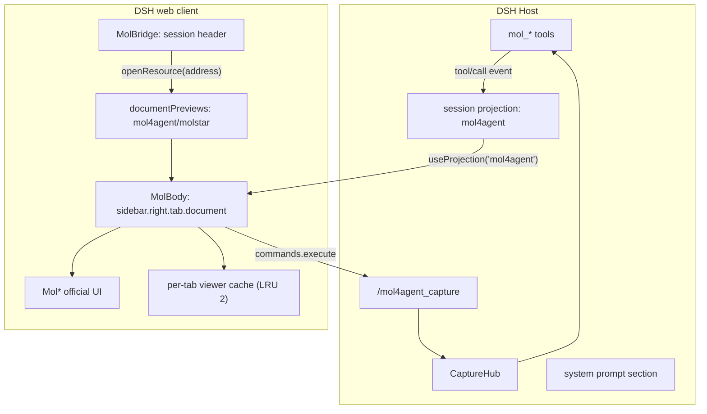
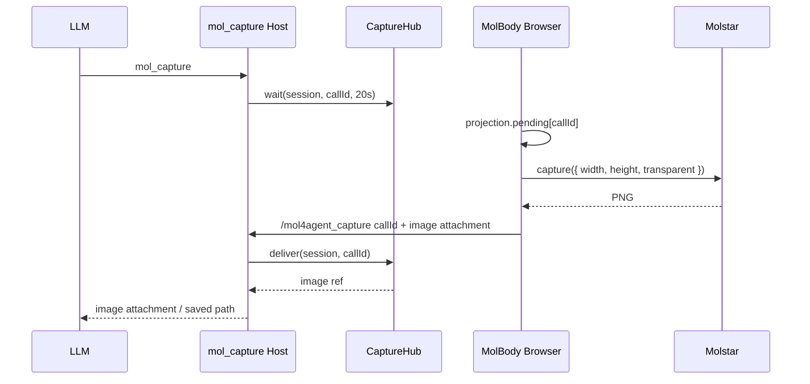
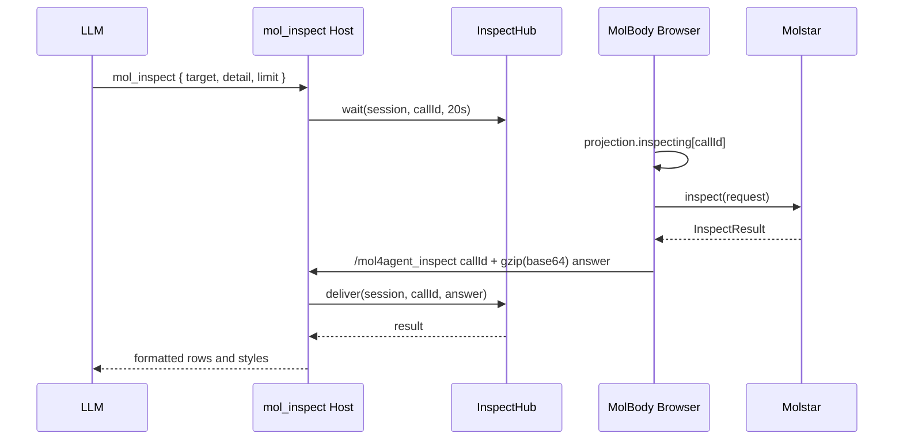

# @gcszhn/mol4agent-deepseekharness

[English](README.md) | [中文](README_zh.md)

DeepSeek Harness (DSH) adapter for mol4agent: a right-sidebar molecular document
preview that an agent can operate.

- **Structure**: `.pdb`, `.ent`, `.pdbqt`, `.pqr`, `.cif`, `.mmcif`,
  `.mcif`, `.bcif`, `.mol`, `.sdf`, `.sd`, `.mol2`, `.xyz`, `.gro` open in
  Mol*'s official UI instead of plain text. Every claimed suffix also accepts a
  `.gz` variant (for example `.pdb.gz`, `.cif.gz`, `.sdf.gz`); the adapter
  decodes it before handing bytes to core. The previewer's **Open with** menu
  still offers code/plain text (`bcif` has no plain-text fallback because its
  bytes are binary).
- **Agent tools**: `mol_info`, `mol_inspect`, `mol_interface`, `mol_fetch`,
  `mol_open`, `mol_add_structure`, `mol_align`, `mol_tmscore`,
  `mol_remove_structure`, `mol_list_structures`, `mol_style`, `mol_select`,
  `mol_focus`, `mol_measure`, `mol_capture`.
- **Multi-structure scenes**: one tab page can hold several structures with
  stable ids; `mol_align` superposes one onto another, `mol_tmscore` compares
  two selections read-only, and selectors accept `structureId` to disambiguate
  equal chain ids.
- **Live-state inspection**: `mol_inspect` reads what the viewer currently shows
  (residues, atoms, coordinates, per-component counts, representations and
  resolved colours) straight from the running Mol* page, including changes a
  human made by clicking or through the Mol* panel. Read-only; it never parses
  the file or changes the scene.
- **Database fetch**: `mol_fetch` downloads PDB entries (PDB/mmCIF/BinaryCIF),
  AlphaFold DB predictions, PubChem compounds, and ChEMBL molecules into the
  workspace, so an agent can start from an entry id instead of a local file.
- **Agent-driven page**: tool calls are folded into a durable session
  projection; the open page follows it and applies commands.
- **Auto-open**: naming a new structure reveals its preview through a
  session-header bridge.
- **Screenshots**: the page renders a PNG and delivers it back to the blocked
  tool call; a copy is saved under `.mol4agent/captures/`.

## Architecture



**Boundary**: all path handling lives here — suffix to `MolFormat`, workspace
reads, authorization, sessions, projections, UI. `@gcszhn/mol4agent-core` only
receives bytes plus an explicit format.

## Agent tools

All tools are Host tools. Mutating tools are registered with
`isConcurrencySafe: () => false`. The Host tool body validates arguments and
reads files for summaries; the **projection** turns the recorded `tool/call`
into viewer commands, so the page changes even if the tool card is scrolled
away.

| Tool | Parameters | Behavior |
|---|---|---|
| `mol_info` | `path` | Summarize chains, residues, atoms, ligands. Does not open a viewer or change the scene. |
| `mol_inspect` | `tab?`, `target?`, `detail?`, `limit?` | Read the live viewer: totals, per-component counts, residue rows, or per-atom rows with coordinates, plus the representations/colours drawing the target. `target` accepts any selector or `{"kind":"selection"}` / `{"kind":"focus"}`; `styles` lists, per representation drawing the target, `type`, `color` theme, `size` theme, and both `baseColor` (theme colour) and `visibleColor` (after overpaint and the selection marker) with the `overlays` responsible; `appearance` repeats that pair for the target as a whole. `{kind:"selection"}` reports every selection entry with its own residue/atom totals. `detail` is `summary` (default, includes per-component counts), `residues`, or `atoms`; `limit` caps residue rows (default 200) without truncating totals or counts. Blocks until the page answers, like `mol_capture`. |
| `mol_interface` | `path`, `chainsA`, `chainsB`, `cutoff?` | Find interface residues between two chain groups (default 8 Å, 0 < cutoff ≤ 30) in PDB-like files. Returns ranges for `mol_style`/`mol_focus`. |
| `mol_fetch` | `entry_id`, `target_path`, `source_db?` | Download a structure from an online database and save it at `target_path`. `source_db` defaults to `rcsb-pdb`; see [database sources](#database-sources). A directory target (or trailing slash) appends the source file name, and a suffix-less path gets the source suffix. Returns the saved path plus a summary. |
| `mol_open` | `path`, `type?`, `color?`, `colorParams?`, `select?`, `focus?` | Create/update the tab page keyed by its canonical `/`-separated absolute path and make it active. Emits `represent` and optionally `select`/`focus`; the tab page id is that path. |
| `mol_add_structure` | `tab?`, `path`, `id?`, `type?`, `color?`, `colorParams?`, `focus?` | Add another structure to the same tab scene without replacing existing ones. Default ids are `structure-2`, `structure-3`, ...; the result echoes the id. |
| `mol_align` | `tab?`, `reference`, `target`, `method?`, `referenceChain?`, `targetChain?` | Superpose the target onto the reference with Mol* TM-align (default) or sequence-guided superposition. Optional chains restrict the trace used for alignment. |
| `mol_tmscore` | `tab?`, `reference`, `target` | Read-only TM-align comparison of two selections; returns RMSD, both TM-scores, and aligned length without moving either structure. Selections are reduced to polymer trace atoms. |
| `mol_remove_structure` | `tab?`, `structureId` | Append `remove-structure`; other structures stay. |
| `mol_list_structures` | `tab?` | List the active structures in the tab with ids, labels, and formats. |
| `mol_style` | `tab?`, `type?`, `color?`, `target?`, `replace?`, `colorParams?` | Append `represent` to the tab (`tab` defaults to active). `replace` defaults to `true`: clear the current representations, then draw the new one (a `structureId` target limits the clear to that structure). Pass `replace: false` to keep them and overlay. `target` only narrows the new representation's coverage; it does not imply replace or overlay. `colorParams.value` applies to `uniform` and accepts a CSS name (`"red"`), hex (`"#ff0000"`), or an integer (`16711680`); invalid colours are rejected and the result echoes the resolved hex. |
| `mol_select` | `tab?`, `target`, `mode?`, `focus?` | Append `select`. `mode` is `select` or `highlight`. |
| `mol_focus` | `tab?`, `target?` | Append `focus`; target omitted frames the whole structure. |
| `mol_measure` | `tab?`, `kind`, `targets` | Append `measure`. 2 targets for distance, 3 for angle, 4 for dihedral. |
| `mol_capture` | `tab?`, `width?`, `height?`, `transparent?` | Block until the target tab delivers a PNG (default 1024×768). Returns an image attachment when the routed model accepts images, plus `savedPath` when available. |

`path` is absolute or relative to the session working directory. `target_path`
follows the same rule. Files are limited to 64 MiB.

Tab page ids are canonical (`/`-separated) absolute paths on every platform:
`mol_open`/`mol_fetch` echo `D:/work/5jds.pdb`, and `tab` accepts either that
form or a native `D:\work\5jds.pdb`. The path-key invariant is described in
[Session projection](#session-projection).

### Database sources

| `source_db` | `entry_id` | Saved format |
|---|---|---|
| `rcsb-pdb` (default) | 4-character PDB id, e.g. `1crn` | `.pdb` |
| `rcsb-cif` | 4-character PDB id, e.g. `1crn` | `.cif` (mmCIF) |
| `rcsb-bcif` | 4-character PDB id, e.g. `1crn` | `.bcif` (BinaryCIF) |
| `alphafold` | UniProt accession, e.g. `P00533` | `.pdb` |
| `pubchem` | CID (`2244`) or compound name (`aspirin`) | `.sdf` (3D) |
| `chembl` | ChEMBL id (`CHEMBL25`) or bare number (`25`) | `.sdf` |

Entry ids are normalized and validated in core
(`@gcszhn/mol4agent-core/sources`); the Host performs the HTTPS download, caps
it at 64 MiB, times out after 30 s, and writes through a temporary file so a
failed fetch leaves no partial structure. Existing targets are overwritten.
AlphaFold file names are versioned, so the Host resolves `0.pdbUrl` through the
AlphaFold JSON API before downloading.

`mol_fetch` examples:

```json
{ "entry_id": "1crn", "target_path": "fixtures/1crn.pdb" }
{ "entry_id": "aspirin", "source_db": "pubchem", "target_path": "fixtures/" }
{ "entry_id": "P00533", "source_db": "alphafold", "target_path": "egfr.pdb" }
```

`mol_info` example:

```json
{ "path": "fixtures/1atp.pdb" }
```

`mol_open` example:

```json
{
  "path": "fixtures/1atp.pdb",
  "type": "cartoon",
  "color": "chain-id",
  "select": { "kind": "ligand" },
  "focus": true
}
```

`mol_select` selectors:

```json
{ "kind": "ligand" }
{ "kind": "chain", "chain": "A" }
{ "kind": "residues", "chain": "A", "start": 10, "end": 25 }
{ "kind": "residue", "chain": "A", "index": 42 }
{ "kind": "comp", "compId": "ATP" }
```

Interface workflow:

```json
{ "path": "fixtures/7czd.pdb", "chainsA": ["A"], "chainsB": ["B"], "cutoff": 8 }
```

```json
{ "type": "cartoon", "color": "uniform", "colorParams": { "value": 8421504 } }
```

```json
{ "type": "ball-and-stick", "color": "uniform",
  "colorParams": { "value": 16711680 },
  "target": { "kind": "residues", "chain": "A", "start": 28, "end": 54 } }
```

Call the last command once per returned range, then `mol_focus` on a central
range.

`mol_capture` returns:

```ts
{
  attachment: ImageAttachmentRef
  width: number
  height: number
  path: string
  savedPath?: string
  imageCapable: boolean
  diagnostics?: Record<string, unknown>
}
```

- The image is attached to the tool result only when `imageCapable` is true;
  otherwise the text result reports the attachment and, when available, the saved
  path.
- `savedPath` is `<cwd>/.mol4agent/captures/mol4agent-<timestamp>-<id>.png`.
- `diagnostics` carries the browser-side status/path/command counts and Mol* hierarchy diagnostics.

### Tool-call to command mapping

| Tool | Scene effect |
|---|---|
| `mol_open` | New `sceneKey`; commands `[represent, select?]` or `[represent, focus?]` |
| `mol_style` | Append `{ op: 'represent', style, target?, replace? }` |
| `mol_select` | Append `{ op: 'select', target, mode, focus? }` |
| `mol_focus` | Append `{ op: 'focus', target? }` |
| `mol_measure` | Append `{ op: 'measure', kind, targets }` |
| `mol_add_structure` | Add a `structures[]` entry; optional targeted `represent`/`focus` commands |
| `mol_align` | Append `{ op: 'align', reference, target, method?, referenceChain?, targetChain? }` |
| `mol_remove_structure` | Append `{ op: 'remove-structure', structureId }` |
| `mol_list_structures` | None; lists projection structures only |
| `mol_capture` | Add a pending capture entry; no viewer command |
| `mol_tmscore` | Add a pending TM-score request; no viewer command |
| `mol_inspect` | Add a pending inspection entry; no viewer command |
| `mol_interface` | None; returns computed ranges only |
| `mol_fetch` | None; downloads a file only |
| `mol_info` | None |

## Session projection

The projection key is **`mol4agent`**. It is registered on the Host, folded from
session events, and exposed to the browser through the projection wire.

```ts
interface MolSessionState {
  revision: number
  cwd?: string
  tabs: Record<string, {
    sceneKey: string   // `${canonicalPath}#${callId}`
    path: string       // canonical `/`-separated absolute path
    format: MolFormat
    label: string
    structures?: {
      id: string
      path: string
      format: MolFormat
      label: string
    }[]
    commands: MolCommand[]
  }>
  active: string | null   // canonical `/`-separated absolute path
  pending: Record<string, {
    callId: string
    path?: string
    width?: number
    height?: number
    transparent?: boolean
  }>
  inspecting: Record<string, {
    callId: string
    path?: string
    target?: InspectTarget
    detail?: InspectDetail
    limit?: number
  }>
}
```

- `mol_open` adds/replaces `tabs[path]` and sets `active`; each tab page has
  its own `sceneKey`, structure list, and command list. `mol_style`/`mol_select`/
  `mol_focus`/`mol_measure`/`mol_align`/`mol_remove_structure` fold into the
  `tab` argument (or active tab) and bump `revision`; `mol_add_structure`
  appends to `structures` and optionally appends targeted commands.
- The client loads the primary structure with id `structure`, then reads and
  adds every later `structures` entry before applying new commands. A removed
  structure stays in the projection so replaying the command log reproduces the
  same scene; the id cannot be reused in that tab.
- `mol_capture` adds a pending entry for the `tab` argument (or active tab) and
  bumps `revision`; the header bridge activates that tab so the capture can be
  delivered. `mol_inspect` adds a matching entry under `inspecting` instead:
  it carries no viewer command, because the page answers from current Mol*
  state. Read-only tools (`mol_info`, `mol_interface`) and invalid
  selector/format arguments leave state unchanged. A file that fails to read can
  still create/switch a tab before the Host tool reports the error.
- `tool/result` clears a matching pending capture or inspection and bumps
  `revision`; other results leave state unchanged.
- Relative paths are resolved against `cwd` captured when the projection is
  initialized.
- Tab keys are **canonical**: the `/`-separated absolute path with an uppercase
  drive letter (`D:/work/5jds.pdb`). DSH resource addresses and the Sidebar tab
  registry are `/`-separated on every platform, and the body derives its path
  from the address; keying `tabs`/`active` with a Host-native Windows spelling
  (`D:\work\5jds.pdb`) makes every scene-tool lookup and screenshot miss
  silently. `openScene`, `tabOf`, the tool-side scene lookup, and the body all
  canonicalize through `canonicalTabPath` (`src/tab-path.ts`), and `mol_open` /
  `mol_fetch` echo that form back to the agent.
- The projection is replayable: it stores paths and JSON commands, never bytes.
- `sceneKey` changes when the agent opens that tab again. Only that tab reloads
  the structure (clearing old measurements/selection styles) and resets its
  applied-command cursor; other tabs are untouched.

The client selects `tabs[path]` for its own tab with
`props.useProjection('mol4agent')`, where `path` is `canonicalTabPath()` of the
path parsed from its resource address. It reads the file bytes separately
through `remote.workspaceFiles.readBytes`, then calls
`@gcszhn/mol4agent-core` with `{ data, format, label }`.

## Document preview

The client registers one preview implementation:

```ts
ctx.documentPreviews.register({
  id: 'mol4agent/molstar',
  extensions: PREVIEW_EXTENSIONS,
  binaryExtensions: ['bcif'],
  priority: 'extension',
  title: () => t('viewer'),
  loading: 'renderer',
  wrap: false,
})
```

- `priority: 'extension'` makes it the default renderer for the claimed
  suffixes; code/plain text remain selectable via **Open with**.
- The body is registered in the `sidebar.right.tab.document` slot, keyed by
  `mol4agent/molstar`.
- `wrap: false` means the preview scrolls nothing above the viewer; Mol*'s own
  UI fills the body.

The body:

1. parses the session path from the `dsh-resource://` address;
2. maps the suffix to a `MolFormat` (adapter-only logic);
3. reads bytes through `remote.workspaceFiles.readBytes`;
4. creates/reuses a Mol* viewer and calls `load()`;
5. follows the projection and applies new commands incrementally;
6. captures and delivers PNGs when `pending` contains its call, and answers
   `inspecting` queries from the live viewer.

The header bridge is registered in `conversation.session.header.utilities`. It
opens a resource when a tab is new or reopened, and activates the target tab
when a capture is pending. Tabs that already existed when the session is opened
are not auto-opened (the chip reopens the active one).

## Screenshot loop



`CaptureHub` keys waiters by `sessionId + callId`; deliveries that arrive before
the tool starts waiting are buffered for 30 s. The internal command is registered
with `input: { attachments: true }` and `recordInput: false`.

The body does not capture on the first render: it waits for a laid-out canvas
with a representation, then retries while the PNG still holds only the
background (Windows/ANGLE can present a blank frame right after `mol_open`).
The capture report carries `visibleContent`; command failures observed while
applying a scene travel back as `applyErrors`, so an optimistic tool message
cannot hide a client-side rejection.

## Inspection loop



`mol_inspect` is the read counterpart of the scene tools and shares
`PendingRequests` with `CaptureHub`. The answer is plain data whose size grows
with `detail`, so the browser gzips it with `CompressionStream` and
base64-encodes it into one command argument; the Host decodes it with
`gunzipSync` under a 16 MiB cap. A viewer failure (for example no structure in
that tab) is delivered as `{ ok: false, message }` and becomes a normal text
result instead of a timeout. The body answers only after the pending scene
commands have been applied, so it never reports a half-applied style.

## Viewer behavior

- **Official Mol* UI**: `createPluginUI` + `DefaultPluginUISpec`. The viewer is
  bundled into `client.js`; there is no lazy chunk.
- **Layout**: chosen from the viewer container's aspect ratio, not the browser
  window. Tall containers use Mol*'s `portrait` layout, wide containers use
  `landscape`. The official control-panel set (top sequence, left State
  Tree/Home, right Structure Tools) **starts closed** (`showControls: false`);
  the viewport's sliders button toggles it open. Mol* renders these regions only
  while `showControls` is true.
- **Theme**: the Mol* skin and canvas background follow DSH's
  `theme/change` event.
- **Tab scope**: each document tab has its own viewer, cache, and projection
  scene. `mol_open` returns the tab page id (canonical `/`-separated absolute
  path); pass `tab` to `mol_style`/`mol_select`/`mol_focus`/`mol_measure`/
  `mol_inspect`/`mol_capture` to target that tab independently. Omitting
  `tab` uses the last-opened tab. Switching tabs preserves all viewer state;
  capture activates its target tab.
- **Tab cache**: an unmounted preview parks its whole Mol* container in a hidden
  holder; remounting the same tab reattaches and resizes instead of re-reading
  the file. The two most recent tabs are kept; plugin unload disposes them.
- **Ligands stay visible**: global `cartoon` uses Mol*'s
  `polymer-and-ligand` preset. With `replace` (the default), core clears the
  structure components before building either style family; with
  `replace: false` it adds the new representation without clearing.

## Build

```sh
pnpm build
# or: pnpm --filter @gcszhn/mol4agent-core build && pnpm --filter @gcszhn/mol4agent-deepseekharness build
```

Produces:

- `lib/host.js` — Host ESM; `@deepseek-ai/*` and `node:*` external.
- `lib/client.js` — DSH lazy-CJS browser module, wrapped in
  `window.__ModuleLoader__.load({ id, factory })`; includes Mol* and the
  official UI CSS.

The build writes client/host through temporary files and atomic renames, so a
page loading during a rebuild never reads a half-written bundle.

## Install

The package is a DSH bundle. From this checkout:

```sh
cd /path/to/mol4agent
pnpm build
dsh plugin --profile desktop add link:"$PWD/packages/deepseek-harness"
```

`dsh plugin` forwards to pnpm in `~/.dsh/profiles/<profile>`. Ensure
`@gcszhn/mol4agent-deepseekharness` is in that profile's `dsh.profile.bundles`
(the DSH Plugin manager does this when installing/enabling a bundle), then
restart DSH.

npm form (0.3.0, published):

```sh
dsh plugin --profile desktop add @gcszhn/mol4agent-deepseekharness@0.3.0
```

The current Desktop `desktop` profile is installed via `plugin_manager` and
enabled as `@gcszhn/mol4agent-deepseekharness`.

- Host change: rebuild, then **restart DSH** (the Host loads `lib/host.js` at
  startup).
- Client change: rebuild, then **refresh the page**; no restart is needed.
- The package manifest contributes `lib/host.js`, `lib/client.js`, the locale
  dictionaries, icon, and `cordis.patch.yml`. The npm `files` allowlist excludes
  `src/`, `AGENTS.md`, and build scripts; `prepack` runs the build.

## Limitations

- BCIF can be rendered but `mol_info` cannot summarize it from raw bytes yet.
- Gzip variants are decoded by the adapter; compressed or decompressed input over
  64 MiB is rejected. The browser needs `DecompressionStream` for gzip previews.
- Files are capped at 64 MiB, including a 64 MiB cap on gzip-decompressed output.
- WebGL 2 is required for the 3D canvas.
- `mol_capture` requires the structure preview to be open and times out after
  20 s. A timeout produces no command row; a successful delivery leaves one
  internal `mol4agent_capture` command row.
- `mol_inspect` also requires the preview to be open (20 s timeout). It reports
  what the page has loaded, so it cannot answer for a path that is no longer
  open; use `mol_info` for file-only facts. Coarse (sphere/gaussian or
  low-resolution) units have no atom hierarchy and are not listed, and
  `occupancy`/`bFactor` are absent for formats that do not carry them.
  `colorValue` is resolved through the representation's own colour theme, so a
  theme that needs custom properties may report only the theme name.
- `mol_style` replaces the current representations by default; `replace: false`
  overlays the new style and is required for additive styling (including a
  `target`). `target` only narrows coverage. Add `structureId` to a selector to
  target one structure in a multi-structure scene. Labels are not exposed as a
  tool yet.
- `mol_align` returns RMSD/TM-score/aligned length from the browser; `mol_tmscore`
  does the same comparison without moving either structure.
- `mol_interface` currently parses PDB-like ATOM records (`pdb`/`pdbqt`/`pqr`)
  only; mmCIF/BCIF interface calculation is not implemented.
- `mol_fetch` needs outbound HTTPS from the DSH Host. Downloads are capped at
  64 MiB and time out after 30 s; a failed fetch does not write a partial file.
  PubChem is requested as a 3D SDF (`record_type=3d`), so compounds without a 3D
  conformer return HTTP 404. Downloaded bytes are stored uncompressed, so a
  `.gz` target is rejected.
- An 8 Å cutoff can produce a large interface (7CZD A/B: 91 residues); lower
  the cutoff or focus a single range for a cleaner figure.
- A tab page id is the canonical `/`-separated absolute path. Reopening the same path (either separator spelling) updates that tab
  (new `sceneKey`) rather than creating a second tab with the same DSH resource.
- The tab cache keeps two viewers; closing a tab does not immediately free its
  cached viewer (it is evicted by the LRU or plugin unload).
- The session bridge does not auto-open tabs that already existed when the
  session was restored; use the header chip.

## Files

- Host: `src/host/{index,projection,tools,capture,commands,prompt,paths,interface}.ts`
- Client: `src/client/{index,document,bridge}.tsx`, `src/client/{viewer-cache,locale,core-loader,address}.ts`
- Shared: `src/{formats,state,selector}.ts`
- Package: `package.json`, `cordis.patch.yml`, `locale/{en,zh}.json`, `icon.svg`
- Details: [docs/DETAIL.md](docs/DETAIL.md), [Core API](../core/README.md),
  [Architecture](../../docs/architecture.md)

Chinese translation: [README_zh.md](README_zh.md).
