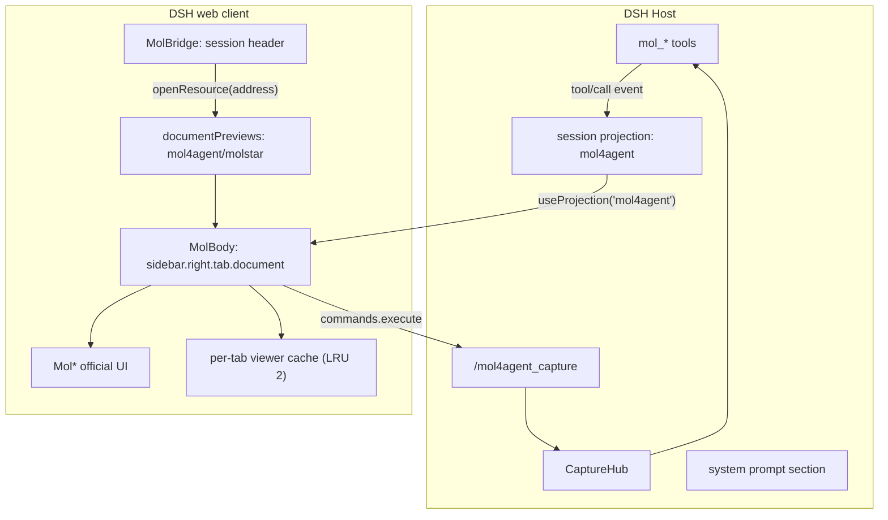
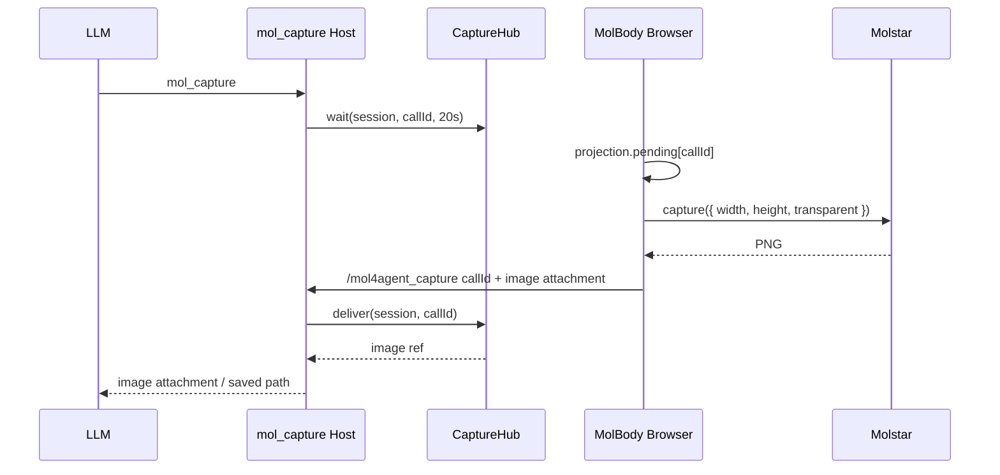

# @gcszhn/mol4agent-deepseekharness

[English](README.md) | [中文](README_zh.md)

DeepSeek Harness (DSH) adapter for mol4agent: a right-sidebar molecular document
preview that an agent can operate.

- **Structure preview**: `.pdb`, `.ent`, `.pdbqt`, `.pqr`, `.cif`, `.mmcif`,
  `.mcif`, `.bcif`, `.mol`, `.sdf`, `.sd`, `.mol2`, `.xyz`, `.gro` open in
  Mol*'s official UI instead of plain text. The previewer's **Open with** menu
  still offers code/plain text.
- **Agent tools**: `mol_info`, `mol_open`, `mol_style`, `mol_select`,
  `mol_measure`, `mol_capture`.
- **Agent-driven page**: tool calls are folded into a durable session
  projection; the open page follows it and applies commands.
- **Auto-open**: naming a new structure reveals its preview through a
  session-header bridge.
- **Screenshots**: the page renders a PNG and delivers it back to the blocked
  tool call; a copy is saved under `.mol4agent/captures/`.

## Architecture



**Boundary**: all path handling lives here — suffix to `MolFormat`, workspace
reads, authorization, sessions, projections, UI. `@gcszhn/mol4agent-core` only
receives bytes plus an explicit format.

## Agent tools

All tools are Host tools. Mutating tools are registered with
`isConcurrencySafe: () => false`. The Host tool body validates arguments and
reads files for summaries; the **projection** turns the recorded `tool/call`
into viewer commands, so the page changes even if the tool card is scrolled
away.

| Tool | Parameters | Behavior |
|---|---|---|
| `mol_info` | `path` | Summarize chains, residues, atoms, ligands. Does not open a viewer or change the scene. |
| `mol_interface` | `path`, `chainsA`, `chainsB`, `cutoff?` | Find interface residues between two chain groups (default 8 Å) in PDB-like files. Returns ranges for `mol_style`/`mol_focus`. |
| `mol_open` | `path`, `type?`, `color?`, `select?`, `focus?` | Set a new active scene. Emits `represent` and optionally `select`/`focus`. Opens/reveals the preview via the bridge. |
| `mol_style` | `type?`, `color?`, `target?`, `colorParams?` | Append `represent`. Without `target` it replaces the scene representation; with `target` it adds a representation to that selection only. `colorParams` carries e.g. `{"value": 16711680}` for uniform red. |
| `mol_select` | `target`, `mode?`, `focus?` | Append `select`. `mode` is `select` or `highlight`. |
| `mol_focus` | `target?` | Append `focus`; target omitted frames the whole structure. |
| `mol_measure` | `kind`, `targets` | Append `measure`. 2 targets for distance, 3 for angle, 4 for dihedral. |
| `mol_capture` | `width?`, `height?`, `transparent?` | Block until the open page delivers a PNG (default 1024×768). Returns an image attachment when the routed model accepts images, plus the saved path. |

`path` is absolute or relative to the session working directory. Files are
limited to 64 MiB.

`mol_info` example:

```json
{ "path": "fixtures/1atp.pdb" }
```

`mol_open` example:

```json
{
  "path": "fixtures/1atp.pdb",
  "type": "cartoon",
  "color": "chain-id",
  "select": { "kind": "ligand" },
  "focus": true
}
```

`mol_select` selectors:

```json
{ "kind": "ligand" }
{ "kind": "chain", "chain": "A" }
{ "kind": "residues", "chain": "A", "start": 10, "end": 25 }
{ "kind": "residue", "chain": "A", "index": 42 }
{ "kind": "comp", "compId": "ATP" }
```

Interface workflow:

```json
{ "path": "fixtures/7czd.pdb", "chainsA": ["A"], "chainsB": ["B"], "cutoff": 8 }
```

```json
{ "type": "cartoon", "color": "uniform", "colorParams": { "value": 8421504 } }
```

```json
{ "type": "ball-and-stick", "color": "uniform",
  "colorParams": { "value": 16711680 },
  "target": { "kind": "residues", "chain": "A", "start": 28, "end": 54 } }
```

Call the last command once per returned range, then `mol_focus` on a central
range.

`mol_capture` returns:

```ts
{
  attachment: ImageAttachmentRef
  width: number
  height: number
  path: string
  savedPath?: string
  imageCapable: boolean
  diagnostics?: Record<string, unknown>
}
```

- The image is attached to the tool result only when `imageCapable` is true;
  otherwise the text result contains the saved path.
- `savedPath` is `<cwd>/.mol4agent/captures/mol4agent-<timestamp>-<id>.png`.
- `diagnostics` is reserved for a browser-supplied layout/hierarchy report.

### Tool-call to command mapping

| Tool | Scene effect |
|---|---|
| `mol_open` | New `sceneKey`; commands `[represent, select?]` or `[represent, focus?]` |
| `mol_style` | Append `{ op: 'represent', style, target? }` |
| `mol_select` | Append `{ op: 'select', target, mode, focus? }` |
| `mol_focus` | Append `{ op: 'focus', target? }` |
| `mol_measure` | Append `{ op: 'measure', kind, targets }` |
| `mol_capture` | Add a pending capture entry; no viewer command |
| `mol_interface` | None; returns computed ranges only |
| `mol_info` | None |

## Session projection

The projection key is **`mol4agent`**. It is registered on the Host, folded from
session events, and exposed to the browser through the projection wire.

```ts
interface MolSessionState {
  revision: number
  cwd?: string
  scene: {
    sceneKey: string   // `${absolutePath}#${callId}`
    path: string
    format: MolFormat
    label: string
    commands: MolCommand[]
  } | null
  pending: Record<string, {
    callId: string
    width?: number
    height?: number
    transparent?: boolean
  }>
}
```

- `tool/call` for any `mol_*` tool is folded into `scene`/`pending` and bumps
  `revision`.
- `tool/result` clears the matching `pending` entry and bumps `revision`.
- Relative paths are resolved against `cwd` captured when the projection is
  initialized.
- The projection is replayable: it stores paths and JSON commands, never bytes.
- `sceneKey` changes when the agent opens a file anew. The client uses it to
  reload the structure and reset the applied-command cursor.

The client reads the scene with `props.useProjection('mol4agent')`. It reads the
file bytes separately through `remote.workspaceFiles.readBytes`, then calls
`@gcszhn/mol4agent-core` with `{ data, format, label }`.

## Document preview

The client registers one preview implementation:

```ts
ctx.documentPreviews.register({
  id: 'mol4agent/molstar',
  extensions: PREVIEW_EXTENSIONS,
  binaryExtensions: ['bcif'],
  priority: 'extension',
  title: () => t('viewer'),
  loading: 'renderer',
  wrap: false,
})
```

- `priority: 'extension'` makes it the default renderer for the claimed
  suffixes; code/plain text remain selectable via **Open with**.
- The body is registered in the `sidebar.right.tab.document` slot, keyed by
  `mol4agent/molstar`.
- `wrap: false` means the preview scrolls nothing above the viewer; Mol*'s own
  UI fills the body.

The body:

1. parses the session path from the `dsh-resource://` address;
2. maps the suffix to a `MolFormat` (adapter-only logic);
3. reads bytes through `remote.workspaceFiles.readBytes`;
4. creates/reuses a Mol* viewer and calls `load()`;
5. follows the projection and applies new commands incrementally;
6. captures and delivers PNGs when `pending` contains its call.

The header bridge is registered in `conversation.session.header.utilities`. It
opens the resource for a new `sceneKey`; a scene that already existed when the
session is opened is not auto-opened (the chip reopens it).

## Screenshot loop



`CaptureHub` keys waiters by `sessionId + callId`; deliveries that arrive before
the tool starts waiting are buffered for 30 s. The internal command is registered
with `input: { attachments: true }` and `recordInput: false`.

## Viewer behavior

- **Official Mol* UI**: `createPluginUI` + `DefaultPluginUISpec`. The viewer is
  bundled into `client.js`; there is no lazy chunk.
- **Layout**: chosen from the viewer container's aspect ratio, not the browser
  window. Tall containers use Mol*'s `portrait` layout, wide containers use
  `landscape`. The official control-panel set (top sequence, left State
  Tree/Home, right Structure Tools) **starts closed** (`showControls: false`);
  the viewport's sliders button toggles it open. Mol* renders these regions only
  while `showControls` is true.
- **Theme**: the Mol* skin and canvas background follow DSH's
  `theme/change` event.
- **Tab cache**: an unmounted preview parks its whole Mol* container in a hidden
  holder; remounting the same tab reattaches and resizes instead of re-reading
  the file. The two most recent tabs are kept; plugin unload disposes them.
- **Ligands stay visible**: global `cartoon` uses Mol*'s
  `polymer-and-ligand` preset. When replacing a representation, core snapshots
  old representation refs and removes only those after the new ones exist.

## Build

```sh
pnpm build
# or: pnpm --filter @gcszhn/mol4agent-core build && pnpm --filter @gcszhn/mol4agent-deepseekharness build
```

Produces:

- `lib/host.js` — Host ESM; `@deepseek-ai/*` and `node:*` external.
- `lib/client.js` — DSH lazy-CJS browser module, wrapped in
  `window.__ModuleLoader__.load({ id, factory })`; includes Mol* and the
  official UI CSS.

The build writes client/host through temporary files and atomic renames, so a
page loading during a rebuild never reads a half-written bundle.

## Install

The package is a DSH bundle. From this checkout:

```sh
cd /path/to/mol4agent
pnpm build
dsh plugin --profile desktop add link:"$PWD/packages/deepseek-harness"
```

`dsh plugin` forwards to pnpm in `~/.dsh/profiles/<profile>`. Ensure
`@gcszhn/mol4agent-deepseekharness` is in that profile's `dsh.profile.bundles`
(the DSH Plugin manager does this when installing/enabling a bundle), then
restart DSH.

npm form (0.1.0):

```sh
dsh plugin --profile desktop add @gcszhn/mol4agent-deepseekharness@0.1.0
```

The current Desktop `desktop` profile is installed via `plugin_manager` and
enabled as `@gcszhn/mol4agent-deepseekharness`.

- Host change: rebuild, then **restart DSH** (the Host loads `lib/host.js` at
  startup).
- Client change: rebuild, then **refresh the page**; no restart is needed.
- The package manifest contributes `lib/host.js`, `lib/client.js`, the locale
  dictionaries, icon, and `cordis.patch.yml`. The npm `files` allowlist excludes
  `src/`, `AGENTS.md`, and build scripts; `prepack` runs the build.

## Limitations

- BCIF can be rendered but `mol_info` cannot summarize it from raw bytes yet.
- Files are capped at 64 MiB.
- WebGL is required for the 3D canvas.
- `mol_capture` requires the structure preview to be open; it times out after
  20 s and leaves an internal `mol4agent_capture` command row.
- `mol_style` without `target` changes the global representation; with `target`
  it adds a selection component. Labels are not exposed as a tool yet.
- `mol_interface` currently parses PDB-like ATOM records (`pdb`/`pdbqt`/`pqr`)
  only; mmCIF/BCIF interface calculation is not implemented.
- An 8 Å cutoff can produce a large interface (7CZD A/B: 91 residues); lower
  the cutoff or focus a single range for a cleaner figure.
- One active scene per session: `mol_open` replaces the scene. Cached viewers
  remain for tab switches but no longer receive commands after a new scene.
- The tab cache keeps two viewers; closing a tab does not immediately free its
  cached viewer (it is evicted by the LRU or plugin unload).
- The session bridge does not auto-open a scene that already existed when the
  session was restored; use the header chip.

## Files

- Host: `src/host/{index,projection,tools,capture,commands,prompt,paths}.ts`
- Client: `src/client/{index,document,bridge}.tsx`, `src/client/{viewer-cache,locale,core-loader}.ts`
- Shared: `src/{formats,state,selector}.ts`
- Package: `package.json`, `cordis.patch.yml`, `locale/{en,zh}.json`, `icon.svg`
- Details: [docs/DETAIL.md](docs/DETAIL.md), [Core API](../core/README.md),
  [Architecture](../../docs/architecture.md)

Chinese translation: [README_zh.md](README_zh.md).
