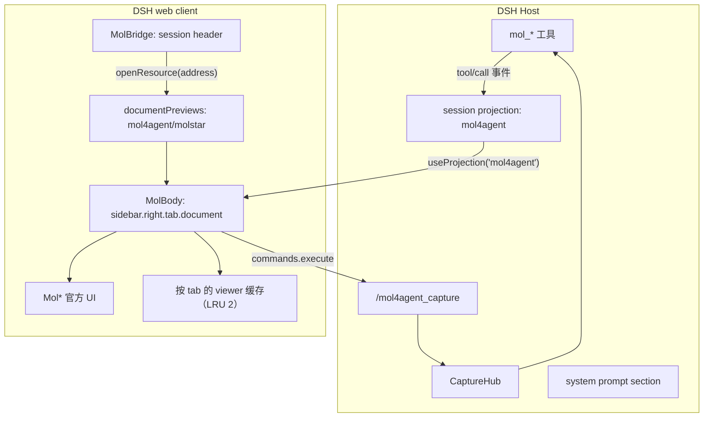
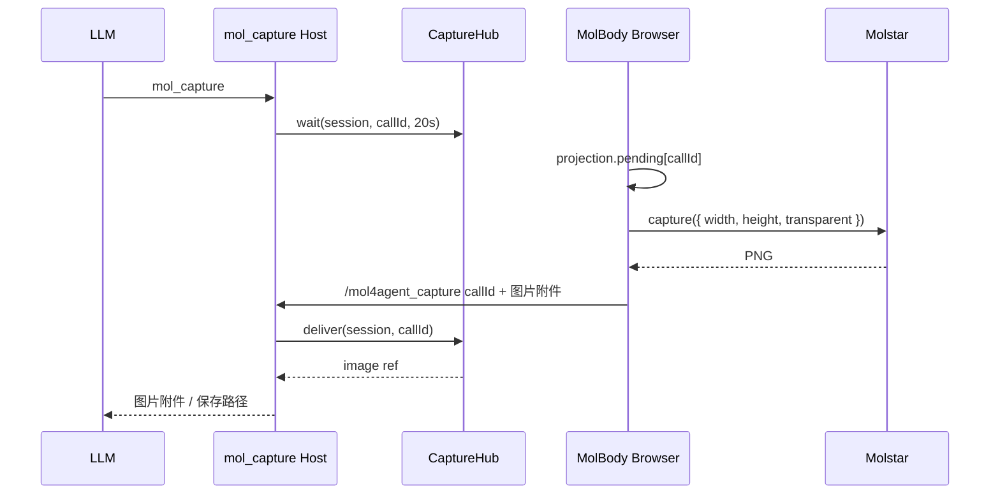

# @gcszhn/mol4agent-deepseekharness

[English](README.md) | 中文

mol4agent 的 DeepSeek Harness（DSH）适配包：右侧栏分子文档预览，agent 可直接操作。

- **结构预览**：`.pdb`、`.ent`、`.pdbqt`、`.pqr`、`.cif`、`.mmcif`、`.mcif`、
  `.bcif`、`.mol`、`.sdf`、`.sd`、`.mol2`、`.xyz`、`.gro` 默认用 Mol* 官方
  UI 打开，而不是纯文本。每个后缀也接受 `.gz` 变体（例如 `.pdb.gz`、
  `.cif.gz`、`.sdf.gz`），适配器会先解压再交给 core。预览器的「打开方式」仍
  可切回代码/纯文本（`bcif` 是二进制，没有纯文本回退）。
- **agent 工具**：`mol_info`、`mol_interface`、`mol_fetch`、`mol_open`、
  `mol_style`、`mol_select`、`mol_focus`、`mol_measure`、`mol_capture`。
- **数据库抓取**：`mol_fetch` 可把 PDB 条目（PDB/mmCIF/BinaryCIF）、AlphaFold
  DB 预测结构、PubChem 化合物和 ChEMBL 小分子下载到工作区，agent 可以直接
  从条目 id 开始，而不需要本地文件。
- **agent 驱动页面**：工具调用被折叠进可持久化的 session projection；打开的
  页面跟随它并应用命令。
- **自动打开**：agent 指定新结构时，通过 session header 的 bridge 打开对应
  预览。
- **截图**：页面渲染 PNG 并回传给阻塞中的工具调用；副本保存到
  `.mol4agent/captures/`。

## 架构



**边界**：所有路径处理都在本适配包——后缀到 `MolFormat`、工作区读取、鉴权、
session、projection、UI。`@gcszhn/mol4agent-core` 只接收字节 + 显式 format。

## Agent 工具

全部是 Host 工具。会改变场景的工具都注册为
`isConcurrencySafe: () => false`。Host 工具主体负责校验参数、为摘要读取文件；
真正驱动页面的是 **projection**：它把记录下来的 `tool/call` 变成 viewer 命令，
所以即使工具卡片滚出视野，页面也会变化。

| 工具 | 参数 | 行为 |
|---|---|---|
| `mol_info` | `path` | 摘要链、残基、原子、配体。不打开 viewer，也不改变场景。 |
| `mol_interface` | `path`、`chainsA`、`chainsB`、`cutoff?` | 在 PDB-like 文件中找两个链组之间的界面残基（默认 8 Å，0 < cutoff ≤ 30），返回可用于 `mol_style`/`mol_focus` 的区间。 |
| `mol_fetch` | `entry_id`、`target_path`、`source_db?` | 从在线数据库下载结构并保存到 `target_path`。`source_db` 默认 `rcsb-pdb`，见[数据库来源](#数据库来源)。目标为目录（或以 `/` 结尾）时自动追加来源文件名；无后缀的路径补上来源后缀。返回保存路径和结构摘要。 |
| `mol_open` | `path`、`type?`、`color?`、`colorParams?`、`select?`、`focus?` | 按规范化（canonical）的 `/` 分隔绝对路径创建/更新 tab 页面并设为活动 tab；发出 `represent`，可选 `select`/`focus`。tab 页面 id 即该路径。 |
| `mol_style` | `tab?`、`type?`、`color?`、`target?`、`colorParams?` | 给指定 tab（默认活动 tab）追加 `represent`。不传 `target` 替换整个场景表示；传 `target` 只给该选择添加表示。`colorParams.value` 只对 `uniform` 生效，可传 CSS 名称（`"red"`）、十六进制（`"#ff0000"`）或整数（`16711680`）；非法颜色会被拒绝，结果会回显解析后的十六进制。 |
| `mol_select` | `tab?`、`target`、`mode?`、`focus?` | 追加 `select`；`mode` 为 `select` 或 `highlight`。 |
| `mol_focus` | `tab?`、`target?` | 追加 `focus`；不传 target 聚焦整个结构。 |
| `mol_measure` | `tab?`、`kind`、`targets` | 追加 `measure`；距离 2 个目标，角度 3 个，二面角 4 个。 |
| `mol_capture` | `tab?`、`width?`、`height?`、`transparent?` | 阻塞等待目标 tab 回传 PNG（默认 1024×768）；当前模型支持图片时把图片作为附件返回，并在可用时给出 `savedPath`。 |

`path` 是绝对路径，或相对 session 工作目录；`target_path` 规则相同。文件
上限 64 MiB；gzip 解压后同样限制 64 MiB。

tab 页面 id 在所有平台上都是规范化（`/` 分隔）的绝对路径：
`mol_open`/`mol_fetch` 回显 `D:/work/5jds.pdb`，`tab` 既接受该形式，也接受
Windows 原生的 `D:\work\5jds.pdb`。路径 key 的不变量见
[Session projection](#session-projection)。

### 数据库来源

| `source_db` | `entry_id` | 保存格式 |
|---|---|---|
| `rcsb-pdb`（默认） | 4 字符 PDB id，例如 `1crn` | `.pdb` |
| `rcsb-cif` | 4 字符 PDB id，例如 `1crn` | `.cif`（mmCIF） |
| `rcsb-bcif` | 4 字符 PDB id，例如 `1crn` | `.bcif`（BinaryCIF） |
| `alphafold` | UniProt accession，例如 `P00533` | `.pdb` |
| `pubchem` | CID（`2244`）或化合物名（`aspirin`） | `.sdf`（3D） |
| `chembl` | ChEMBL id（`CHEMBL25`）或纯数字（`25`） | `.sdf` |

条目 id 的规范化和校验在 core（`@gcszhn/mol4agent-core/sources`）；Host 负责
HTTPS 下载，上限 64 MiB、30 秒超时，并先写临时文件再原子替换，失败的抓取
不会留下半个结构。目标文件已存在会被覆盖。AlphaFold 的文件名带版本号，所以
Host 会先通过 AlphaFold JSON API 解析 `0.pdbUrl`，再下载实际文件。

`mol_fetch` 示例：

```json
{ "entry_id": "1crn", "target_path": "fixtures/1crn.pdb" }
{ "entry_id": "aspirin", "source_db": "pubchem", "target_path": "fixtures/" }
{ "entry_id": "P00533", "source_db": "alphafold", "target_path": "egfr.pdb" }
```

`mol_info` 示例：

```json
{ "path": "fixtures/1atp.pdb" }
```

`mol_open` 示例：

```json
{
  "path": "fixtures/1atp.pdb",
  "type": "cartoon",
  "color": "chain-id",
  "select": { "kind": "ligand" },
  "focus": true
}
```

`mol_select` 选择器：

```json
{ "kind": "ligand" }
{ "kind": "chain", "chain": "A" }
{ "kind": "residues", "chain": "A", "range": "10-25, 40" }
{ "kind": "residue", "chain": "A", "index": 42 }
{ "kind": "comp", "compId": "ATP" }
```

`range` 按数字残基编号选择，因此共享同一编号的插入码残基会被一起选中
（`100`、`100A`、`100B` 都命中 `"100"`）。要精确选中某一个，用 `schema`
选择器：

```json
{ "kind": "schema",
  "schema": { "auth_asym_id": "H", "auth_seq_id": 100, "pdbx_PDB_ins_code": "A" } }
```

空字符串表示“无插入码”。需要真正的序列位置时用 `residue_index`（0-based
源顺序）。

selector kind 是互斥的：`range` 和 `schema` 是二选一，混用顶层字段会被适配器
拒绝。要组合谓词，把全部字段放进一个 `schema` 对象。

界面操作流程：

```json
{ "path": "fixtures/7czd.pdb", "chainsA": ["A"], "chainsB": ["B"], "cutoff": 8 }
```

```json
{ "type": "cartoon", "color": "uniform", "colorParams": { "value": 8421504 } }
```

```json
{ "type": "ball-and-stick", "color": "uniform",
  "colorParams": { "value": 16711680 },
  "target": { "kind": "residues", "chain": "A", "range": "28-54" } }
```

`range` 是逗号分隔的闭区间残基编号（`12`、`5-10`；默认 `auth_seq_id`，
`auth:false` 时用 `label_seq_id`），因此每条界面链只需一次 `mol_style`，再对
一个中心链范围调用 `mol_focus`。

`mol_capture` 返回：

```ts
{
  attachment: ImageAttachmentRef
  width: number
  height: number
  path: string
  savedPath?: string
  imageCapable: boolean
  diagnostics?: Record<string, unknown>
}
```

- 只有 `imageCapable` 为 true 时，图片才会作为工具结果附件；否则文本结果会
  说明附件已生成，并在可用时给出保存路径。
- `savedPath` 为 `<cwd>/.mol4agent/captures/mol4agent-<timestamp>-<id>.png`。
- `diagnostics` 包含浏览器侧的 status/path/命令数量以及 Mol* 层级诊断。

### 工具调用到命令的映射

| 工具 | 场景效果 |
|---|---|
| `mol_open` | 新 `sceneKey`；命令 `[represent, select?]` 或 `[represent, focus?]` |
| `mol_style` | 追加 `{ op: 'represent', style, target? }` |
| `mol_select` | 追加 `{ op: 'select', target, mode, focus? }` |
| `mol_focus` | 追加 `{ op: 'focus', target? }` |
| `mol_measure` | 追加 `{ op: 'measure', kind, targets }` |
| `mol_capture` | 添加 pending 截图项；不产生 viewer 命令 |
| `mol_interface` | 无；只返回计算出的区间 |
| `mol_fetch` | 无；只下载文件 |
| `mol_info` | 无 |

## Session projection

projection key 是 **`mol4agent`**。它在 Host 注册、从 session 事件折叠，并通过
projection wire 暴露给浏览器。

```ts
interface MolSessionState {
  revision: number
  cwd?: string
  tabs: Record<string, {
    sceneKey: string   // `${canonicalPath}#${callId}`
    path: string       // 规范化的 `/` 分隔绝对路径
    format: MolFormat
    label: string
    commands: MolCommand[]
  }>
  active: string | null   // 规范化的 `/` 分隔绝对路径
  pending: Record<string, {
    callId: string
    path?: string
    width?: number
    height?: number
    transparent?: boolean
  }>
}
```

- `mol_open` 添加/替换 `tabs[path]` 并设置 `active`；每个 tab 页面有独立的
  `sceneKey` 和命令列表。`mol_style`/`mol_select`/`mol_focus`/`mol_measure`
  折叠进 `tab` 参数（缺省为活动 tab）并递增 `revision`。
- `mol_capture` 按 `tab` 参数（缺省为活动 tab）添加 pending 并递增
  `revision`；header bridge 会激活目标 tab 以完成截图。只读工具（`mol_info`、
  `mol_interface`）和非法 selector/format 参数保持状态不变；文件读取失败时
  仍可能先创建/切换 tab，随后 Host 工具报错。
- `tool/result` 清除对应的 pending 截图项并递增 `revision`；其他结果保持状态
  不变。
- 相对路径基于 projection 初始化时捕获的 `cwd` 解析。
- tab key 必须**规范化**：`/` 分隔、盘符大写的绝对路径
  （`D:/work/5jds.pdb`）。DSH resource 地址和 Sidebar tab 注册表在所有平台上
  都用 `/` 分隔，body 也从地址反推路径；若用 Host 原生的 Windows 写法
  （`D:\work\5jds.pdb`）做 `tabs`/`active` 的 key，所有 scene 工具查找和
  截图都会静默 miss。`openScene`、`tabOf`、Host 工具侧的 scene 查找和 body
  都通过 `canonicalTabPath`（`src/tab-path.ts`）规范化，`mol_open`/`mol_fetch`
  也回显该形式。
- projection 可重放：只存路径和 JSON 命令，不存字节。
- agent 重新打开该 tab 时 `sceneKey` 变化；只有该 tab 重新加载结构（清掉旧
  measurement/选择样式）并重置自己的命令游标，其他 tab 不受影响。

client 通过 `props.useProjection('mol4agent')` 选择自己的 `tabs[path]`，其中
`path` 是资源地址解析结果经 `canonicalTabPath()` 规范化后的值；文件字节另经
`remote.workspaceFiles.readBytes` 读取，然后调用 `@gcszhn/mol4agent-core`，
传入 `{ data, format, label }`。

## 文档预览

client 注册一个预览实现：

```ts
ctx.documentPreviews.register({
  id: 'mol4agent/molstar',
  extensions: PREVIEW_EXTENSIONS,
  binaryExtensions: ['bcif'],
  priority: 'extension',
  title: () => t('viewer'),
  loading: 'renderer',
  wrap: false,
})
```

- `priority: 'extension'` 让它成为这些后缀的默认渲染器；代码/纯文本仍可在
  「打开方式」里选择。
- body 注册在 `sidebar.right.tab.document` slot，key 为 `mol4agent/molstar`。
- `wrap: false` 表示预览不在 viewer 上方额外包滚动容器；Mol* 自己的 UI 填满
  body。

body 的流程：

1. 从 `dsh-resource://` 地址解析 session path；
2. 后缀映射为 `MolFormat`（适配包逻辑）；
3. 通过 `remote.workspaceFiles.readBytes` 读字节；
4. 创建/复用 Mol* viewer 并调用 `load()`；
5. 跟随 projection，增量应用新命令；
6. 当 `pending` 中有自己的 call 时截图并回传。

session header bridge 注册在 `conversation.session.header.utilities`。新
新 tab 或重新打开的 tab 出现时打开对应资源；有 pending capture 时激活目标
tab；session 打开时已经存在的 tab 不会自动打开（用 header 上的 chip 重新打开
活动 tab）。

## 截图链路



`CaptureHub` 用 `sessionId + callId` 作为 waiter key；先于工具等待到达的投递
会缓冲 30 秒。内部命令注册为 `input: { attachments: true }`、
`recordInput: false`。

body 不会在首帧就截图：它先等待画布完成布局、representation 就绪，再在 PNG
仍只有背景色时重试（Windows/ANGLE 在 `mol_open` 之后可能先呈现一帧空画面）。
截图 report 会带上 `visibleContent`；应用 scene 时观察到的命令失败会以
`applyErrors` 写进 `diagnostics`，因此工具的乐观提示无法掩盖客户端拒绝。

## Viewer 行为

- **官方 Mol* UI**：`createPluginUI` + `DefaultPluginUISpec`。viewer 打进
  `client.js`，没有懒加载 chunk。
- **布局**：按 viewer 容器的宽高比选择，而不是浏览器窗口。高容器用 Mol* 的
  `portrait` 布局，宽容器用 `landscape`。官方控制面板组（顶部 sequence、
  左侧 State Tree/Home、右侧 Structure Tools）**默认关闭**
  （`showControls: false`）；点 viewport 上的滑杆按钮展开。Mol* 只在
  `showControls` 为 true 时渲染这些 region。
- **主题**：Mol* 皮肤和画布背景跟随 DSH 的 `theme/change`。
- **tab 作用域**：每个文档 tab 有独立 viewer、缓存和 projection scene。
  `mol_open` 返回 tab 页面 id（规范化的 `/` 分隔绝对路径）；给
  `mol_style`/`mol_select`/`mol_focus`/`mol_measure`/`mol_capture` 传 `tab`
  即可独立操作该 tab；省略 `tab` 使用最后打开的 tab。切换 tab 保留所有 viewer
  状态；截图会激活目标 tab。
- **tab 缓存**：预览卸载时把整个 Mol* 容器停到隐藏 holder；同一个 tab 重新
  mount 时 reattach + resize，而不是重新读文件。保留最近 2 个 tab；插件卸载
  时统一 dispose。
- **配体保持可见**：全局 `cartoon` 使用 Mol* 的 `polymer-and-ligand` preset。
  替换表示时，core 先快照旧 representation ref，等新表示建好后再只删除旧 ref。

## 构建

```sh
pnpm build
# 或：pnpm --filter @gcszhn/mol4agent-core build && pnpm --filter @gcszhn/mol4agent-deepseekharness build
```

产出：

- `lib/host.js` — Host ESM；`@deepseek-ai/*` 和 `node:*` external。
- `lib/client.js` — DSH lazy-CJS browser module，包在
  `window.__ModuleLoader__.load({ id, factory })` 里；内含 Mol* 和官方 UI CSS。

构建通过临时文件 + 原子 rename 写 client/host，页面在重建期间不会读到半截
bundle。

## 安装

本包是 DSH bundle。在本仓库根目录执行：

```sh
cd /path/to/mol4agent
pnpm build
dsh plugin --profile desktop add link:"$PWD/packages/deepseek-harness"
```

`dsh plugin` 会把参数转发给 `~/.dsh/profiles/<profile>` 下的 pnpm。还需要把
`@gcszhn/mol4agent-deepseekharness` 放进该 profile `package.json` 的
`dsh.profile.bundles`（DSH Plugin manager 安装/启用时会自动处理），然后重启
DSH。

npm 形式（0.4.0，已发布）：

```sh
dsh plugin --profile desktop add @gcszhn/mol4agent-deepseekharness@0.4.0
```

当前 Desktop `desktop` profile 已通过 `plugin_manager` 安装，并启用为
`@gcszhn/mol4agent-deepseekharness`。

- Host 变更：重新 build，然后**重启 DSH**（Host 启动时加载 `lib/host.js`）。
- Client 变更：重新 build，然后**刷新页面**；不需要重启。
- package manifest 贡献 `lib/host.js`、`lib/client.js`、locale 字典、图标和
  `cordis.patch.yml`。npm `files` 排除 `src/`、`AGENTS.md` 和构建脚本；
  `prepack` 会先构建。

## 限制

- BCIF 可以渲染，但 `mol_info` 目前还不能从 raw bytes 摘要。
- gzip 变体由适配器解压；压缩前或解压后超过 64 MiB 都会拒绝。浏览器预览
  gzip 需要 `DecompressionStream`。
- 文件上限 64 MiB。
- 3D 画布需要 WebGL 2。
- `mol_capture` 要求结构预览处于打开状态；20 秒超时。**超时不会**产生命令
  记录；只有成功回传时才留下一条内部 `mol4agent_capture` 命令记录。
- `mol_style` 不传 `target` 时修改全局表示；传 `target` 时添加选择 component。
  标签（label）还没有暴露成工具。
- `mol_interface` 目前只解析 PDB-like ATOM 记录（`pdb`/`pdbqt`/`pqr`）；
  mmCIF/BCIF 的界面计算尚未实现。
- `mol_fetch` 需要 DSH Host 能访问外网 HTTPS。下载上限 64 MiB、30 秒超时；
  抓取失败不会写出半个文件。PubChem 请求的是 3D SDF（`record_type=3d`），
  没有 3D 构象的化合物会返回 HTTP 404。下载内容按未压缩保存，因此 `.gz`
  目标会被拒绝。
- 8 Å cutoff 可能产生很大的界面（7CZD A/B：91 个残基）；想要更干净的图可
  降低 cutoff 或只聚焦一个区间。
- tab 页面 id 是规范化的 `/` 分隔绝对路径；以任一分隔符重新打开同一路径都会
  更新该 tab（新的 `sceneKey`），不会为同一 DSH resource 创建第二个 tab。
- tab 缓存保留 2 个 viewer；关闭 tab 不会立刻释放缓存（由 LRU 或插件卸载
  回收）。
- session 恢复时，已经存在的 tab 不会自动打开；用 header 上的 chip。

## 文件

- Host：`src/host/{index,projection,tools,capture,commands,prompt,paths,interface}.ts`
- Client：`src/client/{index,document,bridge}.tsx`、`src/client/{viewer-cache,locale,core-loader,address}.ts`
- 共享：`src/{formats,state,selector}.ts`
- 包：`package.json`、`cordis.patch.yml`、`locale/{en,zh}.json`、`icon.svg`
- 细节：[docs/DETAIL.md](docs/DETAIL.md)、[Core API](../core/README_zh.md)、
  [架构](../../docs/architecture_zh.md)

English: [README.md](README.md)。
