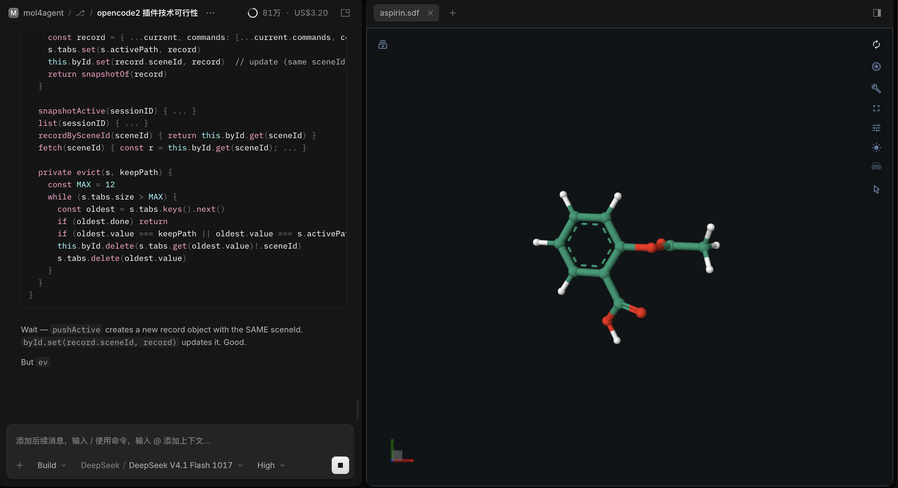

# @gcszhn/mol4agent-opencode

OpenCode 2 adapter for [mol4agent](../../README.md): an in-harness Mol* 3D viewer
side panel that the agent operates with `mol_*` tools.

- **In-harness preview**: `mol_open` (agent), **Ctrl+P file search** (`/open`)
  via LinkHandler, and the "Open molecular structure" pick-file command (human)
  render a structure in the side panel's official Mol* UI — no external app.
- **Agent-operated page**: `mol_style`, `mol_select`, `mol_focus`, `mol_measure`
  mutate the open page; `mol_info` and `mol_interface` summarize files without a
  viewer.
- **Database fetch**: `mol_fetch` downloads a structure from RCSB PDB
  (PDB/mmCIF/BinaryCIF), AlphaFold DB, PubChem, or ChEMBL and saves it on the
  session's server, ready for `mol_open`.
- **Screenshots**: `mol_capture` renders the viewport to a PNG saved under
  `.mol4agent/captures/`.
- **Tabs keep state**: each structure has its own viewer tab; switching tabs
  keeps its camera, style, and selection. Viewers also survive switching session
  tabs; opening the same session again shows the previous state. Closing a
  structure tab disposes its viewer (closed-session viewers are cleaned up when
  the window unloads).

> **Tip**: every open structure keeps a live Mol* viewer (WebGL context and
> memory) alive across tab/session switches. The adapter keeps at most 12 live
> viewers and releases the oldest hidden one when the cap is exceeded. Open only
> the structures you need, and close the structure tabs when you are done.

- **Same molecular semantics as DSH/ChatGPT**: this adapter passes the same
  `MolFormat`, selectors, commands, and capture semantics to
  `@gcszhn/mol4agent-core`.
- **Formats**: `.pdb`, `.ent`, `.pdbqt`, `.pqr`, `.cif`, `.mmcif`, `.mcif`,
  `.bcif`, `.mol`, `.sdf`, `.sd`, `.mol2`, `.xyz`, `.gro`, and `.gz` variants
  (decoded server-side before core).



## Open a structure (OpenCode)

- **Agent**: `mol_open` (run `mol_info` first to pick chains/residues).
- **Human**:
  - **Ctrl+P file search** (the `/open` command) → type the file name → select the `.pdb`/`.cif`/... entry. It opens in the Mol* panel via the `LinkHandler`.
  - **Open molecular structure** command (system file picker).
- **No `/mol_open` slash command**: its name would collide with the agent tool
  `mol_open`; Ctrl+P (that is, `/open`) and the pick-file command cover the
  human paths.
- **Not the built-in file tree**: clicking a `.pdb` in the file tree opens the plain-text editor. OpenCode does not route file-tree clicks to plugins (a `FileViewer` registered for the `"text"` kind is ignored), so use **Ctrl+P** (`/open`) instead of clicking the tree.

## Architecture

The package is an OpenCode plugin with three parts:

- **server** (`exports["."]`, `src/server.ts`): registers the `mol_*` tools and
  the `mol4agent` RPC. It is the only place that sees paths, reads bytes, and
  stores the scene log.
- **GUI** (`exports["./gui-experimental"]`, `src/gui/`): a side `Panel` with one
  Mol* viewer tab per open structure, the launcher, the pick-file command, and a
  `LinkHandler` (Ctrl+P file search, i.e. `/open`, and `.pdb` links open the
  structure). It follows scenes through RPC and renders/delivers screenshots.
  It targets each session's own server (`session.server.client`), because the
  window's `ctx.client` is always the built-in local server.
- **RPC** (`exports["./rpc"]`, `src/rpc.ts`): the typed `mol4agent` contract.

Core receives only `{ data, format, label }` plus JSON commands; paths, suffix
detection, IO, sessions, and UI all stay in this adapter.

## Compatibility

Requires **OpenCode 2.2.0 or newer** — the `@opencode/plugin/gui` window API
(`./gui`, `./gui/file`, `./gui/vite`, panel/RPC registration) was introduced in
`@opencode/plugin` 2.2.0. Built and verified on **2.3.0**; the package declares a
`@opencode/plugin` peer dependency of `>=2.2.0 <3.0.0`.

OpenCode v1 cannot run this adapter: v1 is a terminal UI with no GUI plugin
layer, no custom RPC, and no DOM/WebGL for Mol*. Its server/TUI plugins cannot
render an interactive 3D page or return a rendered screenshot, so only the
text-only `mol_info` / `mol_interface` / `mol_fetch` tools could be ported.

### Remote servers and the web

OpenCode 2.3 loads a plugin's GUI bundle from, and binds the GUI's `ctx.client`
to, the desktop app's **built-in server**, even while the routed session belongs
to a remote (SSH) server. This adapter treats the GUI as a thin client of the
session's own server:

- Every GUI RPC call uses `session.server.client` and the session's server-side
  location. `mol_open`, styling, focusing, measuring, and capture therefore run
  on the server that owns the session, and paths are resolved there against the
  session's workspace directory. The GUI never interprets a path with the
  client OS's rules.
- To view structures in a **remote desktop session**, install the plugin both on
  the desktop machine (global config: provides the GUI and the file picker) and
  on the remote server (provides the `mol_*` tools). A remote-only install shows
  the tools but no panel: the desktop does not load GUI bundles from a
  non-builtin server.
- The system file picker ("Open molecular structure") reads files on the
  desktop machine, so it is disabled for remote sessions. Use Ctrl+P file
  search, click a `.pdb`/`.cif` path in the conversation, or ask the agent to
  run `mol_open`; those paths are resolved on the session's server.

### Current limitation: the web UI is tool-only

The Mol* panel depends on the **desktop app's local GUI-plugin host**. The
OpenCode 2.3 web app served by `opencode serve` has no plugin-GUI bridge, so it
never mounts `./gui-experimental`: there is no side panel, no viewer, and no
capture target. The server half still works — `mol_open` records the scene and
the `mol_*` tools run on the session's server — but `mol_capture` times out
because no viewer exists to render it. Use the desktop app (local, or connected
to a remote server) for the viewer; a browser session is tool-only.

## Tools

| Tool | Behavior |
|---|---|
| `mol_info` | Summarize chains, residues, atoms, ligands. Does not open a viewer. |
| `mol_interface` | Find interface residues between two chain groups (PDB-like ATOM files). |
| `mol_fetch` | Download a database entry (`entry_id`, `target_path`, `source_db?`) and save it on the session's server. |
| `mol_open` | Open a structure in the side panel and make it the active scene. |
| `mol_style` | Change representation/color; with `target`, style a selection additively. `colorParams.value` applies to `uniform` (CSS name, hex, or integer). |
| `mol_select` | Select/highlight (and optionally focus) a selection. |
| `mol_focus` | Focus a selection or the whole structure. |
| `mol_measure` | Add a distance (2), angle (3), or dihedral (4) measurement. |
| `mol_capture` | Render the viewport to PNG and save under `.mol4agent/captures/`. |

Selectors are the same JSON shapes as the other adapters:

```json
{"kind":"ligand"}
{"kind":"chain","chain":"A"}
{"kind":"residues","chain":"A","start":10,"end":25}
{"kind":"residue","chain":"A","index":42}
{"kind":"comp","compId":"ATP"}
```

### Colours

`color` selects a Mol* colour **theme** (`chain-id`, `element-symbol`, ...).
`colorParams.value` only affects the `uniform` theme; `color: "uniform"` alone
is a theme name, not a colour.

`colorParams.value` accepts a CSS colour name (`"red"`, `"lightgrey"`), hex
(`"#f00"`, `"#ff000080"`), `0x`/bare hex (`"0xB0B0B0"`), `rgb()`/`rgba()`, or a
24-bit integer (`16711680`). Alpha is accepted but ignored. A value that cannot
be parsed is rejected before the scene changes, and `mol_style` echoes the
resolved hex, for example `Applied cartoon / uniform #ff0000 to polymer.`

Common values: red `0xff0000`, blue `0x0000ff`, white `0xffffff`, grey
`0x808080`, light grey `0xd3d3d3`.

### Database sources

`mol_fetch` takes `entry_id`, `target_path`, and an optional `source_db`
(default `rcsb-pdb`). `target_path` follows the same server-side rules as every
other path argument: absolute, or relative to the session workspace. A
directory (or a trailing slash) appends the source file name, and a suffix-less
path gets the source suffix.

| `source_db` | `entry_id` | Saved format |
|---|---|---|
| `rcsb-pdb` (default) | 4-character PDB id, e.g. `1crn` | `.pdb` |
| `rcsb-cif` | 4-character PDB id, e.g. `1crn` | `.cif` (mmCIF) |
| `rcsb-bcif` | 4-character PDB id, e.g. `1crn` | `.bcif` (BinaryCIF) |
| `alphafold` | UniProt accession, e.g. `P00533` | `.pdb` |
| `pubchem` | CID (`2244`) or compound name (`aspirin`) | `.sdf` (3D) |
| `chembl` | ChEMBL id (`CHEMBL25`) or bare number (`25`) | `.sdf` |

Entry ids are normalized and validated in core
(`@gcszhn/mol4agent-core/sources`); the OpenCode server performs the HTTPS
download, caps it at 64 MiB, times out after 30 s, and writes through a
temporary file so a failed fetch leaves no partial structure. Existing targets
are overwritten. AlphaFold file names are versioned, so the server resolves
`0.pdbUrl` through the AlphaFold JSON API before downloading.

```json
{ "entry_id": "1crn", "target_path": "fixtures/1crn.pdb" }
{ "entry_id": "aspirin", "source_db": "pubchem", "target_path": "fixtures/" }
{ "entry_id": "P00533", "source_db": "alphafold", "target_path": "egfr.pdb" }
```

## Install

### From npm

```sh
opencode plugin add @gcszhn/mol4agent-opencode
```

`plugin add` installs the package and writes it to the **global**
`opencode.json(c)`, so the desktop app loads its GUI part in every window.
Pin an exact version with `@0.2.0`, and confirm with `opencode plugin list`
(or **Settings > Extensions > Plugins** in the desktop app). The npm package is
published automatically when `packages/opencode/package.json` changes version on
`main`; use the local checkout path below to test unreleased changes.

### From a local checkout

Build core, then this package:

```sh
pnpm install
pnpm --filter @gcszhn/mol4agent-core build
pnpm --filter @gcszhn/mol4agent-opencode build
```

`opencode plugin add` only accepts npm/Git specs; point the global config at the
checkout directory instead:

```jsonc
{
  "$schema": "https://opencode.ai/config.json",
  "plugins": [
    "/absolute/path/to/mol4agent/packages/opencode"
  ]
}
```

The server part loads for the current location; the GUI part loads in the
desktop app from its built-in server (see [Remote servers and the
web](#remote-servers-and-the-web) for a remote setup). GUI rebuilds reload in
every window without a restart
(`pnpm --filter @gcszhn/mol4agent-opencode build`); server changes need a
`/reload`.

## Development

```sh
pnpm --filter @gcszhn/mol4agent-opencode typecheck
pnpm --filter @gcszhn/mol4agent-opencode test
pnpm --filter @gcszhn/mol4agent-opencode build
```

`test` builds core first, then runs the Node test runner; `build` produces:

- `dist/index.js` — server part (ESM; core bundled, `@opencode/*`/`node:*` external).
- `dist/gui.cjs` — GUI part (one CommonJS file; core + Mol* + React bundled).
- `dist/rpc.js` — the RPC contract.

## Limitations

- OpenCode tool results have no inline-image content type, so `mol_capture`
  returns the saved path (and a `file` reference) rather than attaching the PNG
  to the model context.
- **A browser session is tool-only.** The viewer panel requires the desktop
  app's local GUI-plugin host; the `opencode serve` web app has no plugin-GUI
  bridge, so `mol_open` records the scene but no viewer mounts and `mol_capture`
  times out. Use the desktop app for the Mol* panel.
- The built-in file tree cannot open a structure: clicking a `.pdb` there opens
  the text editor. Use **Ctrl+P file search** (`/open`) or the pick-file command
  instead. A `FileViewer` for the `"text"` kind is ignored by the host (it only
  renders kinds the file view does not render itself).
- Scene tools target the **tool call's** session last `mol_open` unless you pass
  `tab` (the path `mol_open` returned). Scenes are bucket-per-session; the panel
  follows the routed session (and refreshes when you switch tabs).
- `mol_capture` needs the target viewer tab to mount: it reveals the tab first
  and fails after 15 s if the viewer cannot be created (for example, the side
  panel stays closed on a narrow screen).
- On a fresh GUI mount the panel lists the routed session's stored tabs; if the
  active structure's tab is not in the strip, use the **Molecular viewer** menu
  item to reveal it.
- `mol_interface` parses PDB-like ATOM records only; `mol_info` cannot summarize
  BCIF from raw bytes yet.
- `mol_fetch` needs outbound HTTPS on the **server that owns the session** — a
  remote server downloads and stores the file itself, not the desktop machine.
  Downloads are capped at 64 MiB and time out after 30 s; a failed fetch does
  not write a partial file. PubChem is requested as a 3D SDF (`record_type=3d`),
  so compounds without a 3D conformer return HTTP 404. Downloaded bytes are
  stored uncompressed, so a `.gz` target is rejected.
- Files are capped at 64 MiB (including gzip-decompressed output); WebGL 2 is
  required. A session keeps at most 12 open structure tabs (oldest non-active
  evicted).
