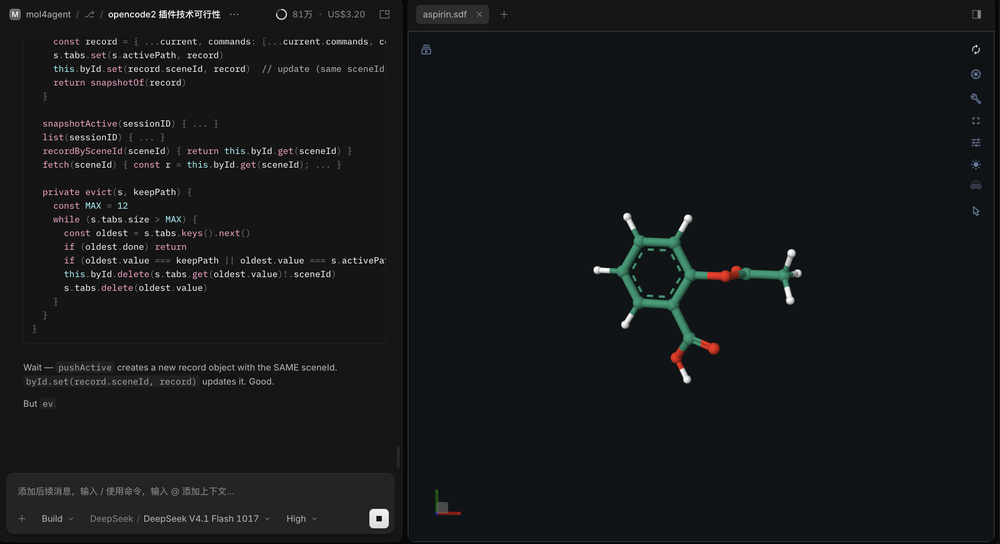

# @gcszhn/mol4agent-opencode

[mol4agent](../../README_zh.md) 的 OpenCode 2 适配器：在 harness 内的侧边栏里
用官方 Mol* 3D 视图预览分子结构，agent 通过 `mol_*` 工具直接操作。

- **harness 内预览**：`mol_open`（agent）、**Ctrl+P 文件搜索**（LinkHandler）、
  以及「Open molecular structure」选文件命令（人类）在侧边栏的官方 Mol* UI
  里渲染结构，无需离开 harness、无需外部应用。
- **agent 操作同一页面**：`mol_style` / `mol_select` / `mol_focus` / `mol_measure`
  修改打开的页面；`mol_info` / `mol_interface` 无需打开 viewer 即可摘要。
- **截图**：`mol_capture` 把视口渲染成 PNG 保存到 `.mol4agent/captures/`。
- **与 DSH/ChatGPT 语义一致**：本适配器把相同的 `MolFormat`、selector、命令
  与截图语义传给 `@gcszhn/mol4agent-core`。
- **格式**：`.pdb`、`.ent`、`.pdbqt`、`.pqr`、`.cif`、`.mmcif`、`.mcif`、`.bcif`、
  `.mol`、`.sdf`、`.sd`、`.mol2`、`.xyz`、`.gro`，以及 `.gz` 变体（server 端先解压
  再交给 core）。



## 打开结构（OpenCode）

- **agent**：`mol_open`（先 `mol_info` 选链/残基）。
- **人类**：
  - **Ctrl+P 文件检索** → 输入文件名 → 选中 `.pdb`/`.cif`/... 条目，会通过 `LinkHandler` 在 Mol* 面板里打开。
  - **Open molecular structure** 命令（系统选文件）。
- **没有 `/mol_open` 斜杠命令**：它的名字会和 agent 工具 `mol_open` 冲突；
  Ctrl+P 与选文件命令已覆盖人类打开路径。
- **不能从内置文件树打开**：在文件树里点击 `.pdb` 会打开纯文本编辑器。OpenCode 不会把文件树点击路由给插件（注册 `"text"` kind 的 `FileViewer` 会被忽略），所以请用 **Ctrl+P** 而不是点文件树。

## 架构

本包是一个包含三部分的 OpenCode 插件：

- **server**（`exports["."]`，`src/server.ts`）：注册 `mol_*` 工具与 `mol4agent`
  RPC。只有这里能看到路径、读取字节、保存场景日志。
- **GUI**（`exports["./gui-experimental"]`，`src/gui/`）：侧边栏 `Panel`，每个
  打开的结构一个 Mol* viewer 标签；另有启动器、选文件命令，以及 `LinkHandler`
  （Ctrl+P 文件搜索与 `.pdb` 链接可打开结构）。通过 RPC 跟随场景，并渲染/回传截图。
- **RPC**（`exports["./rpc"]`，`src/rpc.ts`）：类型化的 `mol4agent` 契约。

core 只接收 `{ data, format, label }` 加 JSON 命令；路径、后缀识别、IO、session
与 UI 全部留在本适配器内。

## 兼容性

需要 **OpenCode 2.2.0 或更新**——`@opencode/plugin/gui` 的窗口 API（`./gui`、
`./gui/file`、`./gui/vite`、panel/RPC 注册）是 `@opencode/plugin` 2.2.0 才引入的。
构建和验证基于 **2.3.0**；本包声明 `@opencode/plugin` peer 依赖 `>=2.2.0 <3.0.0`。

OpenCode v1 无法运行本适配器：v1 是终端 UI，没有 GUI 插件层、没有自定义 RPC、
也没有 DOM/WebGL 供 Mol* 使用。它的 server/TUI 插件无法渲染可交互 3D 页面或返回
渲染好的截图，因此只能移植纯文本的 `mol_info` / `mol_interface` 工具。

## 工具

| 工具 | 行为 |
|---|---|
| `mol_info` | 摘要链、残基、原子、配体；不打开 viewer |
| `mol_interface` | 寻找两组链之间的界面残基（PDB 类 ATOM 文件） |
| `mol_open` | 在侧边栏打开结构并设为活动场景 |
| `mol_style` | 修改表示/颜色；带 `target` 时叠加式着色某个选区 |
| `mol_select` | 选择/高亮（可同时聚焦）某个选区 |
| `mol_focus` | 聚焦某个选区或整个结构 |
| `mol_measure` | 添加距离(2)/角度(3)/二面角(4)测量 |
| `mol_capture` | 把视口渲染成 PNG 保存到 `.mol4agent/captures/` |

selector 与其他适配器使用相同的 JSON 形状，见 [README.md](README.md)。

## 本地安装

```sh
pnpm install
pnpm --filter @gcszhn/mol4agent-core build
pnpm --filter @gcszhn/mol4agent-opencode build
```

把包目录加到**全局** `opencode.json(c)`，桌面端会在每个窗口加载其 GUI 部分：

```jsonc
{
  "$schema": "https://opencode.ai/config.json",
  "plugins": [
    "/absolute/path/to/mol4agent/packages/opencode"
  ]
}
```

server 部分按当前 location 加载；GUI 部分由桌面端加载。GUI 重新构建后无需重启即可
热更新（`pnpm --filter @gcszhn/mol4agent-opencode build`）；server 改动需要 `/reload`。

## 开发

```sh
pnpm --filter @gcszhn/mol4agent-opencode typecheck
pnpm --filter @gcszhn/mol4agent-opencode build
```

`build` 产出：

- `dist/index.js` — server 部分（ESM；core 打包，`@opencode/*`/`node:*` external）。
- `dist/gui.cjs` — GUI 部分（单 CommonJS 文件；core + Mol* + React 打包）。
- `dist/rpc.js` — RPC 契约。

## 限制

- OpenCode 的工具结果没有内联图片内容类型，因此 `mol_capture` 返回保存路径
  （加一个 `file` 引用），而不是把 PNG 附加到模型上下文。
- **内置文件树不能打开结构**：在文件树里点 `.pdb` 会打开文本编辑器。请用
  **Ctrl+P 文件检索**或选文件命令。注册 `"text"` kind 的 `FileViewer` 会被宿主
  忽略（它只渲染 file view 自己不渲染的 kind）。
- Scene 工具默认作用于当前 session 上次 `mol_open` 的结构；传 `tab`（`mol_open`
  返回的路径）可指定某个已打开结构。场景按 session 分桶；面板只显示当前 session。
- `mol_capture` 需要目标 viewer 标签挂载：它会先激活该标签，若 15 秒内仍无法创建
  viewer（例如窄屏时侧栏未打开）则失败。
- `mol_interface` 只解析 PDB 类 ATOM 记录；`mol_info` 尚不能从原始字节摘要 BCIF。
- 文件上限 64 MiB（含 gzip 解压后）；需要 WebGL 2。每个 session 最多保留 12 个打开的
  结构标签（淘汰最旧的非活动标签）。
